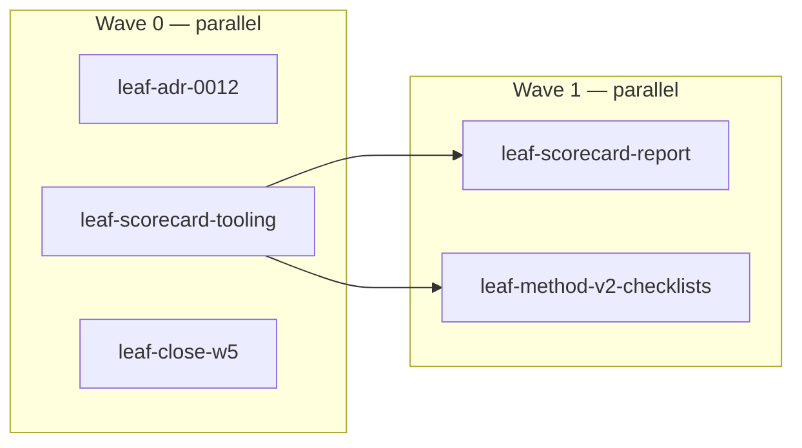
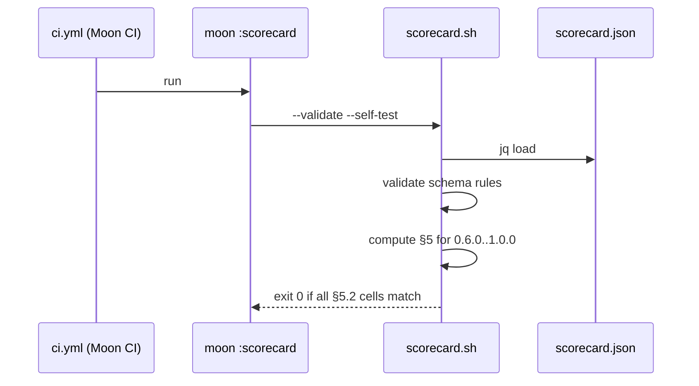

# Roadmap bootstrap: execution plan

Parent: `.maestro/specs/roadmap/PLAN-OF-PLANS.md` (§3.1 L1, L5; §5 E0.6). Lane: heavy. Risk:
high (CI workflow + moon config + ADR policy).

---

## leaf-adr-0012 · wave 0 · parallel group A

**Context.** ADR 0010:39-42 states that id_effect "is not a batteries-included web framework", and
its Rule 5 requires an ADR amendment before any new published crate. Every 0.9+ battery crate
would violate that rule. This leaf makes the plan of plans legal under the repo's own governance.
- Depends on: none.
- Maestro slug: `leaf-adr-0012`.

**Acceptance criteria**
1. `docs/adrs/0012-platform-vision.md` exists with Status `Accepted`, Date, Context (cites the
   scorecard baseline E 46.8), Decision (PLAN-OF-PLANS L1–L12 verbatim), Consequences, and a tier
   table that adds `platform`.
2. `docs/adrs/0010-crate-tiers.md` has a "Superseded in part by ADR 0012 (vision statement, Rule 4)"
   line under its status. The rest of ADR 0010 is unchanged (`git diff` touches only that header
   block).
3. `README.md` lines 3–5 describe the platform vision. `grep -n "not a batteries-included" README.md`
   returns nothing.
4. `docs/QUALITY_BAR.md` has a `platform` tier row: integration gates, test density ≥ 1/80, plus "a
   CI-tested reference app depends on it".
5. `scripts/tier-conformance.sh` accepts `tier = "platform"` in `[package.metadata.id_effect]` and
   applies the integration thresholds. Negative case: an unknown tier still exits non-zero.

**Files.** Create `docs/adrs/0012-platform-vision.md`. Modify `docs/adrs/0010-crate-tiers.md`
(header only), `README.md` (scope paragraph), `docs/QUALITY_BAR.md` (tier table),
`scripts/tier-conformance.sh` (tier switch).

**Gates**

| Gate | Command | Pass | Witness |
|---|---|---|---|
| Tier script | `bash scripts/tier-conformance.sh` | exit 0 | agent-claimed-locally |
| Negative tier | fixture manifest with `tier="bogus"` | exit ≠ 0 | agent-claimed-locally |
| Repo gate | `moon run :ci` | exit 0 | witnessed-by-ci |
| Maestro | `maestro task verify` + verdict | PASS | witnessed-by-maestro |

**Notes.** Follow the structure of ADR 0011. Changing the docs-only parts is low risk; changing the
script is medium.
**Risk/rollback.** Revert the commit. No code depends on the ADR.

---

## leaf-scorecard-tooling · wave 0 · parallel group B

**Context.** The scorecard currently lives in `.maestro/specs/roadmap/scorecard/` plus scratch
`.tmp/` files, and the numbers come from an ad-hoc Python script. L5 makes the scorecard the
release KPI, so it must be versioned, documented and recomputable in CI under repo conventions
(bash + jq, like `scripts/bench-compare.sh`).
- Depends on: none.
- Maestro slug: `leaf-scorecard-tooling`.

**Acceptance criteria**
1. `git mv` moves `.maestro/specs/roadmap/scorecard/{METHOD.md,scorecard.json}` to
   `docs/scorecard/`. PLAN-OF-PLANS links are updated, and `grep -rn "roadmap/scorecard"
   .maestro/specs/roadmap` returns 0.
2. `scripts/scorecard.sh` has a `Requires: bash ≥ 4, jq ≥ 1.6` header and exit codes 0 OK, 1 FAIL,
   2 misuse. It implements:
   - `--version <v>`: prints U, E, RT with ranks, and ≥80, <40, leader, median gap (METHOD §5)
   - `--targets <v>`: the same output using planned scores (§5.1)
   - `--json <v>`: machine-readable output, written to `docs/scorecard/results/v<v>.json` by
     `--write`
   - `--self-test`: recomputes every cell of METHOD §5.2 and string-compares at one decimal. Exits
     1 on any mismatch.
3. `docs/scorecard/scorecard.schema.json` (JSON Schema 2020-12) plus `scorecard.sh --validate`,
   which checks:
   - row ids are unique
   - there are exactly 10 competitor scores
   - every score is an integer in 1..100
   - `group` and `track` reference declared ids
   - `targets` keys are semver

   The validation runs through jq, so no new dependency is added. Fixtures in
   `docs/scorecard/fixtures/` (`dup-id.json`, `bad-score.json`, `unknown-group.json`) each make
   `--validate` exit 1.
4. `docs/scorecard/results/v0.6.0.json` and `v0.7.0.json` are committed and equal the output of
   `--json` (CI diff check).
5. `moon.yml` gains task `scorecard` (`command: bash`, `args: scripts/scorecard.sh --validate
   --self-test`). `ci.yml` runs it in the Moon CI job.
6. Edge cases:
   - A version that has no measured scores and no targets falls back to the latest measured score
     (§5.1).
   - Ranks with ties take the better rank (METHOD §5.5). A fixture forcing a tie verifies this.

**Files.** Create `docs/scorecard/{METHOD.md (moved), scorecard.json (moved), scorecard.schema.json,
results/v0.6.0.json, results/v0.7.0.json, fixtures/*.json}` and `scripts/scorecard.sh`. Modify
`moon.yml`, `.github/workflows/ci.yml` (one step), and `.maestro/specs/roadmap/PLAN-OF-PLANS.md`
(paths).

**Gates**

| Gate | Command | Pass | Witness |
|---|---|---|---|
| Self-test | `bash scripts/scorecard.sh --validate --self-test` | exit 0 | agent-claimed-locally |
| Negative fixtures | `for f in docs/scorecard/fixtures/*.json; do scorecard.sh --validate --file $f; done` | each exits 1 | agent-claimed-locally |
| Results stable | `scorecard.sh --json 0.7.0 \| diff - docs/scorecard/results/v0.7.0.json` | empty | witnessed-by-ci |
| Syntax | `bash -n scripts/scorecard.sh` | exit 0 | agent-claimed-locally |
| Repo gate | `moon run :ci` | exit 0 | witnessed-by-ci |
| Maestro | verify + verdict | PASS | witnessed-by-maestro |

**Notes.** Follow the patterns in `scripts/bench-compare.sh`: the `Requires:` header, `--self-test`
with fixtures, and exit codes. Use jq's `add/length` for means. Format numbers with
`"%.1f"` via `printf` after jq, never inside jq, to avoid jq's float formatting differences.
Reference numbers: `.tmp/score2.py` (scratch) produced METHOD §5.2.
**Risk/rollback.** jq float rounding could differ from Python's at .x5 boundaries. Mitigation: the
self-test pins the expected strings, and any mismatch is investigated, not papered over. Rollback:
revert the commit; the CI step is additive.

---

## leaf-close-w5 · wave 0 · parallel group C

**Context.** `tsk-mv799sew-y9wf9g` ("W5: migrate assay and solana to crates.io 0.6") is the only
open item in `NOW.md`. 0.7 has shipped, so a migration to 0.6 is obsolete. The work moves to
PLAN-OF-PLANS E0.5.
- Depends on: none.
- Maestro slug: `leaf-close-w5`.

**Acceptance criteria**
1. `maestro task abandon tsk-mv799sew-y9wf9g --reason "superseded by PLAN-OF-PLANS E0.5
   (downstream migration to 0.7+)"` succeeds.
2. Mission `pln-mv799j4f-1r1u6b` reaches a terminal state (completed, or cancelled with a reason).
3. `NOW.md` shows no ready tasks from the 0.6 mission.

**Files.** Maestro state only (`.maestro/tasks/**`, `.maestro/missions/missions.jsonl`).

**Gates.** `maestro task get tsk-mv799sew-y9wf9g` shows state `abandoned`. `maestro status` is
clean.
**Risk/rollback.** None; the task is draft and unclaimed.

---

## leaf-scorecard-report · wave 1 · parallel group D (blocked by leaf-scorecard-tooling)

**Context.** The release exit gate (PLAN-OF-PLANS §7.3) needs diff, target comparison, a report
and a rendered view. Without them, "prove progress with numbers" stays manual.
- Maestro slug: `leaf-scorecard-report`.

**Acceptance criteria**
1. `--diff <a> <b>` lists every row whose id_effect score changed, with old, new, delta and
   evidence. It exits 1 if any delta is ≤ −5 and the row has no `adr` field for version `b`.
   - Fixture: `regression.json` → exit 1.
   - Fixture: `regression-with-adr.json` → exit 0.
2. `--compare-targets <v>` prints measured versus planned E, RT and KPIs, and exits 1 if measured
   E < planned E − 1.0.
3. `--report <v>` writes `docs/scorecard/REPORT-<v>.md` with the sections listed in PLAN-OF-PLANS
   §7.4. `docs/scorecard/REPORT-0.7.0.md` is committed: the 0.6 → 0.7 diff with all 42 changed
   rows.
4. `--html` writes `docs/scorecard/index.html`. It is self-contained, with the data inlined from
   scorecard.json, and follows the layout of the published matrix (scoreboard, group heatmap, gaps,
   leads, filterable matrix, version selector 0.6/0.7/targets). It is regenerated in CI and
   checked by diff.
5. The book appendix (`crates/id_effect/book/src/appendix-*`) links to `docs/scorecard/`.

**Files.** Modify `scripts/scorecard.sh`. Create `docs/scorecard/REPORT-0.7.0.md`,
`docs/scorecard/index.html`, and fixtures. Modify `.github/workflows/ci.yml` (diff check) and
one book appendix file (a link).

**Gates.** Fixtures pass and fail as specified. `scorecard.sh --html | diff - docs/scorecard/index.html`
is empty. `moon run :ci` passes. Then Maestro verify + verdict.
**Risk/rollback.** HTML generation in bash is brittle. Mitigation: emit only a JSON `<script>`
blob into a static template file (`docs/scorecard/template.html`) and let JS render it. Bash only
splices.

---

## leaf-method-v2-checklists · wave 1 · parallel group E (blocked by leaf-scorecard-tooling)

**Context.** Method v1 is anchored judgment plus caps. Re-tests by different assessors can drift.
v2 (METHOD §7) derives scores from objective table-stakes checks.
- Maestro slug: `leaf-method-v2-checklists`.

**Acceptance criteria**
1. Every row in `scorecard.json` has `checks: [{id, text}]` (4–8 entries), plus per framework and
   version a `met: [check ids]` list. The schema is extended, and `--validate` enforces the 4–8
   count and that every check id is known.
2. id_effect `met` lists for 0.6.0 and 0.7.0 are filled with evidence; competitor `met` lists are
   filled from the frozen snapshot.
3. `scorecard.sh --method 2 --version <v>` computes `s = clamp(1, cap(level), round(100 ×
   met/total))`, where `level` is a per-row field `level: absent|labs|published|tested|documented|production`.
4. `docs/scorecard/REPORT-method-v2.md` shows, for both versions, v1 and v2 scores per row, the
   per-index difference, and every row whose v1/v2 difference exceeds 15 with an explanation.
5. METHOD.md §7 is rewritten from "planned" into the operative v2 rules. The method version
   becomes 2.0 **only if** the owner accepts the comparison report. Otherwise v1 stays primary and
   v2 is reported alongside.

**Files.** Modify `docs/scorecard/{scorecard.json, scorecard.schema.json, METHOD.md}` and
`scripts/scorecard.sh`. Create `docs/scorecard/REPORT-method-v2.md`.

**Gates.** `--validate` passes. `--self-test` still passes (v1 numbers unchanged). Then
`--method 2 --version 0.7.0` runs, followed by Maestro verify + verdict.
**Risk/rollback.** The work is large (82 × 4–8 checks × 11 frameworks). Mitigation: split with
`maestro_task_split` into four parallel slices by group, and run them as concurrent subagents.
Rollback: v2 is additive; v1 stays primary until accepted.

---

## Rollup

- **Executive summary.** Five leaves in two waves. They legalise the platform vision (ADR 0012),
  turn the scorecard into a tested CI tool that reproduces METHOD §5.2, close stale 0.6 work, and
  make re-scoring objective (v2). After this mission, the 0.8 kickoff can follow PLAN-OF-PLANS §7
  mechanically.
- **Decision log.** bash + jq rather than Python or an xtask: repo precedent (`bench-*.sh`) and no
  new toolchain. Scorecard canonical home is `docs/scorecard/` (public, versioned); the plan of
  plans stays in `.maestro/specs/roadmap/` (planning artifact). Risk class high (CI + moon).
- **Total gate.** `moon run :ci && bash scripts/scorecard.sh --validate --self-test`.
- **Out of scope.** All 0.8 product work, competitor re-scoring, CI benches.
