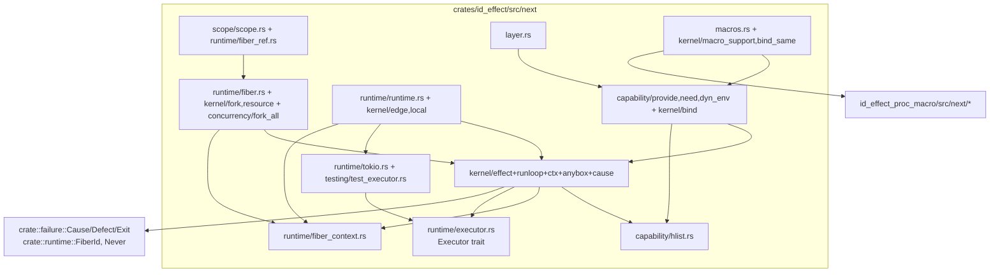
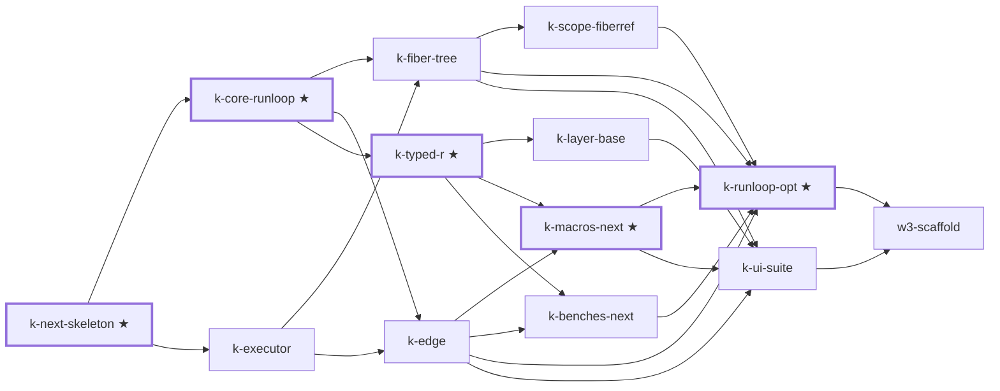

# k-rebuild — design A lands in `id_effect::next`

## 0. Scope lock

**Goal.** Port the working spike A (`spikes/kernel_a`, last touched `090b541`, tree pinned at
`9cf380e`) into `crates/id_effect/src/next/**` as production code, side by side with the v1 kernel,
so that `w3-scaffold` can verify the K exit contract (release-plan §3, items 1–7) and the W3/W4
`c-*`/`p-*` leaves can build on it.

**In scope (K-owned, release-plan §3):** `Effect`/`LocalEffect`, runloop, `Executor` +
`TokioExecutor` + `TestExecutor`, fiber tree (fork/fork_daemon/join/interrupt, masks, finalizers,
one-shot exit slot), typed R (`caps_next!`, `Selector`/`Plucker`/`Sculptor`/`Embed`/`Concat`,
`need`/`provide*`/`narrow`, `DynEnv`) with `#[diagnostic]` messages, `fork_all` + `Concurrency`,
`block_on` with a real waker, `Scope`, a Layer base (H1 condition 2), the temporary `*_next!` macros,
retargeted kernel bench bodies, and deleting `spikes/**`.

**Entry conditions (verified 2026-10-15):** all nine W1 tasks are `shipped` (`.maestro/tasks/tasks.jsonl`);
H1 = design A (`docs/benchmarks/SPIKE-REPORT.md` "H1 decision"); ADR 0011 status "Accepted (2026-10-15)"
(`docs/adrs/0011-fiber-runtime-send-typed-r.md:3-5`).

**Pre-K SHA.** `PRE_K = 9cf380e447ff400d8f3e76c79ff6fc4251f99c04` (HEAD when this plan was written; the last
commit touching `crates/id_effect/src` is `cb1a3f0`). Every K gate diffs against it.

### 0.1 Locked decisions

| # | Decision | Why |
|---|---|---|
| L1 | `next` reuses the **root shared types**: `crate::failure::{Cause, Defect, Exit}`, `crate::runtime::FiberId` (v1 `FiberId(u64)`, `concurrency/fiber_id.rs:11`), `Never = core::convert::Infallible` (same as v1 `runtime/execute.rs:50`). The spike's own `Cause`/`Defect`/`Never` (`spikes/kernel_a/src/cause.rs`) are **not** ported. The internal step channel stays `Result<A, Cause<E>>` (spike `Exit` alias). Public edges (`block_on`, `join`, `Runtime::run`) return the root `Exit<A, E>` enum. | §3a lists `failure` as shared. Root `Cause` already has `Both`/`Then` (`failure/cause.rs:146-157`), which `c-race-timeout` and `c-panic-boundary` need. One `Cause` type means the compat bridge does not have to convert causes. |
| L2 | `FiberId` parentage lives in `FiberContext` (`parent: Weak<FiberContext>`), not in `FiberId`. | `Cause::Interrupt(FiberId)` is a v1 type; changing it would touch v1 (exit item 7). `k-retire-v1` moves `FiberId`/`Never` into `next` when it deletes `runtime/`. |
| L3 | The yield constructor is named **`yield_fiber()`**, not `yield_now()`. | Exit item 6 is the literal `rg -n 'Waker::noop\|yield_now' crates/id_effect/src/next` = 0. The spike's `yield_now` (`effect.rs:143`) would trip it. |
| L4 | All three temporary macros (`effect_next!`, `effect_local_next!`, `caps_next!`) live in **`id_effect_proc_macro`**, as new files under `src/next/`. `id_effect_macro` is **not modified** in K. | `caps_next!` has to reject duplicates by comparing tokens (spike `macros/src/lib.rs:33-63`), and `macro_rules!` cannot compare idents. Leaving `id_effect_macro` alone keeps the v1 `caps!` untouched. The release-plan wording "in `id_effect_macro` and `id_effect_proc_macro`" is met by proc_macro alone. Record this at claim time. |
| L5 | `next/layer.rs` is created by **K** (`k-layer-base`). `p-layer-core` extends it; it does not re-create it. `w3-scaffold` drops `layer` from its list of empty modules. | §3 "Layer overlap": K delivers the Layer base because H1 condition 2 is a K obligation. |
| L6 | K does **not** create `next/par.rs`, `next/race.rs`, `zip_par` or `timeout`. The spike's `par.rs:171-257` is the reference for `c-zip-par-all`/`c-race-timeout`, read with `git show 9cf380e:spikes/kernel_a/src/par.rs`. K ports only `fork_all` + `Concurrency` + `Admission` (to `next/concurrency/fork_all.rs`). | Keeps the c-* contracts disjoint (release-plan §4 W3). |
| L7 | **Spikes are deleted inside K** (last commit of `k-ui-suite`), not deferred to `k-retire-v1`. | `spikes/` is its own workspace (`spikes/Cargo.toml:5-11`) and not a root member, so deleting it costs no root `Cargo.toml` edit. By the time `k-ui-suite` ships, the spike's evidence (UI cases, corpus, probe bench) has been ported into `crates/id_effect`. Keeping it longer leaves a third kernel in the tree for agents to read by mistake. Downstream references use git history at `9cf380e`. |
| L8 | Gates during parallel work are per crate (`cargo fmt -p … -- --check`, `cargo clippy -p …`, `cargo nextest … -E 'binary(…)'`). Root `G-full` (which runs root `:ci-format`) runs only at serialisation points: `k-next-skeleton`, `k-ui-suite`, `k-runloop-opt` (at ship, after the orchestrator has frozen other edits), and `w3-scaffold`. | Requested by the orchestrator. Root formatting sees other agents' unformatted in-flight files in the shared tree. This deviates from release-plan §0 "every leaf passes G-full", so it is listed as open question Q-A. |
| L9 | trybuild `.stderr` are blessed and checked with the **stable** toolchain CI uses (`RUST_STABLE_BIN`, rustc 1.97.0 per `devenv.nix:10`), not devenv's nightly. | CI `moon-ci` runs `dtolnay/rust-toolchain@stable` (`.github/workflows/ci.yml:50-51`). `scripts/ci-local.sh:18-24` already prefers `RUST_STABLE_BIN`. The spike's `.stderr` were produced on nightly 1.99. |
| L10 | No user-facing API breaks in K: `next` is `#[doc(hidden)]` and additive. **No migration fragment** (`docs/migration-0.7/`) is written by K leaves. | Release-plan §0 requires fragments only for leaves that break user-facing API. |
| L11 | Admission stays a trait stub (`Admission`, `Concurrency::Inherit = Unbounded` as in the spike). | Wiring the fabric is `c-fabric-scheduler` (D6). |

### 0.2 Non-goals (do not drift into these)

- `zip_par`, `race`, `timeout`, `all`, `for_each_par`, `join_binds` (c-zip-par-all, c-race-timeout, c-join-binds).
- Layer memoisation, `fresh`, `scoped` layers, `provide_to`, provider-derive emission (p-layer-core, p-layer-scoped).
- Schedule, metrics, Random, request batching, coordination, Cache/Pool, streams, compat bridge (c-*/p-*/m-streams).
- A second, `!Send` runloop for `LocalEffect`. It stays a thin wrapper, as in the spike (SPIKE-NOTES "Skipped"). A macro-generated twin kernel (design §1.2) is deferred, and recorded under Risks.
- `Cause::Both`/`Then` construction rules beyond what `fork_all` and finalizers need (c-panic-boundary asserts them later).
- Fabric/Admission wiring, `FabricExecutor` (c-fabric-scheduler).
- Any edit to v1 modules, v1 macros, `id_effect_macro`, `id_effect_tokio`, labs, or `CHANGELOG.md`.
- Compile-time work beyond not regressing (A's falsifier F4 was hit at 2.18×; accepted by H1, measured again by `r-bench-report`).
- An `unsafe` inline small-box. The crate forbids `unsafe_code` (`crates/id_effect/Cargo.toml:13-14`, `lib.rs:23`).

## 1. Target layout of `crates/id_effect/src/next/` (fixed up front)

`k-next-skeleton` creates **every file below** as a documented stub (`//! <purpose>` and nothing else) and
every `mod.rs` with its final `mod …;` + `pub use …::*;` lists. Later leaves only **fill** the files they
own, so they never edit a shared `mod.rs`. The owner column is the contract. A file with two owners is
edited strictly in dependency order.

```text
crates/id_effect/src/next/
├── mod.rs                    skeleton   module tree, glob re-exports, `#[doc(hidden)] pub use kernel::macro_support as __private;`
├── kernel/
│   ├── mod.rs                skeleton
│   ├── effect.rs             core       Effect<A,E=Never,R=HNil>, Node{Pure,Sync,Op}, map/flat_map/map_err/catch/exit/then/zip/widen, ExitKind
│   ├── constructors.rs       core       succeed/fail/die/sync/suspend/from_async/from_ctx/sleep/yield_fiber
│   ├── runloop.rs            core→opt   Instr, Frame, MaskOp, Runloop (frame stack, budget, interrupt checks)
│   ├── anybox.rs             core→opt   AnyBox erase/unbox, AnyExit, AnyEnv
│   ├── ctx.rs                core       Ctx<R> { env: Arc<R>, fiber: Arc<FiberContext> }, env()/fiber()
│   ├── cause.rs              core       bridge to crate::failure (Result<A,Cause<E>> ↔ Exit), InterruptSignal, cause_from_panic
│   ├── bind.rs               typed-r    Ctx::get, Ctx::bind via `Bindable<R, Is>`, BindFuture
│   ├── bind_same.rs          macros     SameEnv wrapper + `Bindable` impl (H17)
│   ├── fork.rs               fiber      Effect::fork / fork_daemon
│   ├── resource.rs           fiber      ensuring / uninterruptible / uninterruptible_mask / Restore / acquire_use_release
│   ├── edge.rs               edge       Effect::block_on / try_block_on (convenience over Runtime::global())
│   ├── local.rs              edge       LocalEffect, IntoLocal, `.local()`
│   └── macro_support.rs      macros     Lift / LiftNever / LiftFrom (spike lib.rs:46-84)
├── runtime/
│   ├── mod.rs                skeleton
│   ├── executor.rs           skeleton   Executor trait, NotLocal, BoxFuture, LocalBoxFuture (signatures in §1.1)
│   ├── tokio.rs              executor   TokioExecutor
│   ├── fiber_context.rs      core→fiber→scope→opt  FiberContext (id, interrupt flag, mask, waker; children/parent; refs)
│   ├── fiber.rs              fiber      ExitCell (one-shot), spawn_fiber, finish_children, FiberHandle, JoinFuture
│   ├── fiber_ref.rs          scope      FiberRef<T>
│   └── runtime.rs            edge       Runtime{exec, root}, run / try_block_on / block_on / block_on_future / fork, BlockOnInAsync, park waker
├── capability/
│   ├── mod.rs                skeleton
│   ├── hlist.rs              core→typed-r  HNil/HCons/Here/There, HList, Selector/Plucker/Sculptor/Embed/Concat (+ diagnostics)
│   ├── provide.rs            typed-r    provide / provide_some / provide_all / provide_env / narrow
│   ├── need.rs               typed-r    need::<T>(), Need builder
│   └── dyn_env.rs            typed-r    DynEnv, MissingCapability, try_need
├── concurrency/
│   ├── mod.rs                skeleton
│   └── fork_all.rs           fiber      fork_all, Concurrency, Admission (stub)
├── scope/
│   ├── mod.rs                skeleton
│   └── scope.rs              scope      Scope, Effect::scoped, Scope::fork_in
├── layer.rs                  layer      Layer<Out,E,In> base (L5)
├── macros.rs                 macros     `pub use id_effect_proc_macro::{effect_next, effect_local_next, caps_next};`
└── testing/
    ├── mod.rs                skeleton
    └── test_executor.rs      executor   TestExecutor (virtual clock, deterministic queue)
```

Names exported by sibling globs must be unique. `ambiguous_glob_reexports` is warn-by-default, and clippy
runs with `-D warnings`. Test targets live in `crates/id_effect/tests/` as `next_kernel.rs`, `next_executor.rs`,
`next_fibers.rs`, `next_scope.rs`, `next_edge.rs`, `next_typed_r.rs`, `next_layer_base.rs`, `next_macros.rs`,
`next_ui.rs` (+ `tests/next_ui/{fail,pass}/*.rs`) and `next_corpus/{main.rs,services.rs}`. None of these
collides with the W3/W4 names `next_layer.rs`, `next_par.rs`, `next_race_timeout.rs`, `next_panic.rs` or
`compat.rs`, nor with the v1 trybuild glob `tests/ui/*.rs` (`tests/ui_compile_fail.rs:6`).

### 1.1 The one interface fixed before K1 (so core and executor can run in parallel)

```rust
// crates/id_effect/src/next/runtime/executor.rs (owned by k-next-skeleton)
pub type BoxFuture<'a, T> = Pin<Box<dyn Future<Output = T> + Send + 'a>>;
pub type LocalBoxFuture<'a, T> = Pin<Box<dyn Future<Output = T> + 'a>>;
#[derive(Debug, Clone, Copy, PartialEq, Eq)] pub struct NotLocal;
pub trait Executor: Send + Sync + 'static {
  fn spawn(&self, fut: BoxFuture<'static, ()>);
  fn spawn_local(&self, fut: LocalBoxFuture<'static, ()>) -> Result<(), NotLocal>;
  fn spawn_blocking(&self, f: Box<dyn FnOnce() + Send>);
  fn sleep(&self, d: std::time::Duration) -> BoxFuture<'static, ()>;
  fn now(&self) -> std::time::Instant;
}
```

This is the spike trait (`spikes/kernel_a/src/executor.rs:23-30`) with `std::time::Duration` at the boundary (Q4).

### 1.2 Module and dependency diagram



## 2. Shared gate aliases (this spec)

| Alias | Command |
|---|---|
| `K-fmt(P)` | `devenv shell -- cargo fmt -p P -- --check` |
| `K-clippy(P)` | `devenv shell -- cargo clippy -p P --all-targets --all-features -- -D warnings` |
| `K-test(B…)` | `devenv shell -- cargo nextest run -p id_effect -E 'binary(B1) \| binary(B2) …'` |
| `K-v1` | `devenv shell -- bash -c 'P=9cf380e447ff400d8f3e76c79ff6fc4251f99c04; test -z "$(git diff --stat $P -- crates/id_effect/src ":!crates/id_effect/src/next" ":!crates/id_effect/src/lib.rs" crates/id_effect_macro crates/id_effect_tokio)" && test "$(git diff $P -- crates/id_effect/src/lib.rs crates/id_effect_proc_macro/src ":!crates/id_effect_proc_macro/src/next" \| grep -c "^-[^-]")" = 0'` (v1 untouched: no removed lines outside `next/`; lib.rs only gains lines) |
| `K-nb` | `devenv shell -- bash -c '! rg -n "Waker::noop\|yield_now\|run_blocking\|block_in_place\|watch::\|thread::sleep" crates/id_effect/src/next'` |
| `K-labs-check` | `devenv shell -- cargo check --manifest-path labs/Cargo.toml --workspace --all-targets` |
| `K-ui` | `devenv shell -- bash -c 'PATH="$RUST_STABLE_BIN:$PATH" CARGO_TARGET_DIR=target-ci-stable cargo test -p id_effect --test next_ui'` (bless: prefix `TRYBUILD=overwrite`) |
| `G-ws`, `G-full`, `G-labs`, `G-ci`, `G-bench(P,B)` | as release-plan §0 |

**Every leaf's gate set** includes `K-fmt(id_effect)`, `K-clippy(id_effect)`, `G-ws`, `K-v1`, `K-nb` and
`K-labs-check`, plus `maestro task verify <tsk>` and `maestro_verdict_request`. These are listed once here
and not repeated per leaf. `G-ws` + `K-labs-check` at every commit is how "workspace and labs stay green at
every commit" is enforced. Commits use explicit paths (`git add <contract paths>`), never `git add -A`
(release-plan §8 risk 5).

## 3. Leaves

Size: **S** ≈ 1 commit, **M** = 2–3 commits. Group = parallel wave. ★ = critical path.

### 3.1 `k-next-skeleton` ★ — Skeleton, file layout, Executor trait (S, wave K0)

- **Context.** Every later leaf needs disjoint files and a compiling `next`. Without this leaf, the leaves
  would collide on `next/mod.rs`, `lib.rs` and `Cargo.toml` (release-plan §6 hot files).
- **Contract paths.** `crates/id_effect/src/lib.rs` (one added line), `crates/id_effect/Cargo.toml`
  (tokio features), every file in §1 as a stub, `next/runtime/executor.rs` (full, §1.1).
- **Deps.** none (entry conditions only).
- **Acceptance criteria.**
  1. `git diff $PRE_K -- crates/id_effect/src/lib.rs` adds exactly the lines `#[doc(hidden)]` + `pub mod next;` (and at most one `//` comment line), and removes none.
  2. `crates/id_effect/Cargo.toml` `[dependencies] tokio` gains `"time"` and `"rt-multi-thread"`, and nothing else changes (`git diff` of that file = 1 hunk).
  3. Every path in §1 exists. `rg --files crates/id_effect/src/next | wc -l` = the §1 file count (35).
  4. `cargo doc -p id_effect --no-deps` does not list `next` on the crate root page (`#[doc(hidden)]`). Check: `! rg -q 'href="next/index.html"' target/doc/id_effect/index.html`.
  5. `Executor`, `NotLocal`, `BoxFuture` and `LocalBoxFuture` match §1.1 exactly and are documented (`deny(missing_docs)`, `lib.rs:24`).
  6. `G-full` and `G-labs` are green (serialisation point).
- **Gates.** shared set + `G-full` + `G-labs`.
- **Notes.** Glob re-exports of empty modules must not warn under `-D warnings`. If rustc warns on an empty
  `pub use x::*`, put `#[allow(unused_imports)]` on that line with a `// filled by <leaf>` comment, and let
  the owning leaf remove it.
- **Rollback.** Revert the one commit. `next` is additive.

### 3.2 `k-core-runloop` ★ — Effect representation + erased runloop (M, wave K1)

- **Context.** This is the heart of design A (§1.1), ported from `spikes/kernel_a/src/{effect.rs:1-513,runloop.rs,hlist.rs}`.
  Everything else depends on it.
- **Contract paths.** `next/kernel/{effect,constructors,runloop,anybox,ctx,cause}.rs`,
  `next/runtime/fiber_context.rs` (minimal: id, interrupt `AtomicBool`, mask, stored `Waker`, `Arc<dyn Executor>`),
  `next/capability/hlist.rs` (types and traits as in the spike, with its existing `on_unimplemented` attributes),
  `crates/id_effect/tests/next_kernel.rs`.
- **Deps.** `k-next-skeleton`.
- **Acceptance criteria.**
  1. `Effect<A, E = Never, R = HNil>` with `Node::{Pure, Sync, Op}`. `Pure` is inline (0 allocations: a counting-allocator test in `next_kernel.rs` records 0 allocations for `succeed(1)` plus driving it to completion through the `Pure` fast path).
  2. A compile-time assertion test: `fn assert_send<T: Send>() {}` holds for `next::Effect<u8, (), caps_t>` with `caps_t = HCons<u8, HNil>` and for `R = HNil` (exit item 3; the macro form follows in k-ui-suite).
  3. Laziness: `succeed(1).flat_map(f).map(g)` runs `f` and `g` 0 times before the effect is driven (counter test).
  4. Stack safety: 100 000 left-nested sync `flat_map`s and 100 000 async (`from_async`) binds complete on a thread with a 2 MiB stack in `--release` (`cargo nextest run --release -p id_effect -E 'binary(next_kernel)'`), and 10 000 of each in debug.
  5. Interrupt checks: with the fiber's interrupt flag set before driving, a `from_async` chain yields `Exit::Failure(Cause::Interrupt(_))` and no step after the flag was observed runs (counter test). Inside a `Mask(Inc)` region the flag stays pending until the region exits.
  6. A panic inside a `map` closure becomes `Cause::Die(d)` with `d.message() == "boom"` (root `Defect`, L1).
  7. `rg -n 'enum Cause|struct Defect|enum Never' crates/id_effect/src/next` = 0 (L1). `rg -n 'pub fn yield_fiber' crates/id_effect/src/next/kernel/constructors.rs` = 1 (L3).
  8. Tests drive effects with `pollster::block_on` (dev-dep, `Cargo.toml` `[dev-dependencies]`) over a test-local `Executor` stub, because the edge lands in `k-edge`.
- **Gates.** shared set + `K-test(next_kernel)` (debug and `--release`).
- **Notes.** Port the runloop **as is**, including `guard`/`catch_unwind` per step (`runloop.rs:133-138`), the
  FUSE_MAX = 64 fusion (`effect.rs:21`) and BUDGET = 2048. Do not optimise here: `k-runloop-opt` owns that,
  measured against this baseline. Keep `Instr::WithFiber` (`runloop.rs:91`): fork and masks are built on it,
  so `k-fiber-tree` does not need to touch `runloop.rs`. Mark items used only by later leaves as `pub(crate)`.
- **Risk.** Root `Cause` is `Clone` and holds a `Defect` with a takeable Mutex slot (w1-defect-type). The
  spike's `InterruptSignal` panic payload (`cause.rs:152-159`) must still downcast before `Defect::from_panic`
  wraps it.

### 3.3 `k-executor` — TokioExecutor + TestExecutor (M, wave K1, parallel with core)

- **Context.** D3/R6: tokio is the default backend. `TestExecutor` with a virtual clock is K-owned (§3) and
  is a prerequisite for `c-race-timeout` ("timeout(10s) fires at virtual 10 s in < 50 ms") and for the
  `m-process` restart tests. The spike skipped it (SPIKE-NOTES "Skipped").
- **Contract paths.** `next/runtime/tokio.rs`, `next/testing/test_executor.rs`, `crates/id_effect/tests/next_executor.rs`.
- **Deps.** `k-next-skeleton` only (implements the §1.1 trait; no `Effect` needed).
- **Acceptance criteria.**
  1. `TokioExecutor::new(Handle)` and `TokioExecutor::current() -> Option<Self>`. `sleep` uses `tokio::time::sleep` (real timer); `spawn_blocking` uses `tokio::task::spawn_blocking`; `spawn_local` returns `Err(NotLocal)` (spike behaviour; documented as a c-compat-bridge input).
  2. `TestExecutor::new()` is single-threaded and deterministic: `spawn`, `spawn_local` (supported → `Ok`), `run_until_stalled()`, `advance(Duration)` (fires sleeps whose deadline ≤ virtual now, in deadline order, then FIFO), `now()` = virtual. Wakers are real (`std::task::Wake`), so a woken task is re-queued and nothing busy-polls.
  3. Test: 1 000 tasks each sleeping 10 s complete after `advance(10s)`, in < 50 ms of wall time.
  4. Test: the completion order of 100 tasks with mixed sleeps is identical across 50 runs.
  5. Test: a task that is never woken is polled exactly once by `run_until_stalled` (poll counter = 1).
  6. No `tokio` import in `testing/test_executor.rs` (`rg -n tokio crates/id_effect/src/next/testing` = 0).
- **Gates.** shared set + `K-test(next_executor)`.
- **Notes.** Safe Rust only: queue = `Mutex<VecDeque<Arc<Task>>>`, timers = `BinaryHeap` keyed on `(deadline, seq)`.

### 3.4 `k-fiber-tree` — Fibers, one-shot exit slot, masks/finalizer combinators, fork_all (M, wave K2)

- **Context.** D3: structured parent/child fibers whose interrupt really stops work. This fixes the v1 gaps
  at `rt.rs:110-113` and `fiber_handle.rs:92-94` (brief). Port `spikes/kernel_a/src/{fiber.rs,par.rs:1-162}` and
  `effect.rs:489-513,607-628,652-724`.
- **Contract paths.** `next/runtime/fiber.rs`, `next/runtime/fiber_context.rs` (add `parent: Weak`,
  `children`, `finish_children`), `next/kernel/{fork,resource}.rs`, `next/concurrency/fork_all.rs`,
  `crates/id_effect/tests/next_fibers.rs`.
- **Deps.** `k-core-runloop`, `k-executor` (tests run on both executors).
- **Acceptance criteria.** All tests run on `TokioExecutor` (multi-thread) **and** `TestExecutor`, through a shared `fn on_both(..)` helper.
  1. `ExitCell` is one-shot (complete once, take once). `rg -n 'watch' crates/id_effect/src/next` = 0.
  2. `FiberHandle<A, E>::join` compiles for `A`, `E` that are neither `Clone` nor `Sync` (test with a `struct NoClone(std::cell::Cell<u8>)`, which is `Send` but not `Sync`), fixing `rt.rs:27-28`.
  3. Interrupting a fiber suspended in `sleep(1h)` completes `interrupt()` with `Exit::Failure(Cause::Interrupt(id))`, and its `ensuring` finalizer has run (flag test). On TestExecutor this needs no `advance`.
  4. When a parent fiber exits (success, failure or interrupt), it interrupts and awaits its live children before its own `ExitCell` completes (`live_children() == 0` observed by the joiner).
  5. A `fork_daemon` child keeps running after its parent has exited.
  6. `uninterruptible(e)`: an interrupt requested inside the region is honoured only after it exits. `uninterruptible_mask(|restore| …)`: `restore.apply(x)` is interruptible again.
  7. `acquire_use_release`: release runs exactly once on success, on typed failure, on die and on interrupt, and receives the matching `ExitKind`.
  8. `fork_all(vec, Concurrency::Unbounded)`: the first failure interrupts the siblings, and their finalizers run before the result is returned. `Sequential` matches a left fold. `Bounded(2)` never has more than 2 in flight (atomic high-water mark).
  9. 10 000 `fork` + `join` on TokioExecutor complete in < 2 s in debug, with no blocking-pool threads (`spawn_blocking` call counter = 0).
- **Gates.** shared set + `K-test(next_fibers)`.

### 3.5 `k-scope-fiberref` — Scope and FiberRef (S, wave K3)

- **Context.** `next/scope` is K-owned (§3). `c-resource` ("Scope is K's"), `p-layer-scoped` (reverse
  finalizers on close and on interrupt) and `m-sql` (scoped transactions) build on it. `FiberRef` is the
  `FiberContext.refs` slot of design §1.3. `p-metrics`/`m-otel` need FiberRef hooks, and no other leaf owns
  `runtime/fiber_context.rs`. Neither exists in the spike.
- **Contract paths.** `next/scope/scope.rs`, `next/runtime/fiber_ref.rs`, `next/runtime/fiber_context.rs` (add `refs`), `crates/id_effect/tests/next_scope.rs`.
- **Deps.** `k-fiber-tree`.
- **Acceptance criteria.**
  1. `Scope::new()` is a plain fn, not an `Effect`. `scope.add_finalizer(Effect<(), Never, HNil>)` and `scope.close(ExitKind) -> Effect<(), Never, HNil>` run the finalizers in reverse order of registration, exactly once (a second `close` is a no-op), and uninterruptibly.
  2. `Effect::scoped(|scope| eff)` closes the scope on success, failure, die and interrupt (4 tests, order vector asserted).
  3. `scope.fork_in(eff)`: the child is interrupted when the scope closes, even if its forking parent is still alive.
  4. `FiberRef::<T: Clone + Send + Sync + 'static>::new(init)` with `get`, `set` and `locally(v, eff)` effects. A forked child starts with the parent's value at fork time. A child's `set` is not visible to the parent.
  5. No thread-locals: `rg -n 'thread_local' crates/id_effect/src/next` = 0.
- **Gates.** shared set + `K-test(next_scope)`.

### 3.6 `k-edge` — Runtime edge with a real waker, LocalEffect (M, wave K2)

- **Context.** This replaces v1's `Waker::noop` + `yield_now` spin (`runtime/execute.rs:62-79`). Calling it
  inside async returns `BlockOnInAsync`, which removes the bug class at `request_resolver.rs:102`. It also
  carries the R1 shared idea `effect_local!`/`LocalEffect`. Port `spikes/kernel_a/src/{executor.rs:68-228,local.rs}` and `effect.rs:640-651`.
- **Contract paths.** `next/runtime/runtime.rs`, `next/kernel/{edge,local}.rs`, `crates/id_effect/tests/next_edge.rs`.
- **Deps.** `k-core-runloop`, `k-executor`.
- **Acceptance criteria.**
  1. `Runtime::new() -> io::Result<Runtime>` (owns a multi-thread tokio runtime), `Runtime::from_executor(Arc<dyn Executor>)`, `Runtime::global()` (lazy `OnceLock`), `run(eff).await` (async edge), `try_block_on(eff) -> Result<Exit<A,E>, BlockOnInAsync>`, `block_on(eff) -> Exit<A,E>`, `block_on_future(fut)`. The root fiber is driven by a `Waker` built from `std::task::Wake` + `Thread::unpark`, which parks the calling thread.
  2. `try_block_on` called inside a tokio task returns `Err(BlockOnInAsync)` within 100 ms instead of deadlocking (test with `#[tokio::test(flavor = "current_thread")]` and `multi_thread`).
  3. A `Pure` effect returns without spawning a fiber or touching the executor (spawn counter = 0; spike `executor.rs:180-190`).
  4. CPU while parked: 1 000 fibers that each sleep 1 ms complete with process CPU time < 50 ms (spike `semantics.rs:224` `sleeping_fibers_are_parked_not_spinning`). `K-nb` passes (exit item 6).
  5. `LocalEffect<A, E, R>`: inline `Ready`, otherwise a single boxed `!Send` future. `.local()` from `Effect<_, _, HNil>`. A test holds an `Rc<RefCell<_>>` across two awaits and completes via `LocalEffect::block_on`. Documented limits: no interrupts, no fork and no provide (spike parity, non-goal §0.2).
  6. `Effect::block_on` is a documented convenience over `Runtime::global()`.
- **Gates.** shared set + `K-test(next_edge)`.
- **Notes.** `w3-scaffold`'s `clippy-no-blocking` disallows **calls** to `next` `block_on` in lib targets. This
  leaf's own definitions in `runtime.rs`/`edge.rs` must be allowlisted there (see §5).

### 3.7 `k-typed-r` ★ — Typed R: need/provide/narrow/~ bind, DynEnv, diagnostics (M, wave K2)

- **Context.** D5: capability presence is checked at compile time, so `need` can never panic. Ports
  `spikes/kernel_a/src/effect.rs:166-320,514-606` and `hlist.rs`, and adds `DynEnv` (design §2.1). DynEnv is
  not in the spike.
- **Contract paths.** `next/capability/{provide,need,dyn_env}.rs`, `next/capability/hlist.rs` (diagnostics pass), `next/kernel/bind.rs`, `crates/id_effect/tests/next_typed_r.rs`.
- **Deps.** `k-core-runloop`.
- **Acceptance criteria.**
  1. `need::<T>()` / `Need::{effect,map,flat_map}`, `Effect::{provide, provide_some, provide_all, provide_env, narrow}` with the design §2.1 signatures. `provide::<T>` removes exactly one element from `R`; a test asserts the result type by assigning to an annotated `Effect<_, _, HCons<B, HNil>>`.
  2. `Ctx::bind` is implemented through a trait `Bindable<R, Is>` (so `k-macros-next` can add an impl for `SameEnv` without touching `bind.rs`). A `~`-bound sub-effect shares the parent fiber: interrupting the parent while the sub-effect is suspended yields `Cause::Interrupt`, and the sub-effect's finalizer runs.
  3. `narrow` is free when `Wide == R` (reflexive `Embed`), and `HNil` embeds in anything (test).
  4. Diagnostics: `#[diagnostic::on_unimplemented]` on `Selector`, `Plucker`, `Sculptor` and `Embed`, with the messages from spike `hlist.rs`. `#[diagnostic::do_not_recommend]` on every recursive impl (`There<I>` / `HCons<I, Is>`). These are verified as `.stderr` in k-ui-suite. Both attributes are stable at MSRV 1.94.
  5. `DynEnv`: a `TypeId → Arc<dyn Any + Send + Sync>` map with `insert<T>`, `try_get<T>() -> Result<Arc<T>, MissingCapability>` and `try_need::<T>() -> Effect<Arc<T>, MissingCapability, HCons<DynEnv, HNil>>`. No panic paths: `rg -n 'panic!\|\.unwrap()\|\.expect(' crates/id_effect/src/next/capability` = 0, excluding `#[cfg(test)]`.
  6. `need` over a 16-element `R`, last element: correct value (spike bench `need_last_of_16` shape, as a test).
- **Gates.** shared set + `K-test(next_typed_r)`.

### 3.8 `k-layer-base` — Layer base with duplicate handling (S, wave K3) — H1 condition 2

- **Context.** H1 condition 2: "`Layer::merge` dedupes or rejects duplicate capabilities with a custom
  diagnostic instead of reaching E0283". In the spike, merging two layers that both need `ConfigSource` gives
  E0283 (`tests/ui/duplicate_capability_layer.stderr`). The root cause is that `merge` uses a type-searched
  `Embed` to split the merged input (`layer.rs:36-55`).
- **Contract paths.** `next/layer.rs`, `crates/id_effect/tests/next_layer_base.rs`.
- **Deps.** `k-typed-r`.
- **Design (locked).**
  - (a) **Shared inputs are deduplicated by construction.** `merge` splits its input **positionally** with a
    `SplitAt<Left>` trait that walks the structure of `In`, not by type search. `Layer<O1,E,I1>.merge(Layer<O2,E,I2>)`
    has input `Concat<I1,I2>`, and both sides receive the same `Arc`s. A merged input that contains `ConfigSource`
    twice is fine as an `Embed` **sub**-list (ambiguity only arises when the **super**-list has duplicates).
  - (b) **Duplicate outputs are rejected.** First choice: a compile-time post-monomorphisation
    `const { assert!(..) }` over the output's `TypeId`s with a custom message, **if** `const TypeId::of` and
    const `TypeId` comparison compile at MSRV 1.94. Probe this first and record the result. Fallback: a
    construction-time check in `merge`/`provide_merge`. It always runs (not `debug_assert`) and is O(n²) over
    `HList::type_ids()`. It panics with `capability `{type_name}` is produced by both sides of Layer::merge;
    wrap one in a newtype`. Documented as a startup-time failure.
- **Acceptance criteria.**
  1. `Layer::{succeed, from_effect, build, merge, provide_merge}` and `Effect::provide_layer`, ported from spike `layer.rs` + design §2.1.
  2. The spike's failing case (two layers that both need `ConfigSource`, merged side by side) compiles with **0 annotations** and runs; both layers observe the same `Arc<ConfigSource>` (`Arc::ptr_eq`).
  3. W01-shaped wiring (10 caps, 3 strata, spike `tests/corpus.rs:562-569`) compiles with 0 annotations.
  4. Merging two layers that both **output** `Db` is rejected with the custom message. Under (b) compile-time, k-ui-suite pins the `.stderr`. Under the fallback, a `#[should_panic(expected = "produced by both sides")]` test pins it.
  5. `rg -n 'E0283' crates/id_effect/tests/next_ui/fail/layer_*.stderr` = 0 (checked when k-ui-suite lands the cases).
  6. Whichever (b) route was taken is recorded in the leaf's evidence and in the `layer.rs` module docs.
- **Gates.** shared set + `K-test(next_layer_base)`.
- **Risk.** The compile-time route may be impossible on stable. The fallback is a runtime check, which is
  weaker than "custom diagnostic". See open question Q-B.

### 3.9 `k-macros-next` ★ — `effect_next!` / `effect_local_next!` / `caps_next!` + H17 pattern (M, wave K3) — H1 condition 3

- **Context.** These are the temporary next-kernel macros (§3; renamed in `k-retire-sweep`). They port the
  token-level spike macros (`spikes/kernel_a/macros/src/lib.rs`, no syn). H1 condition 3: generic-helper
  narrowing (H17) gets a documented pattern or macro. In the spike, `~audit(..)` on a helper that is generic in
  `R` hits E0283 and needs `~audit::<SignupCaps, _>` (`tests/ui/generic_helper_bind.stderr`).
- **Contract paths.** `crates/id_effect_proc_macro/src/next/{mod,effect,caps}.rs` (new),
  `crates/id_effect_proc_macro/src/lib.rs` (three added `#[proc_macro]` fns only),
  `crates/id_effect/src/next/{macros.rs, kernel/macro_support.rs, kernel/bind_same.rs}`,
  `crates/id_effect/tests/next_macros.rs`.
- **Deps.** `k-typed-r` (and `k-edge` for the `block_on` used in tests).
- **Acceptance criteria.**
  1. `effect_next!` supports `~Cap` reads (`Selector::get`), `~expr` narrowing binds (`Ctx::bind`), `Never` error widening (`Lift`, spike `lib.rs:46-84`), `|r: &R|` and bare-block forms. Expansions use `::id_effect::next::…` paths only (`rg -n 'kernel_a' crates/id_effect_proc_macro` = 0).
  2. `caps_next!(A, B, C)` expands to `HCons<A, HCons<B, HCons<C, HNil>>>`. A duplicate gives **one** custom error at the second occurrence and **no** cascading `Selector … for ()` error. The macro still emits the de-duplicated type after `compile_error!`, which fixes the spike's noisy tail (`duplicate_capability_caps.stderr`). Pinned in k-ui-suite.
  3. `effect_local_next!` builds a `LocalEffect`.
  4. **H17 pattern.** (i) Recommended form: helpers take a concrete `caps_next!(..)` R and are `~`-narrowed (0 annotations). (ii) For helpers that really are generic in R: `Effect::same_env()` returns `SameEnv<Effect<_,_,R>>`, and its `Bindable` impl fixes `Sub = R_outer`, so `~audit(x).same_env()` infers the helper's `R` from the caller with no turbofish. Both forms are documented with doctests in `kernel/bind_same.rs` module docs. A test ports corpus handler H17 (`spikes/kernel_a/tests/corpus.rs`) with **0 turbofish**.
  5. Coexistence: one test module uses v1 `id_effect::effect!` and `id_effect::next::effect_next!` side by side, and both run. The existing proc_macro tests pass unchanged (`K-test` over `-p id_effect_proc_macro`).
  6. `git diff $PRE_K -- crates/id_effect_proc_macro/src/lib.rs` has 0 removed lines (`K-v1`).
- **Gates.** shared set + `K-fmt(id_effect_proc_macro)`, `K-clippy(id_effect_proc_macro)`, `K-test(next_macros)`, `devenv shell -- cargo nextest run -p id_effect_proc_macro`, `G-labs` (proc_macro `lib.rs` is shared by labs `parse`).
- **Notes.** The name `same_env` is the default. The leaf may rename it before ship if it records why. No new token syntax after `~`.

### 3.10 `k-benches-next` — Kernel benches on `next`, IDs unchanged (S, wave K3)

- **Context.** Exit item 5 ("`phase0/*` and `env_lookup/*` IDs are listed and measure `next`"). `k-runloop-opt`
  needs an in-tree measurement of `next` against v0.6 with the same IDs.
- **Contract paths.** `crates/id_effect/benches/{phase0_baseline,env_lookup,gate_core}.rs` (kernel bodies only),
  `crates/id_effect/benches/next_kernel.rs` (new), `crates/id_effect/Cargo.toml` (`[[bench]] next_kernel`),
  `docs/benchmarks/gates-k.toml` (new; the kernel subset of `gates.toml`: map, flat_map, async_bind_64,
  flat_map_depth_10k), `docs/benchmarks/k-pre-opt.json`, `docs/benchmarks/v0.6-k-rerun.json`.
- **Deps.** `k-typed-r` (DynEnv), `k-edge` (`block_on`).
- **Acceptance criteria.**
  1. Retargeted to `next` with **unchanged IDs**: `phase0/bench_effect_map_chain`, `phase0/bench_effect_flat_map_chain`, `phase0/bench_env_insert_overhead` (→ `DynEnv::insert`), every `env_lookup` ID (`env_get_n{4,16,64}` and siblings → `DynEnv`), `gate/async_bind_64`, `gate/flat_map_depth_10k`. Each file imports `id_effect::next` (`rg -c 'id_effect::next' <file>` ≥ 1).
  2. They stay on v1 with a `// v1 body until <leaf>` comment: `phase0/bench_stream_throughput_collect` (m-streams), `phase0/bench_schedule_retry_overhead` (p-schedule), `stream/*` and `coord/*` in `gate_core.rs` (m-streams, c-coordination). See open question Q-C.
  3. The set of IDs is unchanged: `cargo bench -p id_effect --bench B -- --list` for B ∈ {phase0_baseline, env_lookup, gate_core}, sorted, is identical to the same listing at `PRE_K` (diff = empty).
  4. New report-only bench `next_kernel`: `kernel_next/need_last_of_16` (spike `gate.rs:82-110`) and `next_probe/async_bind_n{1,16,64,256}` (the spike-gate probe shape, `docs/benchmarks/spike-gate/harness/probe`).
  5. `k-pre-opt.json` + `v0.6-k-rerun.json`: 3 interleaved rounds (v0.6 then HEAD) of `--only id_effect:gate_core --only id_effect:phase0_baseline`, quiet-checked, exported. `bench-compare.sh --gates docs/benchmarks/gates-k.toml` is run and its output recorded (expected: async_bind_64 fails at about 3×, like spike A).
- **Gates.** shared set + `G-bench(id_effect,phase0_baseline)`, `G-bench(id_effect,env_lookup)`, `G-bench(id_effect,gate_core)`, `G-bench(id_effect,next_kernel)`, plus the compare command (status recorded, not required to pass).

### 3.11 `k-runloop-opt` ★ — Runloop optimisation to ≤ 1.25× (M, wave K4) — H1 condition 1

- **Context.** In spike A, `gate/async_bind_64` is at 3.15× v0.6, and per bind it costs 2.04× (69.9 ns
  against 34.3 ns). That is CPU in the erased interpreter, not allocation (SPIKE-REPORT §3). The target is
  ≤ 1.25 × 1.648 µs ≈ 2.06 µs (marginal cost ≲ 43 ns per bind, a cut of about 40 %). Q7 allows one
  optimisation leaf. H2 is decided at `r-bench-report` only if this leaf misses.
- **Contract paths.** `next/kernel/{runloop,anybox,effect,constructors,bind}.rs`,
  `next/runtime/{fiber,fiber_context,runtime}.rs`, `docs/benchmarks/{k-post-opt.json,k-runloop-opt.md}`.
  No public signature changes (rustdoc JSON or `cargo public-api`-style diff limited to `pub(crate)` items).
- **Deps.** `k-benches-next`, `k-fiber-tree`, `k-scope-fiberref`, `k-edge`, `k-macros-next`. This freezes every
  file the leaf touches, so no other leaf edits runloop internals at the same time. It runs in parallel with `k-ui-suite`.
- **Techniques (from the report; one commit each, each with probe numbers before and after).**
  1. Move `catch_unwind` from per-step `guard` (`runloop.rs:133-138`, `:156`, `:176-189`) to the fiber poll boundary and the `block_on` edge. On a caught panic the runloop must still unwind its frame stack and run `Fold`/finalizer frames.
  2. Amortise interrupt checks: one flag load per poll iteration plus one every N instructions (N ≤ BUDGET), instead of three per async bind (`runloop.rs:176-199`).
  3. Typed fast path: fuse `Op(Future).flat_map(k)` into one boxed state machine, so same-type async binds skip `AnyBox` erase/unbox (`runloop.rs:24-69`).
  4. Fuse runs of sync steps between async steps. Avoid per-value erasure where the type is statically known. Shrink `Instr`/`AnyExit` moves (box large variants).
  5. Optional: reuse the root fiber or waker in `block_on` (edge ≈ 122 ns vs v0.6 37 ns).
- **Acceptance criteria.**
  1. **Target:** `bash scripts/bench-compare.sh --gates docs/benchmarks/gates-k.toml docs/benchmarks/v0.6-k-rerun.json docs/benchmarks/k-post-opt.json` exits 0 (3 interleaved quiet rounds, median of round medians, ±5 % noise per Q7).
  2. **Floor (must hold even if 1 misses):** the map, flat_map and flat_map_depth_10k rows pass in that compare, and `async_bind_64` is strictly better than in `k-pre-opt.json`.
  3. If 1 misses: `k-runloop-opt.md` records the final ratio, a per-technique ablation table (probe n = 1/16/64/256, marginal ns/bind, allocations/bind via a counting allocator) and the remaining gap. The leaf still ships, and H2 is flagged for `r-bench-report` (Q7). Do not open a second optimisation leaf.
  4. Semantics are preserved: `K-test(next_kernel next_fibers next_scope next_edge next_typed_r next_layer_base next_macros)` pass in debug **and** `--release`, including 100k stack safety, laziness, Die with payload on a panic in a sync step **with the finalizer having run**, and interrupt observed within ≤ BUDGET instructions.
  5. No `unsafe` (crate `forbid`). No new dependency.
  6. If `k-ui-suite` has shipped, `K-ui` still passes (re-bless only with a written justification).
- **Gates.** shared set + the compare command above + `G-full` + `G-labs` (serialisation point at ship).
- **Notes.** The orchestrator must keep the machine quiet (no other cargo builds) during measurement rounds.
  Reuse the spike-gate quiet-check rules (SPIKE-REPORT §1).

### 3.12 `k-ui-suite` — trybuild suite, corpus port, delete spikes (M, wave K4)

- **Context.** Exit item 4 (a trybuild test proves a missing capability fails to compile). The spike's
  diagnostic evidence (SPIKE-REPORT §4) becomes permanent regression tests. Then spikes are deleted (L7).
- **Contract paths.** `crates/id_effect/tests/next_ui.rs`, `crates/id_effect/tests/next_ui/{fail,pass}/*`,
  `crates/id_effect/tests/next_corpus/{main.rs,services.rs}` (port of `spikes/corpus/src/lib.rs` +
  `spikes/kernel_a/tests/corpus.rs`), delete `spikes/**`, `docs/benchmarks/README.md` (a one-paragraph note:
  spikes were removed in commit X; reproduce the spike-gate harness at `9cf380e`).
- **Deps.** `k-macros-next`, `k-layer-base`, `k-edge`, `k-fiber-tree`.
- **Acceptance criteria.**
  1. `fail/` ports all 9 spike cases (`spikes/kernel_a/tests/ui/*.rs`) and adds `layer_merge_duplicate_output` (if k-layer-base took the compile-time route). `pass/` adds `layer_merge_shared_input`, `h17_same_env` and `send_effect_macro` (`effect_next!` body is `Send`).
  2. `missing_capability.stderr` contains `capability `Metrics` is not in this effect's environment` and exactly one `help:` line (`do_not_recommend` works).
  3. Line counts do not regress against spike A: each ported `.stderr` has ≤ the spike's line count (missing 13, narrowed 21, caps-duplicate 27 → **target ≤ 8** after the k-macros-next fix, wrong_provide 20, wrong_provide_multi 35, not_send 27). A table of before/after counts is in the evidence.
  4. `rg -l 'E0283' crates/id_effect/tests/next_ui/fail/*.stderr` returns exactly `generic_helper_bind.stderr` and `generic_runner_unannotated.stderr` (the documented H17 residue without the pattern), with no others.
  5. Corpus: 21/21 handlers ported and passing (`K-test(next_corpus)`). `bash spikes/scripts/count-annotations.sh --json crates/id_effect/tests/next_corpus/main.rs` reports `annotated ≤ 1` and `turbofish = 0`. Run this **before** the deletion commit and record the output.
  6. Final commit: under the Q-D default, first `git mv spikes/scripts/{check-time.sh,gen-caps.sh,templates} scripts/check-time/` (contract path `scripts/check-time/**`; rewrite the `spikes/` paths inside them and add a `next` template), then `git rm -r spikes`. Afterwards `test ! -e spikes`, `rg -n 'spikes/' Cargo.toml .github .moon scripts` = 0, and G-ws/G-full are green.
- **Gates.** shared set + `K-ui` + `K-test(next_ui next_corpus)` + `G-full` + `G-labs` + `G-ci` (pushes; CI `moon-ci` on stable re-checks the `.stderr`, and the `msrv` job checks 1.94).

## 4. Dependency graph, waves, critical path



| Wave | Leaves (parallel) | Blocked by |
|---|---|---|
| K0 | k-next-skeleton | entry conditions |
| K1 | k-core-runloop ∥ k-executor | K0 |
| K2 | k-typed-r ∥ k-fiber-tree ∥ k-edge | core (+ executor for fiber/edge) |
| K3 | k-layer-base ∥ k-macros-next ∥ k-scope-fiberref ∥ k-benches-next | per graph |
| K4 | k-runloop-opt ∥ k-ui-suite | per graph |
| → | w3-scaffold | both K4 leaves shipped |

**Critical path (5 leaves):** k-next-skeleton → k-core-runloop → k-typed-r → k-macros-next → **k-runloop-opt** → w3-scaffold.
The opt leaf is the long pole and the least predictable one. `k-ui-suite` runs in parallel with it.

**Hot files inside K (serialised by dependency):** `crates/id_effect/Cargo.toml` (skeleton → benches),
`lib.rs` (skeleton only), `next/mod.rs` (skeleton only), `runtime/fiber_context.rs` (core → fiber → scope → opt),
`capability/hlist.rs` (core → typed-r), `kernel/runloop.rs` + `anybox.rs` (core → opt),
`id_effect_proc_macro/src/lib.rs` (macros only).

**Maestro materialisation (for the orchestrator, not done here):** `maestro_task_split` on
`tsk-mv8ohjj3-7xjiyu` with these 12 titles and `parallel: true`, then dispatch by the wave table above.
`task_split` only supports a linear chain or no edges, so the DAG is enforced by wave dispatch. Note that
`w3-scaffold` and every `c-*`/`p-layer-core` task currently have `blocked_by: []` in `.maestro/tasks/tasks.jsonl`
and appear in NOW.md "Ready to pick up". They must be blocked on the K children before any wave starts.

## 5. What `w3-scaffold` re-verifies (hand-off)

1. Exit items 1–7 verbatim, with `<pre-K-sha>` = `9cf380e447ff400d8f3e76c79ff6fc4251f99c04`:
   G-ws + G-full; `G-crate` for `id_effect_lib`, `id_effect_macro`, `id_effect_proc_macro`, `id_effect_tokio`
   (the first run of `moon … :test` on these four after K, since K used per-crate gates); the `Send`
   assertion (k-core-runloop AC2 + k-ui-suite `pass/send_effect_macro.rs`); `fail/missing_capability.rs`;
   the bench listings (k-benches-next AC3, with the v1-body exceptions of Q-C); `K-nb`; `K-v1`.
2. Its empty-module list must **omit `layer`** (L5: K created `next/layer.rs`). `par`, `race`, `random`,
   `request`, `coordination/`, `resource/`, `scheduling/`, `observability/`, `streaming/` and `compat` are
   still absent and get created by scaffold. It appends them to K's `next/mod.rs` with the same
   `pub mod x; pub use x::*;` pattern.
3. `scripts/clippy-no-blocking/clippy.toml` must allowlist the definitions in `next/runtime/runtime.rs` and
   `next/kernel/edge.rs` (they implement `block_on`; the lint targets callers).
4. `rg -n 'yield_now' crates/id_effect/src/next` = 0 holds because of L3. Scaffold must not add a `yield_now` alias.
5. `test ! -e spikes` (L7).
6. The K evidence bundle: `docs/benchmarks/{k-pre-opt,k-post-opt,v0.6-k-rerun}.json`, `k-runloop-opt.md`,
   the k-layer-base (b) route, and the k-ui-suite line-count table.

## 6. Risks (ranked)

1. **k-runloop-opt misses 1.25×** (likely; the report calls closing a 40 % gap in one leaf "uncertain").
   Mitigation: the floor ACs ship anyway, the ablation evidence feeds H2 at `r-bench-report`, and no second
   optimisation leaf is opened (Q7). Moving `catch_unwind` (technique 1) can silently break "finalizers run on
   die". AC4 pins it with a dedicated test.
2. **Duplicate outputs in Layer cannot get a compile-time diagnostic on stable.** Mitigation: positional
   splitting removes the case seen in the spike (shared input), and duplicate outputs fall back to a runtime
   rejection at construction. Needs a human decision (Q-B).
3. **`.stderr` toolchain drift.** The spike was blessed on nightly 1.99; CI runs stable, beta and MSRV 1.94.
   Mitigation: L9 (bless on `RUST_STABLE_BIN`). On the draft PR, only `moon-ci` (stable) runs trybuild. The stable/beta
   × 3-OS `matrix` job (`ci.yml:108-129`, `cargo test --workspace --all-features`) runs only on push to
   `main`. Beta drift is first seen at merge, and v1's `tests/ui` already carries the same exposure. Accept
   it and record it for `r-quality-gates`.
4. **MSRV 1.94 vs a spike built on nightly.** The `msrv` job (`ci.yml:133-155`) runs `cargo check --workspace --all-targets` on 1.94, and K code is only checked there at `G-ci` (k-ui-suite push). Mitigation: push after K2 as well (orchestrator), so a post-1.94 API is found early.
5. **Glob re-exports (`ambiguous_glob_reexports`).** A name clash across `kernel::*`/`runtime::*`/`capability::*` warns and fails clippy. Mitigation: unique names, checked at every leaf by `K-clippy`.
6. **Shared-tree contention on `fiber_context.rs`.** Four leaves edit it in sequence. Mitigation: the dependency chain core → fiber → scope → opt, and explicit-path commits.
7. **Compile time** (A falsifier F4 hit, 2.18×; it grows to 4.6× at 32×400). It is not re-measured in K and was accepted at H1. `r-bench-report` should run a check-time measurement against `next`, but the spike's `check-time.sh` is deleted by L7. Mitigation: `k-ui-suite` could move `spikes/scripts/check-time.sh` + templates to `scripts/` instead of deleting them. See Q-D.

**Leaf most likely to be wrong:** `k-layer-base`. Its compile-time duplicate-output route depends on const
`TypeId` comparison on stable, which is unverified. Next is `k-runloop-opt` (its outcome is unknowable in advance).

**What would make this plan misconceived:** the plan assumes that a straight port of spike A, followed by one
optimisation pass, is the right order. If the optimisation needs a different `Instr`/`Node` representation (for
example a typed continuation enum instead of `AnyBox`), then `k-typed-r`, `k-fiber-tree` and `k-macros-next`
were built on internals that get rewritten, and their tests are the only guard. Accepting that is deliberate:
the opt leaf may not change public signatures, so the rework stays internal.

## 7. Open questions (need a human decision before EXECUTE)

> **Resolved 2026-10-15 (orchestrator, under the user's `/goal` to finish all planned waves):**
> Q-A–Q-E all take their defaults below. Maestro children of `k-rebuild`
> (tsk-mv8ohjj3-7xjiyu): k-rebuild-1…12 = tsk-mv8vpo06-{cu75f3, rrcm9w, h8zwl2, 6ffmhg, f76nf1,
> 6vlpkx, 8e3rns, tjqk23, 8zkmpw, lyr4dj, neqx58, m6s6ex} in §-order (K0 skeleton … K4 ui-suite).
> Ordering is enforced by the orchestrator's dispatch (Maestro `blocked_by` not set by split).

| # | Question | Default if no answer | Delta if wrong |
|---|---|---|---|
| Q-A | Accept per-crate gates for parallel K leaves, with G-full only at k-next-skeleton, k-runloop-opt, k-ui-suite and w3-scaffold (deviates from release-plan §0 "every leaf passes G-full")? | Yes | Each K2/K3 leaf adds G-full at ship, serialised by the orchestrator: about 4 extra full runs, and ships must wait for quiet. |
| Q-B | Does a **runtime** rejection of duplicate Layer *outputs* (fallback of k-layer-base) satisfy H1 condition 2, given that shared *inputs* are deduplicated at compile time? | Yes, documented as a residual limitation | If no: the leaf grows a proc-macro `layer!` declaration form that knows the outputs by token, adding about 1 leaf (M). |
| Q-C | Exit item 5 says all `phase0/*` IDs measure `next`. `phase0/bench_stream_throughput_collect` and `phase0/bench_schedule_retry_overhead` cannot, until m-streams / p-schedule. Accept that they stay on v1 bodies until those leaves? | Yes; recorded by contract amend on w3-scaffold | If no: K must port a minimal Stream and Schedule, out of K scope (about 2 M leaves). |
| Q-D | Delete `spikes/scripts/check-time.sh` with the rest of `spikes/**`, or move it (plus a `next` template) to `scripts/` so `r-bench-report` can re-measure compile time? | Move `check-time.sh` + `gen-caps.sh` + `templates/` to `scripts/check-time/`, delete everything else | If deleted: `r-bench-report` rebuilds a check-time harness from git history. |
| Q-E | Benches in `gate_core.rs` beyond §3's "phase0/* and env_lookup/*": K retargets `gate/async_bind_64` and `gate/flat_map_depth_10k` to `next`, because H1 condition 1 needs in-tree evidence. Approve the widened bench scope? | Yes | If no: the opt leaf measures only `next_probe/*`, and the gate ratio is first known at `r-bench-report`. |
