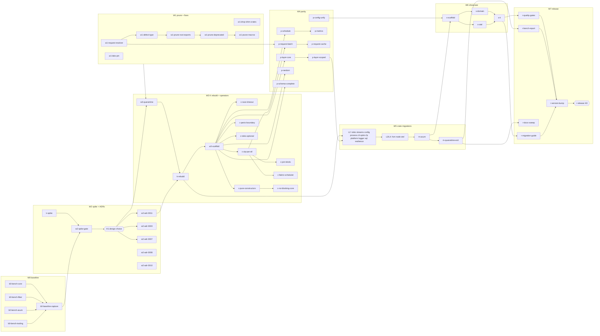

# id_effect 0.7.0 — release plan

## 0. Ground rules

- **Worktree / branch:** `/data/Code/rust/id_effect/.tmp/worktrees/release-0.7.0`, `release/0.7.0` (base `v0.6.0` = 68d4b02).
- **K is a black box.** It is the kernel spike (W2) and rebuild (W3) specified in `kernel-design-{a-hlist,b-traitenv}.md`. This plan only fixes K's **entry conditions** and **exit contract** (§3).
- **All commands run via `devenv shell -- …`.** Moon project ids come from `.moon/workspace.yml`. The core crate is `id_effect_lib`, not `id_effect`.
- **Hot files.** Edit these only in the leaves listed in §6, and the orchestrator serializes their ships:
  - `crates/id_effect/src/lib.rs`
  - root `Cargo.toml`
  - `.moon/workspace.yml`
  - `crates/id_effect/Cargo.toml`
  - `.github/workflows/ci.yml`
  - `CHANGELOG.md`
- **Migration fragments.** Every leaf that breaks user-facing API writes `docs/migration-0.7/<leaf-id>.md` (≤ 15 lines: before/after). Leaves do not touch the guide or the CHANGELOG. `r-migration-guide` assembles them, which keeps paths disjoint.
- **Gate shorthands** (exact commands):

| Alias | Command |
|---|---|
| `G-crate(P)` | `devenv shell -- moon run P:test` (chains `effect:ci-format → P:check → P:clippy -D warnings → nextest -p`) |
| `G-ws` | `devenv shell -- cargo check --workspace --all-targets --all-features` |
| `G-full` | `devenv shell -- bash scripts/ci-local.sh full` |
| `G-nb(P)` | `devenv shell -- bash scripts/check-no-run-blocking.sh P` (created in `w3-scaffold`) |
| `G-bench(P,B)` | `devenv shell -- cargo bench -p P --bench B -- --list` (IDs present; compiles) |
| `G-pg(P…)` | `devenv up` (postgres service in `devenv.nix:94`), then `devenv shell -- env ID_EFFECT_REQUIRE_PG=1 cargo nextest run -p P… --features …` |
| `G-cov` | `devenv shell -- bash scripts/llvm-cov-nextest.sh` |
| `G-tier` | `devenv shell -- bash scripts/tier-conformance.sh` |

Every leaf also runs `maestro task verify <tsk>` and `maestro_verdict_request`. Local gates are *agent-claimed-locally*. `pg-integration` and `ci-pass` on the draft PR are *witnessed-by-ci*.

## 1. Reconnaissance digest

| Finding | Source | Implication |
|---|---|---|
| Criterion benches exist only in core and tokio (`phase0/*`, `env_lookup`, `startup_*`). No fiber, sleep-CPU, axum, stream-map_effect or channel benches. No bench CI. Root `moon :bench` is a no-op. | `crates/id_effect/benches/*`, `crates/id_effect_tokio/benches/startup_first_spawn.rs`, `moon.yml` bench task | W0 adds 3 bench files + tooling. Baselines live in `target/criterion`, so they are exported to JSON and committed. |
| The coverage floor is **95 %** in script and docs. D10 says **96 %**. | `scripts/llvm-cov-nextest.sh:22-24`, `docs/QUALITY_BAR.md:38` | Q1 |
| CI triggers only on push to `main` and on PRs to `main`. | `.github/workflows/ci.yml:2-6` | Q8: open a draft PR at W0. |
| The labs crates path-depend on core. The `labs` job is in `ci-pass` and uses the back-compat aliases. | `labs/*/Cargo.toml`, `labs/id_effect_rpc/src/{client,registry,serialization}.rs` | Any core break turns CI red. `w1-labs-pin` must come first (Q2). |
| `pg-integration` runs `-p id_effect_sql -p id_effect_node`. | `ci.yml` pg job | The showcase joins this job (`s-it`). The job is red while sql/node are quarantined. |
| Publish order levels: L0 macro, proc_macro; L1 core; L2 cli, fp, logger, optics, platform, process, resilience, sql, tokio; L3 config, fsm; L4 node, axum, otel. | `scripts/validate-crate-packaging.sh` | Defines the W5 migration order. |
| The dev-dep edges `proc_macro→optics` and `sql→axum` (only `examples/010_axum_sql.rs` uses axum) create quarantine cycles. | crate `Cargo.toml`s | `w3-quarantine` cuts both. The sql example moves to the showcase. |
| `Schema` already has `encode` and `transform`. The struct-arity limit is real. | `schema/parse.rs:100,200`, `schema/mod.rs:43-46` | The brief's "parse-only" claim is stale. The leaf is rescoped to round-trip completeness + arity. |
| `Config<T>` descriptor already exists. The free-fn explosion duplicates it. | `id_effect_config/src/config_desc.rs` (1136 LOC), `lib.rs:120-218` | D7 Config leaf = unify + Layer, not invent. |
| `run_blocking(` hit counts include inline `#[cfg(test)]` code: core 28 files/232, platform 44, logger 39, fp 37, config 32, sql 27, node 20, fsm 15, otel 12, resilience 11, axum 7, process 5, cli 2, tokio 1. | grep | Gate on **lib targets only** via a clippy `disallowed-methods` config, so tests may keep using it. |
| D8 targets verified: | | All exist → W1 |
| - `StreamV1` | `stream.rs:229`, `lib.rs:159` | |
| - `ComputeSupervisor` | `compute/mod.rs:36`, `lib.rs:107-108` | |
| - deprecated `fabric.rs:64` | | |
| - `platform::process` alias | `platform/src/lib.rs:60-62` | |
| - `SchemaParser` | `proc_macro/src/lib.rs:69` | |
| - `#[capability]` | `capability_attr.rs`, `proc_macro/src/lib.rs:54` | |
| - fn re-exports | `lib.rs:132-135` | |
| - module aliases | `lib.rs:170-181`, used in axum ×5, config ×1, platform ×1, proc_macro ×1 | |
| - shim crates tower, sql_pg | 8-line re-exports | |
| `Cause::Die(String)` is matched in 11 files (core 5, cli 3, process 2, node 1). | grep | `w1-defect-type` |
| `catch_unwind` sites | `kernel/effect.rs:1525`, `capability/{env,needs}.rs`, `axum/src/executor.rs:370`, `process/src/process.rs:192` | `c-panic-boundary` + the owning migrations |
| Kernel design A: spike under `spikes/kernel_a/`, `fork_all` + `Concurrency` hook, Layer sketched in §2.3 | `kernel-design-a-hlist.md:281-350` | Bench IDs are aligned to A's gate list. Layer ownership is resolved in §3. |

## 2. Dependency graph (waves)

**Critical path (17 leaves):**

k-spike → w2-spike-gate → **H1** → w3-quarantine → k-rebuild → w3-scaffold → p-layer-core → p-layer-scoped → m-sql → m-node → m-axum → s-scaffold → s-domain → s-it → r-quality-gates → r-version-bump → r-release (**H3**).

The two K leaves dominate the duration. Everything in W0, W1 and W2 except the H1 chain runs off-path.

## 3. K boundary

| K owns (black box) | This plan owns (on top of K) |
|---|---|
| `Effect`/`LocalEffect` representation, runloop, `Executor` + `TokioExecutor`, `FiberContext` tree, `fork`/`fork_daemon`/`join`/`interrupt`, interrupt masks, typed R (`need`/`provide`/`narrow`), `fork_all` + `Concurrency`, `effect!`/`caps!` expansion, `block_on` with a real waker, porting the existing `phase0/*` and `env_lookup/*` bench bodies **with unchanged IDs**, deleting `spikes/**` | Layer combinators, Schedule, race/timeout, zip_par/all public API, request batching, Random, metrics, schema, config, streams, all non-core crates, showcase, release |

**K entry conditions:**
- W1 has shipped.
- H1 is decided.
- `w3-quarantine` has shipped.
- ADR 0011 is accepted.

**K exit contract** (checked by `w3-scaffold` before it starts):
1. `G-crate(id_effect_lib)`, `G-crate(id_effect_macro)`, `G-crate(id_effect_proc_macro)` and `G-crate(id_effect_tokio)` are green.
2. `static_assertions`-style test: `Effect<u8,(),R>: Send` holds for Send R.
3. A test shows that a missing capability is a compile error (trybuild).
4. `phase0/*` and `env_lookup/*` IDs are listed by `cargo bench -p id_effect -- --list`.
5. `rg -n 'Waker::noop|yield_now' crates/id_effect/src/runtime` returns 0.

**Layer overlap:** if the chosen kernel spec delivers `Layer` (design A §2.3 sketches it), then `p-layer-core`/`p-layer-scoped` shrink to the missing combinators. The orchestrator records that in the leaf contract at claim time.

## 4. Leaves

Size: S ≈ 1 commit, M ≈ 2–3, L = split by its own spec. "Grp" is the parallel group. Leaves in the same group touch disjoint paths, except the hot files in §6.

### W0 — Baseline benchmarks (no source changes)

Sequence: the A-group leaves build the benches and tooling, then the bench/v0.6 branch is checked out, then the v0.6 numbers are captured. Later, `w2-spike-gate` compares the spike against them, and `r-bench-report` re-runs v0.6 and HEAD in the same session. All runs happen on one reference machine with the CPU governor set to performance (Q11).

| ID | Paths (contract) | Acceptance criteria | Gate | Deps | Sz | Grp |
|---|---|---|---|---|---|---|
| b0-bench-core | `crates/id_effect/benches/gate_core.rs` (new), `crates/id_effect/Cargo.toml` (`[[bench]]` only) | IDs `gate/async_bind_64`, `gate/flat_map_depth_10k`, `stream/pull_map_10k`, `stream/map_effect_1k`, `coord/channel_spsc_10k` and `coord/queue_bounded_10k` exist. `phase0_baseline.rs` and `env_lookup.rs` are byte-identical to v0.6.0. Only canonical module paths are used, no `lib.rs:170-181` aliases. | `G-bench(id_effect,gate_core)` lists 6 IDs; `git diff v0.6.0 -- crates/id_effect/benches/phase0_baseline.rs crates/id_effect/benches/env_lookup.rs` empty | – | S | A |
| b0-bench-fiber | `crates/id_effect_tokio/benches/gate_fiber.rs`, `crates/id_effect_tokio/Cargo.toml` (+ `cpu-time` dev-dep) | `gate/spawn_join_10k`, `gate/sleep_1k_x_1ms` (wall), and `gate/sleep_cpu_1k_x_1ms` (criterion custom `Measurement` measuring process CPU time) | `G-bench(id_effect_tokio,gate_fiber)` lists 3 IDs | – | S | A |
| b0-bench-axum | `crates/id_effect_axum/benches/gate_request.rs`, `crates/id_effect_axum/Cargo.toml` | `gate/axum_request_oneshot` (Router `oneshot` → effect handler → JSON) and `gate/axum_request_caps` (with the request-caps middleware, as in example 060). No network. | `G-bench(id_effect_axum,gate_request)` lists 2 IDs | – | S | A |
| b0-bench-tooling | `scripts/bench-{run,export,compare}.sh`, `docs/benchmarks/{gates.toml,README.md}`, `docs/benchmarks/fixtures/*.json` | `run.sh <name>` runs every bench with `--save-baseline <name>`. `export.sh` writes `target/criterion/**/<name>/estimates.json` to `docs/benchmarks/<name>.json`. `compare.sh A B` applies `gates.toml` and exits 1 on any violation. `gates.toml` encodes D9: map/flat_map/async_bind ratio ≤ 1.25; spawn_join, sleep_cpu and axum_request_oneshot ratio < 1.00; everything else is report-only. | `bash scripts/bench-compare.sh --self-test`: the passing fixture exits 0 and the violating fixture exits 1 | – | S | A |
| b0-baseline-capture | branch `bench/v0.6` (= `v0.6.0` + cherry-picked A commits), `docs/benchmarks/v0.6.json`, `docs/benchmarks/v0.6.machine.txt` | The JSON has every ID in `gates.toml` plus the report set. `machine.txt` records the CPU, governor, `rustc -V` and the `bench/v0.6` SHA. `git diff v0.6.0 bench/v0.6 -- 'crates/*/src'` is empty. | `bash scripts/bench-compare.sh docs/benchmarks/v0.6.json docs/benchmarks/v0.6.json` exit 0 | A | S | – |

### W1 — Prune (D8) and pre-K fixes

The B-chain is serial because every leaf in it edits `lib.rs`. `w1-labs-pin` ships before any API break.

| ID | Paths | Acceptance criteria | Gate | Deps | Sz | Grp |
|---|---|---|---|---|---|---|
| w1-labs-pin | `labs/*/Cargo.toml` (7) | `rg -c 'path = "../../crates' labs` = 0. Core deps are `=0.6.0` from the registry (fallback: git `tag = "v0.6.0"`). Labs-internal path deps are unchanged. No `.rs` changes under `labs/`. | `devenv shell -- cargo nextest run --manifest-path labs/Cargo.toml --workspace`; `cargo tree --manifest-path labs/Cargo.toml -i id_effect` shows v0.6.0 non-path | – | S | B |
| w1-drop-shim-crates | delete `crates/id_effect_tower/**` and `crates/id_effect_sql_pg/**`; edit root `Cargo.toml`, `.moon/workspace.yml`, `scripts/validate-crate-packaging.sh`, `crates/id_effect_{axum,sql}/{Cargo.toml,README.md}` and book `appendix-{a,b,c}*.md`, `part2/ch07-09-tower-service.md`, `part6/ch28-00-data.md`, `part6/ch31-00-async-messaging.md` | `rg -l 'id_effect_(tower\|sql_pg)' Cargo.toml .moon scripts .github crates` = 0 outside `CHANGELOG.md`, `docs/MIGRATION-0.6.md` and ADR history. `--print-order` lists 17 crates. | `bash scripts/validate-crate-packaging.sh`; `G-ws` | lp | S | B |
| w1-request-resolver | `crates/id_effect/src/coordination/{request_resolver.rs,mod.rs}`, `lib.rs:125` | (1) `fetch(keys)` is awaited, with no `run_blocking`/`.expect` in non-test code. (2) A fetch error fails every entry with `BatchError::Fetch(e)`; a missing key fails with `BatchError::Missing(k)`. (3) A `#[tokio::test(flavor="current_thread")]` whose fetch awaits `tokio::time::sleep` completes in < 1 s. | `devenv shell -- cargo nextest run -p id_effect -E 'test(request_resolver)'`; `G-crate(id_effect_lib)` | lp | S | B-chain 1 |
| w1-defect-type | `crates/id_effect/src/failure/{cause,mod,pretty}.rs`, `lib.rs:129`, the 11 `Die` matcher files (core, `id_effect_cli`, `id_effect_process`, `id_effect_node`) | `Cause::Die(Defect)`. `Defect::from_panic(Box<dyn Any+Send>)` keeps the payload (Mutex-wrapped so it can be taken) and extracts `&str`/`String` messages. `Cause: Clone` still holds. Eq/Hash compare the message only, and this is documented. Tests cover `&str`, `String` and a custom payload downcast. | `G-ws`; `G-crate` for lib, cli, process, node | rr | S | B-chain 2 |
| w1-prune-root-exports | `lib.rs:131-136,170-181`, `crates/id_effect/src/foundation/{func,mod,mutable_ref}.rs`, callers `crates/id_effect_axum/src/{channel_bridge,json,lib,routing,service}.rs`, `crates/id_effect_config/src/config_desc.rs`, `crates/id_effect_platform/src/http/reqwest.rs`, `crates/id_effect_proc_macro/src/lib.rs` | `rg -n 'id_effect::(channel\|ref_\|either\|func\|clock\|duration\|schedule\|data\|stream\|snapshot)::' crates examples` = 0. `rg -n '\b(pipe[123]\|memoize\|flip\|const_\|tupled\|untupled)\(\|MutableRef' crates/id_effect/src crates/id_effect_axum/src` = 0 (call/type use only; `health.rs:14` "flip-switch" doc is not a hit; the fp crate keeps its own copies). Items with no remaining in-crate use are deleted. | `G-ws`; `G-full` | dt | M | B-chain 3 |
| w1-prune-deprecated | `crates/id_effect/src/{lib.rs,streaming/stream.rs,compute/{mod,governor,fabric}.rs}`, `crates/id_effect_platform/src/{lib,command}.rs` | `rg -n '#\[deprecated\|StreamV1\|ComputeSupervisor' crates/*/src` = 0. The `pub mod process` alias is gone. | `G-ws` | re | S | B-chain 4 |
| w1-prune-macros | `crates/id_effect_proc_macro/src/{lib.rs,derive_schema_parser.rs}`, delete `capability_attr.rs`, `tests/derive_stubs.rs`, `lib.rs:67-71` | `rg -n 'SchemaParser\|capability_attr\|fn capability\(' crates` = 0. `labs/id_effect_lint` is untouched (pinned). | `G-crate(id_effect_proc_macro)`; `G-ws` | dp | S | B-chain 5 |

### W2 — Kernel spike (K) and ADRs

The ADR leaves are docs-only with disjoint files, so they all run in parallel.

| ID | Paths | Acceptance criteria | Gate | Deps | Sz | Grp |
|---|---|---|---|---|---|---|
| k-spike | `spikes/**`, root `Cargo.toml` members | Per the kernel specs. Must emit `docs/benchmarks/spike-<a\|b>.json` via `bench-export.sh` on the reference machine. | per kernel spec | b0-baseline-capture | L | C |
| w2-spike-gate | `docs/benchmarks/spike-{a,b}.json`, `docs/benchmarks/SPIKE-REPORT.md` | One table per design: ratio vs v0.6 for every `gates.toml` ID, plus compile-time and UI-test falsifiers. States a recommendation. The **H1** decision (design + Q7 interpretation) is recorded in the report. | `bash scripts/bench-compare.sh docs/benchmarks/v0.6.json docs/benchmarks/spike-<x>.json` (exit status recorded; D9 allows proceeding) | k-spike | S | – |
| w2-adr-0011 | `docs/adrs/0011-fiber-runtime-send-typed-r.md` | Status Accepted. Covers the Executor, LocalEffect, typed R, interrupts and masks, fork trees, panic→`Defect`, and `block_on`-in-async → error. Records the losing design under Alternatives. | `devenv shell -- moon run effect:ci-format` | H1 | M | D |
| w2-adr-0003-amend | `docs/adrs/0003-*.md`; status lines in `0002`, `0004`, `0005` | The amendment says typed R replaces runtime `verify`, `HasCap` and `project_at_N`. 0002, 0004 and 0005 are marked "superseded in part by 0011". | ci-format | H1 | S | D |
| w2-adr-0007-amend | `docs/adrs/0007-compute-fabric.md`; status note in `0006` | Phase C amendment: the Fabric is the admission scheduler behind `fork_all`/`Concurrency::Inherit` (D6). `par_all` is superseded by `all{concurrency}`. | ci-format | H1 | S | D |
| w2-adr-0008-amend | `docs/adrs/0008-implicit-parallelism.md` | Amendment 2: `map_effect` is sequential and `map_effect_par(n)` is bounded (Q6). It records that `stream.rs:1193` is fixed in `m-streams`. | ci-format | – | S | D |
| w2-adr-0010-amend | `docs/adrs/0010-crate-tiers.md`, `docs/QUALITY_BAR.md` | Amendment 3: 17 crates, no `merge` tier, tokio feature (Q3), labs pinned to 0.6 (Q2), `spikes/` deleted before the release, `examples/http-showcase` at tier `example`, coverage floor (Q1). | ci-format; `G-tier` runs | ds | S | D |

### W3 — Quarantine, K rebuild, concurrency operators

| ID | Paths | Acceptance criteria | Gate | Deps | Sz | Grp |
|---|---|---|---|---|---|---|
| w3-quarantine | root `Cargo.toml` (members → `exclude` block marked `# 0.7 quarantine`), `.moon/workspace.yml`, `crates/id_effect_proc_macro/Cargo.toml` (drop the optics dev-dep), move optics cases from `proc_macro/tests/derive_stubs.rs` to `crates/id_effect_optics/tests/derive_optics.rs`, `docs/migration-0.7/README.md` | Members are {id_effect, macro, proc_macro, tokio} (+ spikes). No member has a (dev-)dep path into a quarantined crate. The moon projects match. | `G-ws`; `devenv shell -- moon run :check` | W1, H1 | S | – |
| k-rebuild | per §3 | K exit contract (§3) | §3 | quarantine, a11 | L | – |
| w3-scaffold | empty documented modules `crates/id_effect/src/{concurrency/race.rs,concurrency/par.rs,capability/layer.rs,random/mod.rs,coordination/request.rs,observability/registry.rs}` + `mod` lines + `pub use …::*` in `lib.rs`; `scripts/check-no-run-blocking.sh` + `scripts/clippy-no-blocking/clippy.toml` | The modules compile under `deny(missing_docs)`. The script runs `CLIPPY_CONF_DIR=scripts/clippy-no-blocking cargo clippy -p P --lib -- -D clippy::disallowed_methods` and has a `--report` mode. The K exit contract is re-verified. | `G-crate(id_effect_lib)`; `bash scripts/check-no-run-blocking.sh --report id_effect` | k-rebuild | S | – |
| c-race-timeout | `concurrency/race.rs`, `crates/id_effect/tests/race_timeout.rs` | `race`/`race_all` return the first success. The loser is interrupted **and its finalizer has run** before the result (Ref flag). Both failing → `Cause::Both`. `timeout`/`timeout_fail` on the test executor fire at virtual 10 s within < 50 ms of wall time. A masked child delays timeout until the mask exits. | `G-crate(id_effect_lib)` | sc | M | E |
| c-zip-par-all | `concurrency/par.rs`, `crates/id_effect/tests/par.rs` | `zip_par` of two 50 ms sleeps takes < 80 ms wall. On first failure, siblings are interrupted (finalizer flag). `all(_, Bounded(2))` never has more than 2 in flight (atomic max). `for_each_par` preserves order. `Sequential` matches a fold. | `G-crate(id_effect_lib)` | sc | M | E |
| c-join-binds | `crates/id_effect/src/kernel/par_bind.rs`, `crates/id_effect_proc_macro/src/expand.rs` | Fail-fast: a failing sibling is interrupted. The error shape is identical to `zip_par`. Arity 8 compiles. *Closes with evidence if K already delivered it.* | `G-crate(id_effect_lib)`; `G-crate(id_effect_proc_macro)` | zp | S | – |
| c-fabric-scheduler | `crates/id_effect/src/compute/{admission,fabric,fiber_pool}.rs` | `Concurrency::Inherit` uses an async `admit`. `rg acquire_blocking crates/id_effect/src/concurrency` = 0. A fabric with capacity 2 caps `all(Inherit)` at 2. `--no-default-features` builds. | `G-crate(id_effect_lib)`; `devenv shell -- cargo check -p id_effect --no-default-features` | zp, a07 | M | – |
| c-pure-constructors | `crates/id_effect/src/coordination/{deferred,semaphore,latch,queue,channel,pubsub}.rs`, `crates/id_effect/src/resource/{cache,pool}.rs` | `make()->Effect` constructors become plain fns. `rg -n 'run_blocking\(.*::(make\|new)' crates/id_effect/src` = 0. | `G-crate(id_effect_lib)` | sc | S | E |
| c-panic-boundary | `crates/id_effect/src/runtime/**`, fiber spawn site, `crates/id_effect/tests/panic.rs` | A panicking forked fiber → `Exit::Failure(Cause::Die(d))` with `d.message()=="boom"`, and the custom payload downcasts. A panic in a finalizer gives `Cause::Then(_, Die)`. Covered for both `block_on` and `Runtime::run`. No abort. | `G-crate(id_effect_lib)` | sc, dt | S | E |
| c-no-blocking-core | `crates/id_effect/src/**` (residual callers) | Only the definition site is allowlisted, via `#[allow(clippy::disallowed_methods)]` + a reason comment. | `G-nb(id_effect)` | pc | S | – |
| c-tokio-optional | `crates/id_effect/Cargo.toml`, `cfg` in `runtime/**` | The default feature `tokio` is on. `cargo tree -p id_effect --no-default-features -e normal \| rg -c tokio` = 0. *Closes if K did this.* | `devenv shell -- cargo check -p id_effect --no-default-features` | sc, Q3 | S | E |

### W4 — Parity (D7)

All W4 leaves are in core, with disjoint files thanks to the scaffold. The exceptions are `p-schedule` → `p-metrics`, which both edit `lib.rs` re-export blocks and are chained.

| ID | Paths | Acceptance criteria | Gate | Deps | Sz | Grp |
|---|---|---|---|---|---|---|
| p-layer-core | `capability/layer.rs`, `crates/id_effect/tests/layer.rs` | `Layer::{succeed, effect, merge, provide_to}`. Providing a layer turns `Effect<_,_,R>` into a runnable (empty-env) effect. A shared dependency in a merge is built once (counter == 1). | `G-crate(id_effect_lib)` | sc | M | F |
| p-layer-scoped | `capability/{layer,provider}.rs`, `crates/id_effect_proc_macro/src/provider_spec.rs` | Scoped finalizers run in reverse order on close **and on interrupt**. `fresh()` builds twice. The sync `on_shutdown` (`provider.rs:48,70`) is replaced by an async finalizer. `derive(ProviderSpec)` emits `layer()` (trybuild pass). | `G-crate(id_effect_lib)`; `G-crate(id_effect_proc_macro)` | lc | M | – |
| p-schedule | `crates/id_effect/src/scheduling/{schedule,mod}.rs`, `lib.rs:148-153`, `benches/phase0_baseline.rs` (body only; ID kept) | `Schedule<Out,In>` is immutable: `rg 'fn next\(&mut self' scheduling` = 0. Combinators: recurs, spaced, exponential, fibonacci, jittered, union, intersect, and_then, while_input, up_to. Methods `retry`, `retry_or_else`, `repeat`, `repeat_or_else`. The free fns are gone: `rg -n 'pub fn (retry\|repeat\|forever)' scheduling` = 0. On the test clock, `exponential(10ms)` with 3 retries advances exactly 70 ms. Duration per Q4. | `G-crate(id_effect_lib)` | sc, Q4 | M | F |
| p-metrics | `crates/id_effect/src/observability/{metric,registry,mod}.rs`, `lib.rs:138-143` | `rg 'Mutex<(u64\|i64)>' observability` = 0. A histogram with boundaries holds `len == boundaries+1` after 1e6 samples. `MetricRegistry::snapshot` returns every metric with tags. The summary window is bounded. | `G-crate(id_effect_lib)` | ps | M | – |
| p-request-batch | `crates/id_effect/src/coordination/request.rs` | `Effect::request(req, resolver)`. `all([r1,r2,r1], Unbounded)` calls the resolver **once** with {1,2}. Sequential requests make one call each. A resolver error fails all waiters with a typed error. | `G-crate(id_effect_lib)` | zp, rr | M | F |
| p-request-cache | `coordination/request.rs` | With caching on (scoped to a Layer/Scope), two identical sequential requests → 1 resolver call. With caching off → 2. | `G-crate(id_effect_lib)` | rb | S | – |
| p-random | `crates/id_effect/src/random/mod.rs`, `crates/id_effect/src/testing/mod.rs` | `Random` capability: `next_u64`, `next_f64 ∈ [0,1)`, `next_range`, `shuffle`. `TestRandom::seeded(42)` matches a golden sequence. `TestRandom::feed` works. `cargo tree -p id_effect -e normal --depth 1` is unchanged (Q13). | `G-crate(id_effect_lib)` | sc | S | F |
| p-schema-complete | `crates/id_effect/src/schema/{parse,extra,mod}.rs`, `crates/id_effect_proc_macro/src/derive_schema_parser.rs` | Proptest: `decode(encode(a)) == a` for every combinator re-exported at `schema/mod.rs:43-46`. Struct arity ≥ 12. `derive(Schema)` works for > 4 fields. | `G-crate(id_effect_lib)`; `G-crate(id_effect_proc_macro)` | sc | M | F |
| p-config-unify | `crates/id_effect_config/src/{lib,config_desc,provider,providers}.rs` | The free loaders at `lib.rs:120-218` are removed and `Config<T>` is the sole API. `Config::<T>::layer()`. The env, map and test providers are capabilities. `all` accumulates errors. | `G-crate(id_effect_config)` | m-config, lc | M | – |

### W5 — Crate migrations

Every m-* leaf meets the **common AC**:
- It re-adds its crate (one line) to `members` and `.moon/workspace.yml`.
- `G-crate(P)` and `G-nb(P)` pass.
- `rg -n 'block_in_place\|thread::yield_now' crates/P/src` = 0 outside tests.
- It writes its migration fragment.

Order follows the publish levels.

| ID | Paths | Specific AC | Deps | Sz | Grp |
|---|---|---|---|---|---|
| m-tokio | `crates/id_effect_tokio/**` | The `spawn_with` blocking-pool driver (`lib.rs:178-210`) is gone. `gate_fiber` is ported with its IDs unchanged. | K | S | G |
| m-streams | `crates/id_effect/src/streaming/**`, `benches/gate_core.rs` (stream bodies) | `rg 'Mutex<StreamState' streaming` = 0. An R clone-counter shows ≤ 1 clone per `map_effect` stream. `rg 'yield_now\|spin_loop' streaming` = 0. `map_effect` is sequential and `map_effect_par(n)` caps in-flight at n. The 0.6 bounded-memory tests still pass. | K, a08 | M | G |
| m-config | `crates/id_effect_config/**` | Mechanical port | K | S | G |
| m-process | `crates/id_effect_process/**` | `rg SpinClock crates` = 0. The `node.rs:4-25` workaround is deleted. `process.rs:192` uses `Defect`. Supervisor restart tests run on the test executor. | K, pb | M | G |
| m-cli | `crates/id_effect_cli/**`, `examples/cli-minimal/**` | Edge `block_on` is allowlisted. cli-minimal is back in the workspace. | K, dt | S | G |
| m-optics | `crates/id_effect_optics/**` | The moved proc-macro optics tests pass. | K | S | G |
| m-fp | `crates/id_effect_fp/**` | STM: `rg yield_now crates/id_effect_fp/src/stm` = 0, retry is waker-based, and a 2-fiber, 1e4-transaction contention test completes. | K | M | G |
| m-platform | `crates/id_effect_platform/**` | fs/http/command providers are Layers. | lc | M | G |
| m-logger | `crates/id_effect_logger/**` | `rg 'thread_local!' crates/id_effect_logger/src` = 0. Two concurrent fibers with different logger layers write to their own sinks (Q5). | lc | M | G |
| m-resilience | `crates/id_effect_resilience/**` | `hedged` is implemented with `race`. `retry_with_breaker` takes `Schedule<_,E>`. `Bulkhead::new` is a plain fn. Duration per Q4. | ps, rt, pc | S | G |
| m-sql | `crates/id_effect_sql/**` (drop the axum dev-dep; delete `examples/010_axum_sql.rs` → s-domain) | The client and transaction are scoped Layers. Passes `G-pg(id_effect_sql --features pg)`. | ls | M | G |
| m-fsm | `crates/id_effect_fsm/**` | `run_blocking` is gone from saga/interpreter. | m-process | S | H |
| m-node | `crates/id_effect_node/**` | Mesh/registry fibers are Send and interruptible. Passes `G-pg(id_effect_node --features pg)`. | m-process, m-sql | M | H |
| m-otel | `crates/id_effect_opentelemetry/**` | `metrics_bridge` reads the registry. The span bridge reads FiberRefs. | m-logger, m-config, m-platform, pmx | M | H |
| m-axum | `crates/id_effect_axum/**` | `rg 'block_in_place\|run_local\|LocalSet' crates/id_effect_axum/src` = 0. `executor.rs:370` panic → `Defect` → 500 (test). `gate_request` is ported with its IDs unchanged. `tests/security.rs` is green. The `tower` feature works. | m-tokio, m-config, m-platform, m-node, ls | M | – |
| m-quarantine-exit | root `Cargo.toml`, `.moon/workspace.yml` | The quarantine block is empty. Members = 17 crates + cli-minimal. `bash scripts/check-no-run-blocking.sh --all` exit 0. A coverage number is **reported** (not gated). pg-integration is green on the draft PR. | `G-full`; CI | all m-* | S | – |

### W6 — Showcase HTTP service (`examples/http-showcase`, publish = false, tier `example`, moon `http_showcase`)

Request path: tower/axum → handler effect → `timeout(2s)` → repo layer `.retry(schedule)` → sql_pg (in a Scope transaction) → typed `AppError` → status code. An otel span and a latency histogram wrap the path.

| ID | Paths | Acceptance criteria | Gate | Deps | Sz |
|---|---|---|---|---|---|
| s-scaffold | `examples/http-showcase/{Cargo.toml,moon.yml,README.md,src/{main,lib,config}.rs}`, root `Cargo.toml`, `.moon/workspace.yml` | `AppConfig` comes from env via a `Config<T>` layer. `GET /health` → 200 (oneshot test). The version is pinned to the workspace version. | `G-crate(http_showcase)`; `bash scripts/check-version-drift.sh` | m-axum, m-sql, cu, ls | S |
| s-domain | `examples/http-showcase/src/{app,routes,repo,error}.rs`, `migrations/0001_init.sql` | `/todos` CRUD. `AppError` maps to 404/409/422/503/504 (tests). Transient errors are retried by `exponential.up_to(3)`: a fake repo that fails twice → 200 with 3 calls. A slow fake → 504 via `timeout`. A transaction rolls back on error (pg test). | `G-crate(http_showcase)`; `G-pg(http_showcase)` | s1, ps, rt | M |
| s-otel | `examples/http-showcase/src/telemetry.rs` | Each request → exactly 1 server span with a route attribute, plus 1 histogram observation (in-memory exporter, `id_effect_opentelemetry::testing`). | `G-crate(http_showcase)` | s1, m-otel, pmx | S |
| s-it | `examples/http-showcase/tests/http_pg.rs`, `.github/workflows/ci.yml` (pg job: add `-p http_showcase`), `nextest.toml` (ci test-group) | Real HTTP on an ephemeral port against real pg. With `ID_EFFECT_REQUIRE_PG=1` and no DB, the test **fails** (it does not skip); the pattern is from `id_effect_sql/tests/pg.rs:21-28`. | `G-pg(http_showcase)`; CI `pg-integration` green | s2, s3 | M |

### W7 — Release

| ID | Paths | Acceptance criteria | Gate | Deps | Sz |
|---|---|---|---|---|---|
| r-bench-report | `docs/benchmarks/{v0.6-rerun,v0.7}.json`, `docs/benchmarks/REPORT-0.7.md` | `bench/v0.6` and HEAD run in the same session on the reference machine. The report has a per-ID ratio with CI bounds. `compare.sh` exits 0, **or** an **H2** waiver is recorded per Q7. | `bash scripts/bench-compare.sh docs/benchmarks/v0.6-rerun.json docs/benchmarks/v0.7.json` | qx | M |
| r-migration-guide | `docs/MIGRATION-0.7.md`, delete `docs/migration-0.7/`, `CHANGELOG.md` (0.7.0), `README.md` link | Every D8 removal is listed with its replacement. Sections cover Send/LocalEffect, typed R, Layer, Schedule, concurrency, Defect, config, logger, streams and removed crates. `test ! -d docs/migration-0.7`. | `devenv shell -- moon run effect:ci-format` | W6 | M |
| r-docs-sweep | `crates/id_effect/book/src/**`, `crates/*/README.md`, `docs/effect-ts-parity/CHECKLIST-upstream-effect.md`, `docs/platform/PARITY_DASHBOARD.md` | `rg 'id_effect_(tower\|sql_pg)\|StreamV1\|SchemaParser\|ComputeSupervisor' crates/id_effect/book docs/effect-ts-parity` = 0 | `moon run effect:book`; `bash scripts/readme-crates.sh --check`; `bash scripts/parity-checklist.sh`; `moon run :examples` | qx | M |
| r-quality-gates | `scripts/llvm-cov-nextest.sh` (floor per Q1), tests as needed, `docs/QUALITY_BAR.md`, `TESTING.md` | Every gate is green: coverage, tier, docs, audit, MSRV 1.94, minimal-versions, packaging. If more than one gate fails, the leaf splits per gate. | `G-cov`; `G-tier`; `moon run effect:docs effect:audit`; `bash scripts/validate-crate-packaging.sh`; CI msrv/minimal-versions | s-it | M |
| r-version-bump | root `Cargo.toml`, `crates/*/Cargo.toml`, `examples/*/Cargo.toml`, `CHANGELOG.md` date | `rg -n 'version = "0\.6\.0"' Cargo.toml crates examples` = 0. `git diff v0.6.0 -- labs` contains only the `w1-labs-pin` manifest lines. No `spikes/` member. | `bash scripts/check-version-drift.sh`; `G-full` | qg, br, mg | S |
| r-release | PR `release/0.7.0 → main`, tag `v0.7.0` | `ci-pass` is green. A `publish.yml` `workflow_dispatch` dry-run passes before the tag. **H3: explicit human go.** | CI | vb | S |

## 5. Parallelism map

| Window | Concurrent subagents | Notes |
|---|---|---|
| W0 + W1 + early W2 | A×4, lp, ds, the B-chain (serial), a08, a10, k-spike | Up to ~10. The B-chain is the only serial lane. |
| After H1 | a11, a03, a07 ∥ w3-quarantine | |
| After w3-scaffold | E×5, F×5 (lc, ps, rb after zp, pr, sch), G-without-layer (tokio, streams, config, process, cli, optics, fp) | Peak of ~16 agents. Disjoint crates and files. The hot files are `lib.rs` (ps → pmx) and the root `Cargo.toml` member lines (each m-*). |
| After p-layer-scoped | m-platform, m-logger, m-sql, m-resilience, p-config-unify | |
| Tail | H (fsm, node, otel) → m-axum → W6 → W7 | Mostly serial |

**Total leaves: 65** (W0 5, W1 7, W2 7, W3 11, W4 9, W5 16, W6 4, W7 6). Two of them, k-spike and k-rebuild, expand per the chosen kernel spec.

## 6. Hot-file register

| File | Leaves (ship order enforced by orchestrator) |
|---|---|
| `crates/id_effect/src/lib.rs` | B-chain (5), w3-scaffold, p-schedule, p-metrics, k-rebuild |
| root `Cargo.toml`, `.moon/workspace.yml` | ds, k-spike, w3-quarantine, every m-*, s-scaffold, m-quarantine-exit, r-version-bump |
| `crates/id_effect/Cargo.toml` | b0-bench-core, k-rebuild, c-tokio-optional |
| `.github/workflows/ci.yml` | s-it |
| `CHANGELOG.md` | r-migration-guide, r-version-bump |

## 7. Non-goals

- Migrating `labs/` to 0.7 or changing labs source. Labs are pinned to 0.6.
- New published crates. The only additions are `examples/http-showcase` and a temporary `spikes/`.
- Effect.ts parity beyond D7: no Stream operator parity sweep, STM redesign, Cache structural sharing, or LRU O(n) fix. The LRU and STM issues are reported in the bench report only, apart from removing the STM spin.
- The `effect!` `>>` token limitation (`transform.rs:39-42`), unless K absorbs it.
- Unifying observability on `tracing`, and downstream (assay/solana) migration. That is a follow-up mission after the publish.
- Bench CI (too noisy). The benches are compiled in CI via the `:check --all-targets` that already runs.

## 8. Risks (ranked)

1. **K overruns, or both designs are falsified.** Mitigation: the spike gate and H1 come before any destructive step. Quarantine keeps every commit compiling. Fallback (human): keep D3/D4 and degrade D5 to runtime-checked R for 0.7.
2. **The branch stays red for a long time (W3–W5).** pg-integration and coverage are expected red until `m-node`/`m-quarantine-exit`. Mitigation: quarantine plus per-crate gates. `ci-pass` is only required from `m-quarantine-exit` onwards.
3. **Parallel agents in one shared tree clobber hot-file commits.** Mitigation: §6 register, the orchestrator serializes ships, and agents commit explicit paths. Alternative: per-leaf worktrees (Q9).
4. **Bench noise invalidates D9 verdicts.** Mitigation: same machine, same session, re-run from the `bench/v0.6` branch, performance governor, criterion CIs. A ratio inside ±5 % noise is treated as "no change" (decide in Q7).
5. **Coverage drops after the rewrite** (95 % → 96 % target). Mitigation: every leaf adds tests, and the number is reported at `m-quarantine-exit` so it does not surprise in W7.
6. **The brief's evidence is stale** (Schema, Config already found). Mitigation: each leaf first re-verifies its cited `file:line`, and rescopes by contract amend.
7. **crates.io lacks a 0.6.0 crate needed by the labs pin.** Mitigation: git `tag = "v0.6.0"` fallback.

**Most likely wrong leaf:** `w3-quarantine`. A path dep from a member to an excluded crate that has `version.workspace = true` fails to resolve. I found two such edges; there may be more in `[target.*]` or optional deps. If quarantine proves unworkable, the whole W3–W5 sequencing needs a different strategy: a long-lived red branch, or K landing additively beside the old kernel.

**What would make the plan misconceived:** if K can be landed **additively** (the new kernel in a new module next to the old one, with crates migrating one by one), then quarantine, the hot-file churn and the red-branch risk all go away. That is a question for the kernel architects.

## 9. Open questions (human, before EXECUTE)

| # | Question | Default if unanswered |
|---|---|---|
| Q1 | Coverage floor: the script and docs say 95, D10 says 96. | Raise to 96 in `r-quality-gates`. |
| Q2 | Labs: pin to 0.6, migrate, or drop the CI job? | Pin to registry `=0.6.0` (`w1-labs-pin`); migrate in a later mission. |
| Q3 | Should tokio be optional in core? | Yes, as default feature `tokio`. |
| Q4 | Which Duration type at public API boundaries? | `std::time::Duration`; core `Duration` only for parsing/formatting. |
| Q5 | Logger: thread-locals → Layer/FiberRef DI? | Yes. |
| Q6 | `map_effect` semantics | Sequential, plus `map_effect_par(n)` (Effect.ts `{concurrency}`). |
| Q7 | What is the D9 "ship anyway within budget"? | At most one optimization leaf after a failed gate; ±5 % counts as noise; any residual violation requires an H2 waiver recorded in `REPORT-0.7.md`. |
| Q8 | How does CI run on `release/0.7.0`? | Open a draft PR to `main` at W0; no `ci.yml` change. |
| Q9 | Shared tree (`--skip-worktree`) vs per-leaf worktrees for W3–W5 | Shared tree with the §6 register. |
| Q10 | H1: design A vs B; fallback if both are falsified | Risk 1 fallback. |
| Q11 | Bench reference machine | The maintainer dev box; recorded in `machine.txt`. |
| Q12 | Showcase location | `examples/http-showcase` as a workspace member, `publish = false`. |
| Q13 | Random: `rand` dep or an internal PRNG? | Internal xoshiro256**, no new dep. |

Human gates:
- **H0:** approve this plan.
- **H1:** kernel design.
- **H2:** D9 waiver, if needed.
- **H3:** tag and publish.
