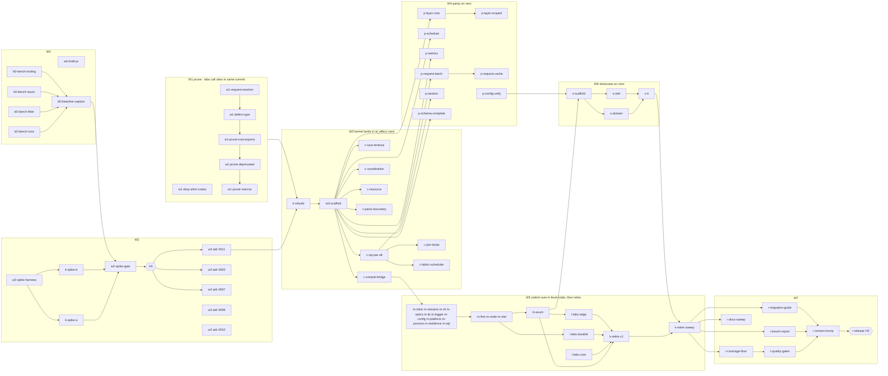

# id_effect 0.7.0 — release plan (v2)

## 0. Ground rules

- **Checkout and branch:** all work happens in the main checkout `/data/Code/rust/id_effect` on branch `release/0.7.0`, based on `v0.6.0` (68d4b02). There are **no worktrees**: no per-leaf worktrees, and Maestro claims use `--skip-worktree`. The bench baseline `bench/v0.6` is a branch. Do **not** switch the shared tree to it. Measure it from a plain export instead: `git archive bench/v0.6 | tar -x -C .tmp/bench-v0.6`. This is not a git worktree, and `.tmp` is excluded from the workspace. Run it with a shared `CARGO_TARGET_DIR`, so both baselines land in one `target/criterion`, and record the SHA. CI runs on the draft PR to `main` opened by `w0-draft-pr` (R3).
- **K is a black box.** K is the two kernel spikes (W2) plus the rebuild (W3), specified in `kernel-design-{a-hlist,b-traitenv}.md`. This plan fixes only:
  - K's entry conditions;
  - K's exit contract (§3);
  - the side-by-side landing site (§3a).
- **Running commands:** everything runs via `devenv shell -- …`. Moon project ids come from `.moon/workspace.yml`; the core crate is `id_effect_lib`.
- **Green at every commit (R2):**
  - Every leaf from W1 on must pass `G-ws` and `G-full`.
  - Every leaf that touches an API labs use must also pass `G-labs`.
  - After push, the draft PR's `ci-pass` is *witnessed-by-ci*.
- **Migration fragments:**
  - Each leaf that breaks user-facing API writes `docs/migration-0.7/<leaf-id>.md`.
  - `r-migration-guide` assembles the fragments.
  - Leaves never touch `CHANGELOG.md`.
- **Gate shorthands:**

| Alias | Command |
|---|---|
| `G-crate(P)` | `devenv shell -- moon run P:test` (runs ci-format, check, clippy `-D warnings`, nextest) |
| `G-ws` | `devenv shell -- cargo check --workspace --all-targets --all-features` |
| `G-full` | `devenv shell -- bash scripts/ci-local.sh full` |
| `G-labs` | `devenv shell -- cargo nextest run --manifest-path labs/Cargo.toml --workspace` (same as CI `labs` job) |
| `G-nb(P)` | `devenv shell -- bash scripts/check-no-run-blocking.sh P` (created in `w3-scaffold`) |
| `G-bench(P,B)` | `devenv shell -- cargo bench -p P --bench B -- --list` |
| `G-pg(P…)` | `devenv up` (postgres, `devenv.nix:94`), then `devenv shell -- env ID_EFFECT_REQUIRE_PG=1 cargo nextest run -p P… --features …` |
| `G-cov` | `devenv shell -- bash scripts/llvm-cov-nextest.sh` |
| `G-tier` | `devenv shell -- bash scripts/tier-conformance.sh` |
| `G-ci` | push, then the draft PR's `ci-pass` is green (*witnessed-by-ci*) |

Every leaf also runs `maestro task verify <tsk>` and `maestro_verdict_request`.

## 1. Reconnaissance digest

| Finding | Source | Implication |
|---|---|---|
| Benches exist only in core and tokio (`phase0/*`, `env_lookup`, `startup_*`). There are no fiber, sleep-CPU, axum, map_effect or channel benches, and no bench CI. | `crates/id_effect/benches/*`, `crates/id_effect_tokio/benches/*` | W0 adds 3 bench files and tooling. Baseline JSON is committed, because criterion baselines live in `target/`. |
| The coverage floor is 95 % in the script and the docs. | `scripts/llvm-cov-nextest.sh:22-24`, `docs/QUALITY_BAR.md:38` | R4: `r-coverage-floor` raises it to 96 %. |
| CI triggers only on `main` and on PRs to `main`. | `.github/workflows/ci.yml:2-6` | R3: `w0-draft-pr`. |
| Labs path-depend on core and 8 other crates. The `labs` job is in `ci-pass`. | `labs/*/Cargo.toml` | R5: labs are migrated, and `G-labs` gates every affecting leaf. |
| Labs hits on D8 targets: the module aliases are used only in `labs/id_effect_rpc/src/{client,registry,serialization}.rs`. `labs/id_effect_lint/src/lib.rs:134` (message text) names `#[capability]`. There are no other hits. | grep | W1 changes are small, so labs are updated in the same commit. |
| Internal deps between labs crates:  - graph has no `id_effect` dependency  - parse depends on core and proc_macro  - events depends on core and graph  - workflow depends on fsm  - jobs depends on events, workflow, node, sql (pg) and tokio  - rpc depends on axum, platform, otel and tokio  - ai depends on config, platform, tokio and cli  - lint is standalone, nightly, and excluded from the labs workspace | `labs/*/Cargo.toml` | 3 labs leaves (§4 W5). |
| Publish levels:  - L0: macro, proc_macro  - L1: core  - L2: cli, fp, logger, optics, platform, process, resilience, sql, tokio  - L3: config, fsm  - L4: node, axum, otel | `scripts/validate-crate-packaging.sh` | This is the switch-over order. |
| Dev-dependency `sql→axum` runs against level order: sql switches before axum. It is used only by `crates/id_effect_sql/examples/010_axum_sql.rs`. | `crates/id_effect_sql/Cargo.toml` | The example still moves to the showcase, so sql's tests never need a bridge to an old-kernel axum. `proc_macro→optics` is kernel-neutral and stays. |
| `Schema` already has `encode` and `transform`. `Config<T>` already exists. | `schema/parse.rs:100,200`; `id_effect_config/src/config_desc.rs` | The brief's evidence is stale. The leaves are rescoped to completion and unification. |
| The D8 targets were all verified at the cited lines. | `stream.rs:229`, `compute/mod.rs:36`, `compute/fabric.rs:64`, `platform/src/lib.rs:60-62`, `proc_macro/src/lib.rs:54,69`, `lib.rs:107-108,132-135,170-181` | W1 |
| `Cause::Die(String)` is matched in 11 files (core 5, cli 3, process 2, node 1). The `catch_unwind` sites are `kernel/effect.rs:1525`, `capability/{env,needs}.rs`, `axum/src/executor.rs:370` and `process/src/process.rs:192`. | grep | `w1-defect-type`, `c-panic-boundary` |
| Design B's spike was specified in core as `kernel_v2/` behind a feature. | `kernel-design-b-traitenv.md:343` | R1 overrides this: B becomes the standalone crate `spikes/kernel_b/`. |

## 2. Dependency graph

**Critical path (18 leaves, plus H1 and H3):**

w2-spike-harness → k-spike-a ∥ k-spike-b → w2-spike-gate → **H1** → w2-adr-0011 → k-rebuild → w3-scaffold → p-layer-core → p-layer-scoped → m-sql → m-node → m-axum → s-scaffold → s-domain → s-it → k-retire-sweep → r-quality-gates → r-version-bump → r-release (**H3**).

`l-labs-edge → k-retire-v1` runs in parallel with the showcase (2 leaves against 3), so it is off the critical path.

## 3. K boundary

| K owns (black box) | This plan owns |
|---|---|
| Spikes A and B.  In `crates/id_effect/src/next/{kernel,runtime,capability,concurrency(fibers),scope,testing}`:  - `Effect`/`LocalEffect`  - runloop  - `Executor` + `TokioExecutor` (tokio mandatory, R6)  - fiber tree, fork/fork_daemon/join/interrupt and masks  - typed R  - `fork_all` + `Concurrency`  - `block_on` with a real waker  - `TestExecutor`  Temporary next-kernel macros (`effect_next!`, `caps_next!`, …) in `id_effect_macro` and `id_effect_proc_macro`.  Retargeting the `phase0/*` and `env_lookup/*` bench bodies to `next`, with unchanged IDs.  Deleting `spikes/**` once the rebuild lands. | Everything else under `next/`, all crate and labs switch-overs, the compat bridge, retiring v1, the showcase, and the release. |

**R1 shared ideas.** Both spikes must adopt all of these:
- an inline `Ready` variant;
- `Cause<E>` as the internal error channel;
- a one-shot completion slot (no `watch`);
- `effect_local!`/`LocalEffect`.

**Entry conditions for `k-rebuild`:**
- W1 has shipped.
- H1 is decided.
- ADR 0011 is accepted.

**K exit contract** (verified by `w3-scaffold`):
1. `G-ws` and `G-full` are green.
2. `G-crate` is green for `id_effect_lib`, `id_effect_macro`, `id_effect_proc_macro` and `id_effect_tokio`.
3. A test asserts `next::Effect<u8,(),R>: Send`.
4. A trybuild test shows that a missing capability fails to compile.
5. The `phase0/*` and `env_lookup/*` IDs are listed and measure `next`.
6. `rg -n 'Waker::noop|yield_now' crates/id_effect/src/next` = 0.
7. `git diff --stat <pre-K-sha> -- crates/id_effect/src ':!crates/id_effect/src/next' ':!crates/id_effect/src/lib.rs'` is empty. The old kernel is untouched apart from a `#[doc(hidden)] pub mod next;` line.

**Layer overlap.** If the chosen spec delivers `Layer`, `p-layer-*` shrinks to the missing combinators. This is recorded in the contract at claim time.

### 3a. Side-by-side landing site (R2)

**Choice:** a `#[doc(hidden)] pub mod next` inside `crates/id_effect` (`crates/id_effect/src/next/**`), always compiled and not behind a feature.

Why this site:
1. **No second published crate (ruled out).** An unpublished internal crate (`crates/id_effect_next`) would have extra problems:
   - It would need core's `Cause`, `Defect`, `Clock`, `Duration` and `Schema`. Either it duplicates them, or core depends on it and it depends on core: a cycle.
   - The orphan rule would also block it from implementing core traits on core types.
2. **No feature-gating.** A feature gate doubles the cfg matrix, and `--all-features` CI would still have to build it.
3. **One rename at the end.** `next` is `pub` so the other crates and labs can switch over to it. Hiding it from the docs keeps the 0.7 rustdoc clean until promotion. At the end, the switch-over is one mechanical rename:
   - `id_effect::next::` → `id_effect::`
   - `effect_next!` → `effect!`

This rename is `k-retire-sweep`. Shared, kernel-independent modules stay at root and are used by both kernels:
- `failure` (with `Defect`)
- `foundation`
- `schema`
- `scheduling::{clock,duration,datetime}`
- `match_`

### 3b. Interop between migrated and unmigrated crates

1. **Downward (no bridge needed).** A crate switches only after every normal and optional dependency it has inside the workspace has switched. This is guaranteed by switching in publish-level order (`validate-crate-packaging.sh` ORDER) and by the `Deps` column in §4 W5. So a migrated crate never calls an old-kernel API.
2. **Upward (bridge).** Unmigrated dependents still call the switched crate's new API. This includes labs crates and examples. They do it through `id_effect::next::compat` (`c-compat-bridge`):
   - `IntoV1` turns `next::Effect<A,E,Empty>` into a v1 `Effect` that awaits the next runtime.
   - `IntoNext` turns a v1 `Effect` into `next::LocalEffect`, which is driven by `spawn_local`.

   Each m-* leaf's contract includes the adapter edits at its dependents' call sites. Its *Dependents* column lists them. When a dependent switches, its adapters are deleted. `k-retire-v1` asserts `rg -n 'next::compat' crates labs examples` = 0 before deleting the bridge.
3. **Dev-deps.** The only dev-dependency that runs against level order is `sql→axum`. Moving its example to `s-domain` removes it. `proc_macro→optics` is kernel-neutral and no cut is needed.

## 4. Leaves

Sizes:
- **S:** about 1 commit.
- **M:** 2–3 commits.
- **L:** split by its own spec.

"Grp" is the parallel group. Leaves in a group touch disjoint paths, apart from the hot files in §6.

### W0 — CI and baseline benchmarks

The benchmark flow:
- The A-group leaves build the benches and tooling.
- `b0-baseline-capture` runs them on the `bench/v0.6` branch (v0.6.0 plus the A commits) and commits `docs/benchmarks/v0.6.json`.
- `w2-spike-gate` compares both spikes against that baseline.
- `r-bench-report` re-runs `bench/v0.6` against HEAD in the same session.
- All runs use one reference machine with the performance governor.

| ID | Paths (contract) | Acceptance criteria | Gate | Deps | Sz | Grp |
|---|---|---|---|---|---|---|
| w0-draft-pr | *(SHIP-type, no files)* push `release/0.7.0`, draft PR to `main` |  - A draft PR exists. If `gh pr create --draft` lacks rights, the human opens `https://github.com/Industrial/id_effect/compare/main...release/0.7.0?expand=1`.  - The first CI run is recorded: job results plus the coverage % from the `coverage` job log.  - From here on, `pg-integration` and `ci-pass` are *witnessed-by-ci* for every leaf. | `gh pr view --json isDraft,url`; `G-ci` | – | S | A |
| b0-bench-core | `crates/id_effect/benches/gate_core.rs`, `crates/id_effect/Cargo.toml` (`[[bench]]`) |  - IDs `gate/async_bind_64`, `gate/flat_map_depth_10k`, `stream/pull_map_10k`, `stream/map_effect_1k`, `coord/channel_spsc_10k` and `coord/queue_bounded_10k` exist.  - `phase0_baseline.rs` and `env_lookup.rs` are byte-identical to v0.6.0.  - No `lib.rs:170-181` aliases are used. | `G-bench(id_effect,gate_core)`; `git diff v0.6.0 -- crates/id_effect/benches/{phase0_baseline,env_lookup}.rs` is empty | – | S | A |
| b0-bench-fiber | `crates/id_effect_tokio/benches/gate_fiber.rs`, `crates/id_effect_tokio/Cargo.toml` (+ `cpu-time` dev-dep) | IDs `gate/spawn_join_10k`, `gate/sleep_1k_x_1ms` (wall clock) and `gate/sleep_cpu_1k_x_1ms` (custom criterion `Measurement` of process CPU time) exist. | `G-bench(id_effect_tokio,gate_fiber)` | – | S | A |
| b0-bench-axum | `crates/id_effect_axum/benches/gate_request.rs`, `crates/id_effect_axum/Cargo.toml` | IDs `gate/axum_request_oneshot` and `gate/axum_request_caps` exist, using `oneshot` with no network. | `G-bench(id_effect_axum,gate_request)` | – | S | A |
| b0-bench-tooling | `scripts/bench-{run,export,compare}.sh`, `docs/benchmarks/{gates.toml,README.md,fixtures/*}` |  - `compare.sh` applies `gates.toml` (D9) and exits 1 on a violation:  &nbsp;&nbsp;- map, flat_map and async_bind: ratio ≤ 1.25  &nbsp;&nbsp;- spawn_join, sleep_cpu and axum_request_oneshot: ratio < 1.00  &nbsp;&nbsp;- the rest: report only  &nbsp;&nbsp;- ±5 % counts as noise (Q7)  - The `--self-test` fixtures cover both a pass and a fail. | `bash scripts/bench-compare.sh --self-test` | – | S | A |
| b0-baseline-capture | branch `bench/v0.6`, `docs/benchmarks/v0.6{.json,.machine.txt}` |  - Every ID is present.  - `machine.txt` records the CPU, governor, `rustc -V` and the SHA.  - `git diff v0.6.0 bench/v0.6 -- 'crates/*/src'` is empty. | `bash scripts/bench-compare.sh docs/benchmarks/v0.6.json docs/benchmarks/v0.6.json` | A | S | – |

### W1 — Prune (D8) and pre-K fixes

The B-chain runs serially because every leaf in it edits `lib.rs`. Labs call sites change in the same commit (R5).

| ID | Paths | Acceptance criteria | Gate | Deps | Sz | Grp |
|---|---|---|---|---|---|---|
| w1-drop-shim-crates |  Delete `crates/id_effect_{tower,sql_pg}/**`.  Edit root `Cargo.toml`, `.moon/workspace.yml`, `scripts/validate-crate-packaging.sh`, `crates/id_effect_{axum,sql}/{Cargo.toml,README.md}`.  Edit the book files `appendix-{a,b,c}*`, `part2/ch07-09-tower-service.md`, `part6/ch28-00-data.md`, `part6/ch31-00-async-messaging.md`. |  - `rg -l 'id_effect_(tower\|sql_pg)' Cargo.toml .moon scripts .github crates labs` = 0, excluding history docs (`CHANGELOG.md`, `docs/MIGRATION-0.6.md`, ADRs).  - `validate-crate-packaging.sh --print-order` lists 17 crates. | `bash scripts/validate-crate-packaging.sh`; `G-ws`; `G-full`; `G-labs` | – | S | B |
| w1-request-resolver | `crates/id_effect/src/coordination/{request_resolver,mod}.rs`, `lib.rs:125` |  - The fetch is awaited, with no `run_blocking` and no `.expect` outside tests.  - A failed fetch fails every entry with `BatchError::Fetch(e)`.  - A missing key fails with `BatchError::Missing(k)`.  - A test under `#[tokio::test(flavor="current_thread")]` with an async fetch completes in < 1 s. | `devenv shell -- cargo nextest run -p id_effect -E 'test(request_resolver)'`; `G-ws`; `G-full` | – | S | B-chain 1 |
| w1-defect-type | `crates/id_effect/src/failure/{cause,mod,pretty}.rs`, `lib.rs:129`, and the 11 `Die` matcher files |  - `Cause::Die(Defect)`.  - `Defect::from_panic` keeps the payload in a takeable Mutex slot and extracts the message.  - `Cause` is still `Clone`.  - Eq/Hash compare the message only, and this is documented.  - Tests cover a `&str` payload, a `String` payload and downcasting a custom payload. | `G-ws`; `G-full`; `G-labs` | rr | S | B-chain 2 |
| w1-prune-root-exports |  - `lib.rs:131-136,170-181`  - `crates/id_effect/src/foundation/{func,mod,mutable_ref}.rs`  - axum `{channel_bridge,json,lib,routing,service}.rs`, config `config_desc.rs`, platform `http/reqwest.rs`, proc_macro `lib.rs`  - `labs/id_effect_rpc/src/{client,registry,serialization}.rs` |  - `rg -n 'id_effect::(channel\|ref_\|either\|func\|clock\|duration\|schedule\|data\|stream\|snapshot)::' crates examples labs` = 0.  - `rg -n '\b(pipe[123]\|memoize\|flip\|const_\|tupled\|untupled)\(\|MutableRef' crates/id_effect/src crates/id_effect_axum/src` = 0. The fp crate keeps its own copies. | `G-ws`; `G-full`; `G-labs` | dt | M | B-chain 3 |
| w1-prune-deprecated | `crates/id_effect/src/{lib.rs,streaming/stream.rs,compute/{mod,governor,fabric}.rs}`, `crates/id_effect_platform/src/{lib,command}.rs` |  - `rg -n '#\[deprecated\|StreamV1\|ComputeSupervisor' crates/*/src labs/*/src` = 0.  - The `platform::process` alias is gone. | `G-ws`; `G-full`; `G-labs` | re | S | B-chain 4 |
| w1-prune-macros |  - `crates/id_effect_proc_macro/src/{lib.rs,derive_schema_parser.rs}`  - delete `capability_attr.rs`  - `tests/derive_stubs.rs`  - `lib.rs:67-71`  - the message text in `labs/id_effect_lint/src/{lib.rs:134,lints/items.rs}` |  - `rg -n 'SchemaParser\|capability_attr\|fn capability\(\|#\[capability\]' crates labs` = 0.  - The lint's advice now names the 0.7 mechanism (`Needs<Key>`/Layer). | `G-ws`; `G-full`; `G-labs` | dp | S | B-chain 5 |

### W2 — Both kernel spikes (R1) and ADRs

| ID | Paths | Acceptance criteria | Gate | Deps | Sz | Grp |
|---|---|---|---|---|---|---|
| w2-spike-harness |  - `spikes/README.md`  - `spikes/corpus/{README.md,handlers.md}`: about 20 handler shapes drawn from axum examples 010–060, the sql example and config usage  - `spikes/scripts/{count-annotations.sh,gen-caps.sh,check-time.sh}`  - empty crates `spikes/kernel_{a,b}/` (`publish = false`)  - root `Cargo.toml` members  - `scripts/llvm-cov-nextest.sh` (ignore `spikes/`) |  - `gen-caps.sh 16 100` emits a crate.  - `check-time.sh` reports the `cargo check` wall time, median of 3.  - `count-annotations.sh <file>` counts turbofish and explicit R/index type annotations.  - Both spike crates build empty. | `G-ws`; `G-full`; `bash spikes/scripts/gen-caps.sh 16 100 --dry-run` | – | S | C |
| k-spike-a | `spikes/kernel_a/**` |  - Per `kernel-design-a-hlist.md`, plus the R1 shared ideas.  - Implements the corpus.  - Trybuild `.stderr` exists for at least 3 compile-error cases: missing capability, duplicate/ambiguous, wrong provide, plus any design-specific ones.  - Emits `docs/benchmarks/spike-a.json`. | per spec; `devenv shell -- cargo nextest run -p kernel_a` | hz, b0b | L | C1 |
| k-spike-b | `spikes/kernel_b/**` (standalone crate, **not** `kernel_v2` in core) |  - Per `kernel-design-b-traitenv.md`, plus the R1 shared ideas.  - Same corpus, the same at least 3 trybuild `.stderr` cases, and `spike-b.json`.  - Reports B's falsifier: the size of the showcase env forward list. | per spec; `devenv shell -- cargo nextest run -p kernel_b` | hz, b0b | L | C1 |
| w2-spike-gate | `docs/benchmarks/SPIKE-REPORT.md`, `spikes/kernel_{a,b}/tests/ui/*.stderr` (referenced) | A side-by-side table of A, B and v0.6:  - every `gates.toml` ratio  - the trybuild `.stderr` excerpts  - annotation counts on the corpus  - `cargo check` time at 16 caps × 100 handlers  - B's forward-list size  - each design's falsifiers marked hit or miss  The report gives a recommendation; the prior is **A**. **H1** is recorded in the report. | `bash scripts/bench-compare.sh docs/benchmarks/v0.6.json docs/benchmarks/spike-{a,b}.json` (status recorded) | ka, kb | S | – |
| w2-adr-0011 | `docs/adrs/0011-fiber-runtime-send-typed-r.md` |  - Status: accepted.  - Covers the Executor, LocalEffect, typed R, interrupts and masks, fork trees, panic→`Defect`, and `block_on` inside async returning an error.  - Records the side-by-side `next` transition (§3a).  - Lists the losing design under Alternatives. | `devenv shell -- moon run effect:ci-format` | H1 | M | D |
| w2-adr-0003-amend | `docs/adrs/0003-*.md`, plus status lines in 0002, 0004 and 0005 |  - Typed R supersedes runtime `verify`, `HasCap` and `project_at_N`.  - 0002, 0004 and 0005 are marked "superseded in part". | ci-format | H1 | S | D |
| w2-adr-0007-amend | `docs/adrs/0007-compute-fabric.md`, plus a status note in 0006 |  - Phase C: the Fabric is the admission scheduler behind `fork_all`/`Concurrency::Inherit` (D6).  - `par_all` is superseded. | ci-format | H1 | S | D |
| w2-adr-0008-amend | `docs/adrs/0008-implicit-parallelism.md` |  - Amendment 2: `map_effect` is sequential and `map_effect_par(n)` is bounded.  - The drift at `stream.rs:1193` is fixed in `m-streams`. | ci-format | – | S | D |
| w2-adr-0010-amend | `docs/adrs/0010-crate-tiers.md`, `docs/QUALITY_BAR.md` | Amendment 3 records:  - 17 crates  - **tokio stays mandatory** (R6), with the rationale: the default executor, no cfg matrix, and the deferral at `0010:89-93` closed  - labs migrated to 0.7 with no new features (R5)  - `spikes/` is temporary  - `examples/http-showcase` is tier `example`  - the coverage floor is 96 % (R4) | ci-format; `G-tier` runs | ds | S | D |

### W3 — The kernel lands in `id_effect::next`; concurrency operators

| ID | Paths | Acceptance criteria | Gate | Deps | Sz | Grp |
|---|---|---|---|---|---|---|
| k-rebuild | §3 (K-owned `next/**`, macro/proc_macro next macros, bench bodies); deletes `spikes/**` and their members | The K exit contract (§3). | §3 | W1, a11 | L | – |
| w3-scaffold |  - `crates/id_effect/src/next/mod.rs`: documented empty modules `race`, `par`, `layer`, `random`, `request`, `coordination/`, `resource/`, `scheduling/`, `observability/`, `streaming/`, `compat`  - `scripts/check-no-run-blocking.sh`  - `scripts/clippy-no-blocking/clippy.toml`: disallows v1 `run_blocking` and `next` `block_on` in lib targets |  - The modules compile under `deny(missing_docs)`.  - The K exit contract is re-verified.  - `check-no-run-blocking.sh --report id_effect` runs. | `G-ws`; `G-full` | kr | S | – |
| c-compat-bridge | `crates/id_effect/src/next/compat.rs`, `crates/id_effect/tests/compat.rs` |  - `IntoV1`/`IntoNext` work as §3b describes.  - Round-trip tests cover success, typed failure, `Die`, and interrupt (cancelling the v1 side drops the next fiber, checked with a finalizer flag).  - Every item is `#[doc(hidden)]`. | `G-crate(id_effect_lib)`; `G-ws` | sc | M | E |
| c-race-timeout | `next/race.rs`, `crates/id_effect/tests/next_race_timeout.rs` |  - `race`/`race_all` return the first success.  - The loser's finalizer has run before the result is returned.  - Two failures produce `Cause::Both`.  - `timeout(10s)` fires at virtual 10 s in < 50 ms of wall time.  - A masked child delays the timeout. | `G-crate(id_effect_lib)`; `G-full` | sc | M | E |
| c-zip-par-all | `next/par.rs`, `tests/next_par.rs` |  - `zip_par` over 2×50 ms takes < 80 ms.  - Failing fast interrupts siblings.  - `all(_, Bounded(2))` never has more than 2 in flight.  - `for_each_par` keeps order.  - `Sequential` matches a fold. | `G-crate(id_effect_lib)`; `G-full` | sc | M | E |
| c-join-binds | `next` par-bind (K file), `crates/id_effect_proc_macro/src/expand.rs` (next path) |  - Fails fast and interrupts siblings.  - Has the same error shape as `zip_par`.  - Arity 8.  - Closes with evidence if K already delivered it. | `G-crate(id_effect_lib)`; `G-crate(id_effect_proc_macro)` | zp | S | – |
| c-fabric-scheduler | `crates/id_effect/src/next/compute.rs` (new) + a read-only use of `compute/{admission,fabric}.rs` via an added async `admit` |  - `Concurrency::Inherit` admits asynchronously.  - A capacity-2 fabric caps `all(Inherit)` at 2.  - `rg acquire_blocking crates/id_effect/src/next` = 0. | `G-crate(id_effect_lib)`; `cargo check -p id_effect --no-default-features` | zp, a07 | M | – |
| c-coordination | `next/coordination/**`: Deferred (one-shot), Semaphore, Latch, Queue, Channel, PubSub, Ref, SynchronizedRef, SubscriptionRef, Supervisor |  - The constructors are plain fns, not `make()->Effect`.  - `rg -n 'watch::' next/coordination` = 0.  - Ported tests pass.  - `G-nb` is clean on `next/coordination`. | `G-crate(id_effect_lib)`; `G-full` | sc | M | E |
| c-resource | `next/resource/**`: Cache, Pool, KeyedPool (Scope is K's) |  - Plain constructors.  - Pool release happens on interrupt (finalizer test). | `G-crate(id_effect_lib)` | sc | M | E |
| c-panic-boundary | K's `next/runtime/**` spawn site, `tests/next_panic.rs` |  - A panicking fiber produces `Cause::Die(d)` with `d.message()=="boom"`, and a custom payload downcasts.  - A panicking finalizer produces `Then(_, Die)`.  - Covered for both `block_on` and `Runtime::run`. | `G-crate(id_effect_lib)` | sc, dt | S | E |

### W4 — Parity (D7) on `next`

These leaves use disjoint `next/` files that the scaffold created, so none of them touches `lib.rs`.

| ID | Paths | Acceptance criteria | Gate | Deps | Sz | Grp |
|---|---|---|---|---|---|---|
| p-layer-core | `next/layer.rs`, `tests/next_layer.rs` |  - `succeed`, `effect`, `merge`, `provide_to`.  - Providing a layer yields a runnable empty-env effect.  - A dependency shared inside a merge is built once. | `G-crate(id_effect_lib)` | sc | M | F |
| p-layer-scoped | `next/layer.rs`, the provider derive in `crates/id_effect_proc_macro/src/provider_spec.rs` (next-path emission) |  - Finalizers run in reverse on close and on interrupt.  - `fresh()` builds twice.  - Finalizers are async, replacing the sync `on_shutdown`.  - The derive emits `layer()`, checked by a trybuild pass. | `G-crate(id_effect_lib)`; `G-crate(id_effect_proc_macro)` | lc | M | – |
| p-schedule | `next/scheduling/{schedule,mod}.rs` |  - `Schedule<Out,In>` is immutable (no `fn next(&mut self`).  - Combinators: `recurs`, `spaced`, `exponential`, `fibonacci`, `jittered`, `union`, `intersect`, `and_then`, `while_input`, `up_to`.  - Methods: `retry`, `retry_or_else`, `repeat`, `repeat_or_else`.  - No free retry or repeat fns.  - On TestClock, `exponential(10ms)` with 3 retries takes exactly 70 ms.  - `std::time::Duration` is used at the boundary (Q4). | `G-crate(id_effect_lib)` | sc | M | F |
| p-metrics | `next/observability/{metric,registry,mod}.rs` |  - Atomics are used (no `Mutex<u64\|i64>`).  - After 1e6 histogram samples, `len == boundaries+1`.  - `MetricRegistry::snapshot` includes tags.  - The summary window is bounded.  - Span and FiberRef hooks are available for otel. | `G-crate(id_effect_lib)` | sc | M | F |
| p-request-batch | `next/request.rs` |  - `Effect::request`.  - `all([r1,r2,r1])` makes 1 resolver call with keys {1,2}.  - Sequential requests make 1 call each.  - Resolver errors are typed. | `G-crate(id_effect_lib)` | zp, rr | M | F |
| p-request-cache | `next/request.rs` |  - With caching scoped to a Layer or Scope, the same request made twice → 1 call.  - With caching off → 2 calls. | `G-crate(id_effect_lib)` | rb | S | – |
| p-random | `next/random.rs`, `next/testing` export |  - `next_u64`, `next_f64` in [0,1), `next_range`, `shuffle`.  - `TestRandom::seeded(42)` matches a golden sequence.  - `feed`.  - No new dependency: internal xoshiro256** (Q13). | `G-crate(id_effect_lib)` | sc | S | F |
| p-schema-complete | root `crates/id_effect/src/schema/{parse,extra,mod}.rs` (kernel-neutral), `crates/id_effect_proc_macro/src/derive_schema_parser.rs` |  - Proptest `decode(encode(a)) == a` for every combinator at `schema/mod.rs:43-46`.  - Arity ≥ 12.  - `derive(Schema)` works for more than 4 fields. | `G-crate(id_effect_lib)`; `G-crate(id_effect_proc_macro)`; `G-full` | sc | M | F |
| p-config-unify | `crates/id_effect_config/src/{lib,config_desc,provider,providers}.rs` |  - The free loaders at `lib.rs:120-218` are removed, leaving `Config<T>` as the sole API.  - `Config::<T>::layer()`.  - The providers are capabilities.  - `all` accumulates errors.  - Callers in cli-minimal and labs ai are updated (via the bridge). | `G-crate(id_effect_config)`; `G-full`; `G-labs` | m-config, lc | M | – |

### W5 — Switch-over in dependency order, labs, retire v1

Each m-* leaf meets this **common AC**:
- The crate imports only `id_effect::next::*` (`rg -n 'id_effect::(kernel\|runtime\|capability\|concurrency\|coordination\|streaming)::' crates/P/src` = 0).
- `G-nb(P)` passes.
- No `block_in_place` or `thread::yield_now` outside tests.
- The crate's dependents (the *Dependents* column) compile via `next::compat` adapters added in the same commit.
- It writes a migration fragment.

The common gate is `G-crate(P)`, `G-ws`, `G-full`, `G-labs` and `G-ci`.

| ID | Paths (+ dependents' call sites) | Specific AC | Dependents to adapt | Deps | Sz | Grp |
|---|---|---|---|---|---|---|
| m-tokio | `crates/id_effect_tokio/**` |  - The `spawn_with` blocking-pool driver (`lib.rs:178-210`) is gone.  - `gate_fiber` is retargeted with its IDs unchanged. | axum, labs ai/jobs/rpc; the dev-dep tests in otel/platform/sql | br | S | G |
| m-streams | `crates/id_effect/src/next/streaming/**`, `benches/gate_core.rs` (stream bodies) |  - No per-pull `Mutex<StreamState>`.  - At most 1 R clone per `map_effect` stream.  - No spin in `fail`.  - `map_effect` is sequential and `map_effect_par(n)` is bounded.  - The 0.6 bounded-memory tests are ported and pass. | – (core-internal) | br, co, a08 | M | G |
| m-cli | `crates/id_effect_cli/**`, `examples/cli-minimal/**` | `block_on` at the edge is allowlisted. | labs ai | br, dt | S | G |
| m-optics | `crates/id_effect_optics/**` |  - Ported.  - Closes with evidence if no Effect API is used. | – | br | S | G |
| m-fp | `crates/id_effect_fp/**` |  - STM retry is waker-based: `rg yield_now crates/id_effect_fp/src/stm` = 0.  - A contention test with 2 fibers × 1e4 transactions passes. | – | br, co | M | G |
| m-logger | `crates/id_effect_logger/**` |  - **Kernel migration only (R7).**  - The thread-local `install_*` API is unchanged (public signature diff = Effect types only). | otel | br | S | G |
| m-config | `crates/id_effect_config/**` | Mechanical port. | axum, otel (optional), cli-minimal, labs ai | br, lc | S | G |
| m-platform | `crates/id_effect_platform/**` | The fs, http and command providers are Layers. | axum, otel (optional), labs ai/rpc | br, lc, m-tokio | M | G |
| m-process | `crates/id_effect_process/**` |  - `rg SpinClock crates` = 0.  - The `node.rs:4-25` workaround is deleted.  - `process.rs:192` uses `Defect`.  - Restart tests run on TestExecutor. | fsm, node | br, co, pb | M | G |
| m-resilience | `crates/id_effect_resilience/**` |  - `hedged` is built on `race`.  - `retry_with_breaker` takes `Schedule`.  - `Bulkhead::new` is plain. | – | ps, rt, co | S | G |
| m-sql | `crates/id_effect_sql/**`: drop the axum dev-dep and move `examples/010_axum_sql.rs` to `s-domain` |  - The client and transaction are scoped Layers.  - Passes `G-pg(id_effect_sql --features pg)`. | node (optional), labs jobs | ls, rs, m-tokio | M | G |
| m-fsm | `crates/id_effect_fsm/**` | No `run_blocking` in saga or interpreter. | labs workflow | m-process | S | H |
| m-node | `crates/id_effect_node/**` |  - Fibers are Send and interruptible.  - Passes `G-pg(id_effect_node --features pg)`. | axum (optional), labs jobs | m-process, m-sql | M | H |
| m-otel | `crates/id_effect_opentelemetry/**` |  - The metrics bridge goes through the `next` registry.  - The span bridge goes through FiberRefs. | labs rpc | m-logger, m-config, m-platform, pmx | M | H |
| m-axum | `crates/id_effect_axum/**` |  - `rg 'block_in_place\|run_local\|LocalSet' crates/id_effect_axum/src` = 0.  - A panic → `Defect` → 500.  - `gate_request` keeps its IDs.  - `tests/security.rs` passes.  - The `tower` feature works. | labs rpc | m-tokio, m-config, m-platform, m-node, m-streams, ls | M | – |
| l-labs-core | `labs/id_effect_{parse,events}/**` (graph has no `id_effect` dependency; recorded as a no-op) | Switched to `next`. No new public items (`cargo public-api`-style diff limited to type changes). | – | br | M | I |
| l-labs-durable | `labs/id_effect_{workflow,jobs}/**` | Switched over; the jobs pg tests pass under `G-pg`-style env. | – | m-fsm, m-node, m-sql, m-tokio, l1 | M | I |
| l-labs-edge | `labs/id_effect_{rpc,ai}/**` | Switched over; no new features. | – | m-axum, m-otel, m-config, m-platform, m-cli | M | – |
| k-retire-v1 |  - `crates/id_effect/src/**`: delete the v1 `kernel`, `runtime`, `capability`, `concurrency`, `coordination`, `resource`, `streaming`, `scheduling/schedule.rs`, `observability/metric.rs` and `next/compat.rs`  - promote `next/*` to root  - keep `#[doc(hidden)] pub mod next` as a re-export alias  - `effect!` gets the next expansion and `effect_next!` becomes an alias  - `lib.rs` |  - `rg -n 'next::compat' crates labs examples` = 0, checked **before** deleting.  - `G-nb(id_effect)` is clean.  - `rg -n 'Waker::noop\|yield_now' crates/id_effect/src` = 0.  - `rg -n 'fn run_blocking' crates/id_effect/src` = 0, or allowlisted at the edge. | – | all m-*, l1–l3, all c-*/p-* | L→M×2 | – |
| k-retire-sweep | `crates/**`, `labs/**`, `examples/**` (including `http-showcase`), `spikes` leftovers |  - Mechanical rename.  - `rg -n 'id_effect::next\|effect_next!\|_next!' crates labs examples` = 0.  - The `next` alias and the temporary macro names are deleted. | – | rv, s4 | M | – |

### W6 — Showcase (`examples/http-showcase`, publish = false, tier `example`, moon `http_showcase`)

The showcase is built on `next` paths, and the sweep renames them.

The request path: tower/axum → handler effect → `timeout(2s)` → repo `.retry(schedule)` → sql_pg in a Scope transaction → `AppError` → status code. The whole path is wrapped in an otel span and a latency histogram.

| ID | Paths | Acceptance criteria | Gate | Deps | Sz |
|---|---|---|---|---|---|
| s-scaffold | `examples/http-showcase/{Cargo.toml,moon.yml,README.md,src/{main,lib,config}.rs}`, root `Cargo.toml`, `.moon/workspace.yml` |  - `AppConfig` is loaded via the `Config<T>` layer.  - `GET /health` → 200.  - The version is pinned. | `G-crate(http_showcase)`; `bash scripts/check-version-drift.sh`; `G-full` | m-axum, m-sql, cu, ls | S |
| s-domain | `examples/http-showcase/src/{app,routes,repo,error}.rs`, `migrations/0001_init.sql` (absorbs `sql/examples/010_axum_sql.rs`) |  - `/todos` CRUD.  - `AppError` maps to 404, 409, 422, 503 and 504.  - A repo that fails twice then succeeds gives 200 after 3 calls.  - A slow repo gives 504.  - A failed transaction rolls back (pg). | `G-crate(http_showcase)`; `G-pg(http_showcase)` | s1, ps, rt | M |
| s-otel | `examples/http-showcase/src/telemetry.rs` | Each request records 1 span with the route attribute and 1 histogram observation (in-memory exporter). | `G-crate(http_showcase)` | s1, m-otel, pmx | S |
| s-it | `examples/http-showcase/tests/http_pg.rs`, `.github/workflows/ci.yml` (the pg job adds `-p http_showcase`), `nextest.toml` |  - Real HTTP on an ephemeral port against real pg.  - With `ID_EFFECT_REQUIRE_PG=1` and no DB, the test **fails** (pattern from `sql/tests/pg.rs:21-28`). | `G-pg(http_showcase)`; `G-ci` (pg-integration) | s2, s3 | M |

### W7 — Release

| ID | Paths | Acceptance criteria | Gate | Deps | Sz |
|---|---|---|---|---|---|
| r-coverage-floor | `scripts/llvm-cov-nextest.sh` (`--fail-under-*` 96), `docs/QUALITY_BAR.md:38`, `TESTING.md:497`, tests as needed |  - The floor is 96 % for lines, regions and functions (R4).  - `G-cov` passes at 96. | `G-cov`; `G-ci` (coverage job) | sw | M |
| r-bench-report | `docs/benchmarks/{v0.6-rerun,v0.7}.json`, `REPORT-0.7.md` |  - Both runs happen in the same session.  - The report gives a per-ID ratio with confidence intervals.  - `compare.sh` exits 0, or an **H2** waiver is recorded. | `bash scripts/bench-compare.sh docs/benchmarks/v0.6-rerun.json docs/benchmarks/v0.7.json` | sw | M |
| r-migration-guide | `docs/MIGRATION-0.7.md`, delete `docs/migration-0.7/`, `CHANGELOG.md`, `README.md` link |  - Every D8 removal and breaking change is listed with its replacement.  - `test ! -d docs/migration-0.7`. | ci-format | sw | M |
| r-docs-sweep | `crates/id_effect/book/src/**`, `crates/*/README.md`, `docs/effect-ts-parity/CHECKLIST-upstream-effect.md`, `docs/platform/PARITY_DASHBOARD.md` | `rg 'id_effect_(tower\|sql_pg)\|StreamV1\|SchemaParser\|ComputeSupervisor\|id_effect::next' crates/id_effect/book docs/effect-ts-parity` = 0 | `moon run effect:book`; `bash scripts/readme-crates.sh --check`; `bash scripts/parity-checklist.sh`; `moon run :examples` | sw | M |
| r-quality-gates | as needed (split per failing gate) |  - Coverage ≥ 96 %.  - Tier, docs `-D warnings`, audit, MSRV 1.94, minimal-versions, packaging and labs are all green. | `G-cov`; `G-tier`; `moon run effect:docs effect:audit`; `bash scripts/validate-crate-packaging.sh`; `G-labs`; `G-ci` | cf, s-it | M |
| r-version-bump | root `Cargo.toml`, `crates/*/Cargo.toml`, `examples/*/Cargo.toml`, `labs/Cargo.toml` + `labs/*/Cargo.toml` (lockstep with the 0.7.0 path-dep versions), `CHANGELOG.md` date |  - `rg -n '"0\.6\.0"' Cargo.toml crates examples labs` = 0.  - No `spikes/` member. | `bash scripts/check-version-drift.sh`; `G-full`; `G-labs` | qg, bre, mg | S |
| r-release | PR merge, tag `v0.7.0` |  - `ci-pass` is green.  - A `publish.yml` dry run passes.  - **H3**: explicit human go. | `G-ci` | vb | S |

## 5. Leaf count and parallelism

**Total: 71 leaves:**
- W0: 6
- W1: 6
- W2: 9
- W3: 10
- W4: 9
- W5: 20
- W6: 4
- W7: 7

The kernel leaves (`k-spike-a`, `k-spike-b`, `k-rebuild`) expand per their specs. `k-retire-v1` may split in two.

| Window | Concurrent subagents | Notes |
|---|---|---|
| W0 → W2 | about 10: A×5 (`w0-draft-pr` plus 4 bench and tooling leaves), w1-drop-shim, the B-chain (serial), w2-spike-harness then **k-spike-a ∥ k-spike-b**, a08, a10 | The spikes use disjoint `spikes/kernel_{a,b}/` paths. |
| After H1 | a11, a03, a07 | Then k-rebuild runs alone. |
| After w3-scaffold | about 17: E×6 (bridge, race, zip, coordination, resource, panic), F×5 (layer-core, schedule, metrics, random, schema; request-batch after zip), and the m-* leaves that need only br/co (m-optics, m-cli, m-logger, then m-tokio, m-streams, m-fp), plus l-labs-core | Every `next/` leaf has its own file, so `lib.rs` is untouched. Each m-* leaf runs `G-full` + `G-labs`. |
| After p-layer-scoped | m-config, m-platform, m-sql, m-process, m-resilience, p-config-unify | |
| Tail | H (fsm, node, otel) → m-axum → {s-* ∥ l-labs-durable, l-labs-edge → k-retire-v1} → k-retire-sweep → W7 (cf, bre, mg, dsw in parallel) | |

## 6. Hot-file register (the orchestrator serializes ships)

| File | Leaves |
|---|---|
| `crates/id_effect/src/lib.rs` | the B-chain (5), k-rebuild (adds `pub mod next`), k-retire-v1, k-retire-sweep |
| `crates/id_effect/src/next/mod.rs` | k-rebuild, w3-scaffold, k-retire-v1 |
| root `Cargo.toml` | w1-drop-shim-crates, w2-spike-harness, k-rebuild (removes spikes), s-scaffold, r-version-bump |
| `.moon/workspace.yml` | w1-drop-shim-crates, s-scaffold |
| `crates/id_effect/Cargo.toml` | b0-bench-core, k-rebuild |
| `scripts/llvm-cov-nextest.sh` | w2-spike-harness, r-coverage-floor |
| `labs/Cargo.toml` | r-version-bump |
| `.github/workflows/ci.yml` | s-it |
| `CHANGELOG.md` | r-migration-guide, r-version-bump |
| dependents' call sites (the adapters) | each m-* leaf, in level order, so the leaves never overlap on one dependent at the same time |

## 7. Non-goals

- New features in labs (R5: switch-over only).
- Optional tokio (R6).
- Changing the logger's thread-local DI (R7).
- New published crates. Only `examples/http-showcase` and the temporary `spikes/` are added.
- Effect.ts parity beyond D7. In particular: no Stream operator sweep, no STM redesign beyond removing the spin, and no Cache structural sharing or LRU rework.
- The `effect!` `>>` limitation, unless K absorbs it.
- Unifying on `tracing`.
- Migrating downstream users (assay, solana).
- Bench CI.

## 8. Risks (ranked)

1. **K overruns, or both spikes are falsified.**
   - H1 gates every destructive step. With side-by-side, nothing destructive happens until `k-retire-v1`, so a failed rebuild leaves 0.6 behaviour intact.
   - Fallback (human decision): keep D3 and D4, and degrade D5.
2. **The bridge cannot express a call site.** For example, a dependent might pass a v1 Env-typed effect into a migrated API that expects typed R.
   - Mitigation: `IntoNext` requires an explicit layer at the boundary.
   - If a call site still cannot be bridged, that dependent switches over in the same leaf. This widens the contract and is recorded via contract amend.
3. **Compile time and code size double while both kernels coexist** (W3–W5).
   - Accepted as temporary.
   - Watched through the `G-full` wall time recorded in the evidence.
4. **Coverage is double-counted while both kernels coexist.** The floor rises to 96 % only after the sweep (`r-coverage-floor`). The W0 baseline coverage % comes from `w0-draft-pr`.
5. **Shared-tree commit clobbering.** Mitigated by the §6 register. The orchestrator serializes ships, and agents commit explicit paths.
6. **Bench noise.** Mitigated by using the same machine and session, the `bench/v0.6` branch, the performance governor, and a ±5 % noise band.
7. **Stale evidence in the brief.** Each leaf re-verifies its cited `file:line` before starting.

**Leaf most likely to be wrong:** `c-compat-bridge`. The v1 `Effect` is `!Send` and holds an `Env`; the next `Effect` is Send with typed R. So `IntoNext` probably needs `LocalEffect` plus an explicit layer. If the bridge is too awkward, the W5 order still holds, but leaves would have to switch a crate together with all its dependents. That merges leaves, for example m-config would also switch axum.

**What would make the plan misconceived:** the bridge cost might exceed the cost of switching dependents in the same leaf. Watch the adapter count recorded in m-tokio and m-config; above roughly 30 call sites per leaf, reconsider.

## 9. Decisions

### Resolved by human ruling (2026-10-15)

| # | Ruling |
|---|---|
| R1 / Q10 | Spike **both** designs in parallel: `k-spike-a` in `spikes/kernel_a/`, and `k-spike-b` as the standalone `spikes/kernel_b/` (not a `kernel_v2` feature).  Both adopt the shared ideas: inline Ready, `Cause<E>` as the error channel, a one-shot slot, and `effect_local!`/LocalEffect.  The side-by-side gate report feeds H1. The prior is A. |
| R2 | Quarantine is **replaced by side-by-side**. The new kernel lives at `id_effect::next` (§3a). The m-* leaves switch in level order with the workspace green at every commit. The old kernel is deleted by `k-retire-v1` and `k-retire-sweep`.  `w3-quarantine` and `m-quarantine-exit` are removed. The `proc_macro→optics` dev-dep cut is dropped. The sql example move is kept because `sql→axum` runs against level order. |
| R3 / Q8 | `w0-draft-pr` is opened in W0. `pg-integration` and `ci-pass` are *witnessed-by-ci* from W0 on. |
| R4 / Q1 | The coverage floor is **96 %** (`r-coverage-floor`), and `r-quality-gates` requires ≥ 96 %. |
| R5 / Q2 | Labs are **migrated** to 0.7: `l-labs-core`, `l-labs-durable` and `l-labs-edge`, all before `k-retire-v1`. W1 updates labs call sites in the same commit. Labs get no features. `w1-labs-pin` is removed. |
| R6 / Q3 | tokio stays **mandatory**. `c-tokio-optional` is removed, and the ADR 0010 amendment records the decision. |
| R7 / Q5 | The logger keeps its thread-local `install_*`. `m-logger` is now kernel migration only (size S). |

### Resolved by default (no ruling given)

| # | Default taken |
|---|---|
| Q4 | `std::time::Duration` at public boundaries; the core `Duration` is used only for parsing and formatting. |
| Q6 | `map_effect` is sequential, plus `map_effect_par(n)`. |
| Q7 | D9 budget: at most one optimisation leaf after a failed gate. A ±5 % noise band applies. Any remaining violation needs an H2 waiver in `REPORT-0.7.md`. |
| Q9 | One shared tree (`--skip-worktree`), with the §6 register. |
| Q11 | The maintainer's dev box is the reference bench machine, recorded in `machine.txt`. |
| Q12 | `examples/http-showcase` is a workspace member with `publish = false`. |
| Q13 | An internal xoshiro256** PRNG; no `rand` dependency. |

**Human gates:**
- **H0:** plan approval.
- **H1:** kernel design, from the spike report.
- **H2:** D9 waiver, if needed.
- **H3:** tag and publish.
