# id_effect Plan of Plans: 0.8 → 1.0 → Surpass

Status: **approved** (2026-10-15) · Baseline: 0.7.0 (2026-10-15) · Scorecard method 2.2 (re-based 2026-10-18, §7.0b; owner acceptance pending)
(`../../../docs/scorecard/METHOD.md`) · Data: `../../../docs/scorecard/scorecard.json`

Every release from 0.8.0 onward begins by reading this document (§7), picks its scope from it, and
closes by proving progress with the scorecard (§6). This document changes only through the release
retro step (§7.5) or an ADR.

---

## 1. North star

> **id_effect is the platform where the compiler checks your dependencies, errors and resources,
> the runtime supervises them, and one command gets you a production-shaped service.**

Success is measured with numbers only:

| Horizon | Enterprise index E | Rank (E) | Runtime index RT | Red rows (<40) | Best-in-class rows (≥80) | First hour (K1) |
|---|---|---|---|---|---|---|
| 0.7.0 baseline | 43.7 | #9 | 56.5 (#6) | 37 | 13 | not possible (no generator) |
| 1.0.0 | ≥ 86.4 | #1 | ≥ 88.4 (#1) | ≤ 1 | ≥ 63 | ≤ 90 s |
| Surpass (1.x) | ≥ 85, and #1 on the refreshed snapshot | #1 | #1 | 0 | ≥ 70 | ≤ 60 s |

All numbers are scorecard method 2.2 (checklist scores, METHOD §7; non-goals left out, §3.3), from
`scripts/scorecard.sh --version 0.7.0` and `--targets 1.0.0` (0.10.0 measured: E 76.6 #2, RT 79.5
#1, red 11, ≥80 49), re-based
2026-10-18 (§7.0b; owner acceptance pending, §11). Being honest about them:
- The plan as targeted reaches **#1 at 1.0** (E 86.4 against .NET 78.8 and Spring 73.6), but
  against the competitor snapshot frozen on 2026-10-14. Competitors keep shipping, and the snapshot
  is refreshed before 1.0 (METHOD §4), so #1 at 1.0 must be re-proven on that refresh. Under the
  method 1.1 history (judgment scores) the same plan reaches only #3 (80.3, behind .NET 85.4 and
  Spring 81.1).
- Method 2.2 (L15, §7.0b) moved every number: non-goal rows and checks left the score for every
  framework (0.10.0 measured E 75.5 → 76.6), and .NET gained Orleans and the Durable Task Framework
  (.NET E 77.3 → 78.8). Under 2.1 the 1.0 row read E ≥ 82 (82.1 planned), RT ≥ 84, ≥80 ≥ 59, and the
  0.7.0 baseline 43.2 (#9), RT 56.1, red 39 (METHOD §5.2 history). `dx.repl#3` is not a non-goal (a
  met check never is, METHOD §3.3), so `dx.repl` stays 75; listing it would have cost id_effect 4
  on that row (75 → 71, 0.11.0.md D3).
- The 1.0 row still holds the 24 row targets stored at 1.0.0; L15 moves them into 0.13–0.17 at
  those kickoffs, which changes when the number is reached, not the number.
- The structural gap is *Ecosystem & trust* (group score 17 at 0.7.0: community, backing,
  production track record), which code alone cannot close. That is why the Surpass horizon (§9)
  exists, and why trust work (T0) is a mandatory part of **every** release rather than its own phase.

---

## 2. Why id_effect can win (the thesis)

| Advantage | Who has it today | id_effect position at 0.7 |
|---|---|---|
| Typed errors + typed DI + resource safety checked by the compiler | Effect-TS, ZIO | ✓ core 85 (group score), Send kernel, HList `R` |
| OTP-grade supervision and distribution | OTP, Phoenix | ✓ the only non-BEAM entrant (supervision 88, mesh rows 75) |
| Native performance with memory safety and no GC | (.NET partially) | ✓ concurrency 82, `forbid(unsafe_code)` |
| Batteries (data, auth, jobs, mail, admin, scaffolding) | Rails, Laravel, Spring, .NET, Phoenix | ✗ data 33, web 28, security 21, messaging 28, DX 37 |
| Trust (license, stability, backing, users) | everyone else | ✗ ecosystem 17 |

Group scores are method 2.0 at 0.7.0 (`docs/scorecard/results/v0.7.0.json`).

Nobody else has the first three together. The plan builds the fourth on top of them and works on the
fifth continuously. **Every battery must be effect-native:** a `Layer` to provide it, a typed error
channel, interruption-safe and supervisable, and testable with `TestExecutor`. Wrapping a battery
any other way does not count.

---

## 3. Decisions

### 3.1 Locked (change only by ADR)

| # | Decision | Rationale |
|---|---|---|
| L1 | **Supersede the ADR 0010 vision with ADR 0012 "Platform vision".** id_effect becomes a batteries-included platform. ADR 0010's tiers stay; a **platform** tier is added for battery crates, using the integration-tier gates plus a reference-app consumer. | ADR 0010:39-42 forbids the goal; Rule 5 requires an amendment before any new crate. |
| L2 | **Effect-native batteries, built on proven Rust crates.** Integrate (sqlx, sea-query, lettre, object_store, openidconnect, jsonwebtoken, argon2, fluent, h3/quinn; async-graphql dropped under L15); do not rewrite them. | The value is the typed effect surface, not reimplementing protocols. |
| L3 | **One front door:** the facade crate `id_effect_kit` (feature flags per battery, `prelude`) plus the `id-effect` CLI binary (`new`, `generate`, `dev`, `doctor`, `migrate`, `deploy`). | Coherence (45), scaffolding (4) and the first hour are the biggest DX gaps. |
| L4 | **Reference apps are the consumers.** `examples/reference/{ledger,relay,pipeline,warden}` are CI-tested apps (Warden added by L15). They count as the "real consumer" for labs → platform promotion and for the ≥ 90 cap. | ADR 0010 Rule 2 (promotion needs a real consumer) blocked promotion; ADR 0012 amends Rule 4 (labs) so a reference app satisfies it. |
| L5 | **The scorecard is the release KPI.** Each release ships `docs/scorecard/results/<ver>.json` and `REPORT-<ver>.md`. Missing an index target by more than 1.0 requires a written carry-over. | The user's request: prove progress with numbers. |
| L6 | **Postgres first, then SQLite, then MySQL.** Jobs, sessions, outbox and workflows default to Postgres, with SQLite for dev and tests. | One excellent path beats three mediocre ones. |
| L7 | **UI: integrate, do not build.** Ship HTMX+maud and Leptos recipes and an admin generator. No in-house frontend framework (`web.ui` target 40). | Next.js and Phoenix own this; Rust UI frameworks exist. |
| L8 | **Hot code loading remains a non-goal.** Target `dev` auto-restart and zero-downtime rolling deploys instead (`fault.reload` target 55). | ADR 0009. |
| L10 | **License: MIT** (owner decision 2026-10-15). A single `LICENSE` file, `license = "MIT"` in every manifest, and a DCO line in CONTRIBUTING. | It is the most widely accepted permissive license, and corporate legal reviews clear it routinely. |
| L11 | **Facade crate: `id_effect_kit`** (owner decision 2026-10-15). | Clear and searchable. |
| L12 | **Console built into the app** (owner decision 2026-10-15). `id_effect_console` is mounted by the service at `/_console` behind auth, server-rendered (axum + maud + htmx) with live updates, behind a feature flag. No separate SPA and no JavaScript toolchain in the repo. | Nothing extra to deploy, everything stays in Rust, and it follows the Phoenix LiveDashboard model. |
| L13 | **Scoring method (owner decisions 2026-10-16):** method v2 (table-stakes checklists) becomes primary after one alignment pass on competitor levels. v1 caps are applied strictly (method 1.1). Both happen in one re-base at 0.8 kickoff (§7.0), after which every stored version, the §1 north-star numbers and the §6 targets are re-stated on method 2.0. | v2 is objective and harder to inflate; under v1, 25 scores broke their own caps (`docs/scorecard/REPORT-method-v2.md`). |
| L14 | **1.0 waits for proof, not code** (owner decision 2026-10-17). Two releases are inserted after 0.12: 0.13 consolidation (no new crates, exit on defects and budgets) and 0.14 adoption / release candidate. The API freeze RFC moves from 0.12 to 0.14. 1.0 also needs calendar gates (§6). **All crates keep one shared version**, through 1.0 and after; versioning per crate was considered and rejected. | Releases ship in days, so code readiness outruns the trust gates (adopters, maintainers, production time). A 1.0 means any later breaking change needs a 2.0. |
| L15 | **Everything buildable ships before 1.0** (owner decisions 2026-10-18). The 1.x "path to 100" work (sweep and promote, the medium items, the 7 large items), Secure by Default (T11), One Call Surface (T12), the Warden reference app and an Aspire-class AppHost all land before the freeze. That makes 1.0 follow 0.19 (§6). L6, L7 and L8 stay as they are. GraphQL becomes a non-goal: E9.2 is deleted, and typed RPC (T12) is the first-party call surface. Realtime channels are a `channels` module inside `id_effect_rpc`, not their own crate. HTTP/3 is on by default in the starter and the `service` template, with TCP fallback and one config flag to turn it off. The scorecard method moves to 2.2 at the 0.11 kickoff (§7.0b): non-goals leave the score for every framework, and .NET is re-scored with Orleans and the Durable Task framework. | A 1.0 freezes the API. Items that change it (inference-friendly ergonomics, deny-by-default routing, the RPC contract) cost a 2.0 if they come after it. The score should measure the platform as designed, and the .NET comparison should include Microsoft's own actor and workflow stacks. |
| L9 | **Breaking changes are allowed until 1.0**, but each one needs a deprecation shim for one minor version and a migration-guide entry. `cargo-semver-checks` runs in CI from 0.8. | Stability (28) is a trust blocker. |

### 3.2 Open: needs owner decision before 0.8 kickoff

| # | Question | Recommendation |
|---|---|---|
| ~~O1~~ | **Decided 2026-10-15 → L10:** the license is **MIT**. | — |
| ~~O2~~ | **Decided 2026-10-15 → L11:** the facade crate is named **`id_effect_kit`**. | — |
| ~~O3~~ | **Decided 2026-10-15 → L12:** the console is built into the app. | — |

---

## 4. Target architecture at 1.0

```mermaid
flowchart TB
  subgraph Front door
    KIT[id_effect_kit — facade + prelude + features]
    CLI[id-effect CLI — new / generate / dev / doctor / migrate / deploy]
  end
  subgraph Core [core tier]
    CORE[id_effect — Effect, Layer, fibers, Schema, Stream, STM*]
    MAC[id_effect_macro / proc_macro]
    TOK[id_effect_tokio] CFG[id_effect_config] LOG[id_effect_logger] RES[id_effect_resilience]
  end
  subgraph Runtime [runtime tier]
    PROC[id_effect_process] NODE[id_effect_node] FSM[id_effect_fsm]
  end
  subgraph Platform [platform tier — new in ADR 0012]
    WEB[id_effect_axum + openapi + ws/sse + http/3]
    SQL[id_effect_sql — pg/sqlite/mysql, FromRow, migrate, sea-query]
    AUTH[id_effect_auth — sessions, argon2, JWT, OIDC] AUTHZ[id_effect_authz — policies]
    JOBS[id_effect_jobs — pg queue, cron, outbox] MAIL[id_effect_mail]
    STORE[id_effect_storage — object_store] REDIS[id_effect_redis — cache, sessions, pubsub]
    CONSOLE[id_effect_console — fibers, supervisors, metrics, jobs UI]
    OTEL[id_effect_opentelemetry + prometheus] PLAT[id_effect_platform — http client, fs]
    RPC[id_effect_rpc* — typed calls, streams, batching, channels + presence] WF[id_effect_workflow*] EV[id_effect_events*] AI[id_effect_ai*]
    MSG[id_effect_messaging — brokers, outbox] I18N[id_effect_i18n] TEST[id_effect_test — containers, http client, arbitrary]
  end
  KIT --> Core & Runtime & Platform
  CLI --> KIT
  Platform --> Core
  Runtime --> Core
```

`*` = promoted from `labs/` once its reference-app consumer exists. STM moves from `id_effect_fp`
into core in 0.11.

---

## 5. Tracks (the work, grouped by outcome)

Each track lists its epics. Release slots are in §6, and row targets are in `scorecard.json`.

### T0 · Trust & governance (in every release)
- **E0.1 Legal:** relicense to MIT (L10): a `LICENSE` file, `license = "MIT"` in the workspace and labs manifests, the README badge and footer, and a `CONTRIBUTING.md` DCO line (0.8).
- **E0.2 Security process:** `SECURITY.md`, `deny.toml` (cargo-deny advisories/licenses/bans/sources), SBOM via `cargo-cyclonedx` in `publish.yml`, signed tags (0.8).
- **E0.3 Stability:** `cargo-semver-checks` in CI, a documented deprecation policy, an MSRV policy (N-2 stable) (0.8). API freeze RFC (0.19; moved from 0.12 to 0.14 per L14, then to 0.19 per L15). 1.0 LTS policy (1.0).
- **E0.4 Governance & backing:** `GOVERNANCE.md`, a co-maintainer program, GitHub Sponsors/OpenCollective (0.8). Target ≥ 3 maintainers with merge rights by 1.0.
- **E0.5 Adoption evidence:** an `ADOPTERS.md`, migration of the downstream consumers (closes stale W5) in 0.19, and case studies (≥ 5 public adopters by 1.0).
- **E0.6 Scorecard in CI:** `scripts/scorecard.sh` with self-test, and a results file per release (bootstrap mission).

### T1 · First hour (onboarding & DX)
- **E1.1 `id-effect new`:** templates `service` (axum+sql+otel+health), `worker` (jobs+cron), `cli`, `cluster` (mesh). Generated apps compile, pass their tests, and include Dockerfile, devenv/compose and CI config (0.8).
- **E1.2 `id_effect_kit`:** facade, prelude, feature bundles (`web`, `sql-pg`, `otel`, `full`) (0.8).
- **E1.3 Generators:** `generate resource|job|migration|layer|process` (0.9). `generate admin` (0.13).
- **E1.4 `id-effect doctor`:** environment check plus a Layer-graph explanation that replaces the removed `id-effect-diagnose` (0.8).
- **E1.5 `id-effect dev`:** watch, rebuild, restart with port hand-off, and a local services bring-up (0.10).
- **E1.6 Docs:** a "Zero to production in 15 minutes" tutorial tested in CI, a cookbook keyed by scorecard row, every book snippet compiled (`K5`), and a docs site with search (0.8 → 0.19; K5 = 100 % at 0.19). One consolidated 0.x → 1.0 migration guide (0.19).
- **E1.7 Diagnostics:** an `on_unimplemented` sweep, a trybuild gallery of top-20 mistakes each with a `help:` fix (`K4`) (0.8), and compile-time budget work (0.10 → 0.18; K2 ≤ 5 s and the K6 budget are met at 0.18; a cold build under 60 s is E13.6).
- **E1.8 Ergonomics:** `Effect` helpers that remove the factory boilerplate for retry/repeat, and `pipe!` revisited (0.8).
- **E1.9 Lint:** port `id_effect_lint` to stable dylint and publish it (0.10).

### T2 · Core runtime completeness
- **E2.1 0.8 quick wins:**
  - `on_interrupt` and `on_exit`, `race_with`
  - cron `Schedule`
  - Stream `zip`, `throttle`, `debounce`, `group_by`
  - a resilience policy pipeline with `fallback`
  - removal of the `streaming/channel.rs:306` `expect`
  - fixes for the queue/schedule perf regressions in REPORT-0.7
- **E2.2 Property testing:** a `HasSchema → Arbitrary` derive plus restored effect-aware proptest helpers, in the `id_effect_test` crate (0.8).
- **E2.3 Schema:** JSON Schema export from `Schema` (0.8), then a full OpenAPI 3.1 path (0.9).
- **E2.4 Determinism:** seeded schedule exploration in `TestExecutor` (0.8).
- **E2.5 STM into core** (0.11).
- **E2.6 Perf:** bench gates in CI on a dedicated runner (0.10), and compile-time benches (`K2`) (0.8).

### T3 · Data platform
- **E3.1 Typed SQL:**
  - `FromRow` derive (bridging Schema), typed params (float, uuid, time, json, decimal)
  - savepoints, isolation levels, streaming rows
  - `sqlite` and `mysql` features (0.9)
- **E3.2 Migrations:** `id_effect_sql::migrate` (sqlx migrator in effect form, with an advisory lock) plus `id-effect migrate new|run|status|check` (0.9).
- **E3.3 Query builder & repositories:** sea-query integration, a `#[derive(Repository)]` for CRUD (0.9), then relations and pagination (0.13).
- **E3.4 Cache:** `id_effect_redis` (cache Layer, session store, rate-limit store, pubsub) and stampede protection in the core `Cache` (0.9).

### T4 · Web & API
- **E4.1 Typed routing:** route definitions carry Schema-typed path/query/body/headers, with uniform `Problem+JSON` errors (0.9).
- **E4.2 OpenAPI:** generated from routes and served with Scalar/Swagger UI behind a feature (0.9).
- **E4.3 HTTP client:** resilience policies, tracing propagation and typed responses as defaults (0.10).
- **E4.4 Storage:** `id_effect_storage` over `object_store` (S3/GCS/Azure/local), plus multipart uploads (0.10).

### T5 · Security
- **E5.1 Web hardening:**
  - per-session double-submit CSRF with a constant-time compare (fixes `security.rs:91`)
  - a CORS layer
  - a complete CSP builder
  - security headers, cookie flags (0.8)
- **E5.2 Authentication:** `id_effect_auth` with argon2 passwords, server-side sessions (pg/redis), JWT, OIDC + PKCE, and TOTP (0.9). Passkeys (0.15; moved from 1.0 per L15).
- **E5.3 Authorization:** `id_effect_authz` with policies as capabilities, RBAC plus attribute checks, and route guards (0.9).
- **E5.4 Secrets:** config providers for Vault, AWS Secrets Manager and GCP Secret Manager, and hot reload (0.9).
- **E5.5 Audit & tenancy:** a tamper-evident audit-log Layer (0.9), then tenant-scoping helpers for sql and authz (0.13).

### T6 · Operations & observability
- **E6.1 0.8 quick wins:** a Prometheus `/metrics` endpoint and readiness aggregation over dependency checks.
- **E6.2 `id_effect_console`:** fiber dump API in core, supervisor tree, metrics, job queues and mesh membership, mounted at `/_console` behind auth (0.10). Remote eval shell (0.15; moved from 1.0 per L15).
- **E6.3 Deploy:** Docker, Kamal and Helm templates driven by `id-effect deploy`, plus rolling-drain docs (0.8 templates, 0.10 command).
- **E6.4 Logging:** a redaction policy, sampling, per-module levels at runtime (0.10).
- **E6.5 Testing:** `id_effect_test` with a testcontainers harness, an in-process HTTP test client and DB fixtures (0.9 → 0.10), and effect-level fault injection (0.10).

### T7 · Async work
- **E7.1 Jobs:** promote `id_effect_jobs` with a Postgres queue (`SKIP LOCKED`), retries via `Schedule`, uniqueness, priorities, cron (cluster singleton) and a dashboard in the console (0.10).
- **E7.2 Brokers:** Kafka, NATS and AMQP as features, plus the transactional outbox (0.10).
- **E7.3 Mail:** `id_effect_mail` over lettre, with templates, a preview server and a test mailbox (0.10).
- **E7.4 Events:** promote `id_effect_events` (pg journal, projections) (0.10).
- **E7.5 Workflows:** promote `id_effect_workflow` on Postgres, multi-writer, with sagas and timers (0.11).

### T8 · Distribution & realtime
- **E8.1 Actors:** selective receive, `send_after`/timers, hibernate (0.11).
- **E8.2 gen_statem parity:** state data, state timeouts, postpone, enter actions (0.11).
- **E8.3 Mesh hardening:** mTLS on QUIC, encrypted TCP, a global registry, at-least-once delivery mode (0.11). Builds on the 0.10.1 mesh fixes (E11.1).
- **E8.4 Realtime:** moved to E12.2 (0.12, L15). Channels become a `channels` module in `id_effect_rpc`; there is no `id_effect_channels` crate.
- **E8.5 RPC:** moved to E12.1 (0.12, L15).

### T9 · Breadth
- **E9.1 AI:** promote `id_effect_ai` (tool calling, streaming, MCP server and client, embeddings) (0.13).
- ~~**E9.2 GraphQL**~~: deleted (L15). GraphQL is a non-goal; typed RPC (T12) covers its use cases, and `web.graphql` leaves the score (§7.0b).
- **E9.3 Admin:** `generate admin` from `Repository` and Schema (htmx) (0.13).
- **E9.4 i18n:** `id_effect_i18n` over fluent with locale negotiation (0.13).
- **E9.5 UI:** recipes for HTMX+maud and Leptos (0.13).

### T10 · Hardening & release candidate (0.18 – 0.19, L14 and L15)
- **E10.1 API audit:** one pass over every crate for naming, error types, `Layer`/capability shapes and prelude contents, with findings fixed or recorded as accepted (0.18).
- **E10.2 Shim removal:** remove every deprecation shim and `#[deprecated]` item so that 1.0 starts clean; each removal gets a migration-guide entry (0.18).
- **E10.3 Crate review:** for each crate, keep it, merge it into a neighbour, or move it back to `labs/`. A thin crate with no reference-app consumer does not go to 1.0. All crates keep the shared workspace version (L14) (0.18).
- **E10.4 Soak & chaos:** run the Ledger, Relay, Pipeline and Warden reference apps under sustained load, with fault injection and interruption storms; gate on no fiber or memory growth over the soak window (0.18).
- **E10.5 Fuzzing:** folded into E11.4 (fuzz targets start in 0.11, all of them in CI with no open crash by 0.18).
- **E10.6 Published benchmarks:** a reproducible comparison against the competitors' equivalent services, published with method and raw data (0.18).
- **E10.7 Security review:** folded into E11.5 (the outside audit, before 0.19).
- **E10.8 Release candidates:** `1.0.0-rc.N` builds of every crate after the freeze RFC is accepted; only fixes land between candidates (0.19).

### T11 · Secure by default (0.10.1 – 0.19, L15)
The security review of 2026-10-18 found 41 gaps: 8 high, 25 medium (2 of them medium-high) and 8 low. Its plan has five phases:
- **E11.1 Close the highs (0.10.1, patch):**
  - client IP behind trusted proxies, so per-IP limits work under `serve`
  - QUIC requires roots or a pinned key, with a `dangerous_` opt-out; TCP behind a feature
  - the handshake bound to the TLS channel, with a timeout and a pre-auth frame cap
  - login and TOTP throttling, with argon2 behind a bulkhead
  - JWT requires issuer and audience, plus JWKS limits
  - server header and keep-alive timeouts, and a streaming body cap in the client
  - GHSA advisories for the mesh findings
  - closes H1–H7, M1, M2, M9, M15, M20, L4
- **E11.2 Make it the default (0.11):**
  - ADR 0013 "Secure by default" with ten rules
  - deny-by-default routing (H8)
  - secrets zeroized; default log redaction and log-forging escapes
  - a `RawSql` capability; bounded mailboxes
  - an SSRF guard in the platform client; console and `/docs` locked down in prod
  - CSRF masking; a prod-profile posture check
- **E11.3 Supply chain and badges (0.11):**
  - actions pinned by SHA; least-privilege workflows
  - crates.io trusted publishing; SLSA Build L3 provenance; CodeQL or Semgrep
  - DCO and signed commits and tags
  - the OpenSSF Scorecard and the Best Practices badge at Passing
  - a threat model
- **E11.4 Prove it (0.11 → 0.18):**
  - a compile-fail security suite
  - ASVS 5.0 L2 requirements mapped to tests
  - cargo-fuzz with ClusterFuzzLite; ZAP and DoS attack tests in CI
  - timing tests; Kani, loom and Miri
  - `id-effect doctor --security`; a security section in every release report
- **E11.5 Outside validation (0.15 → 0.19):**
  - a second maintainer (Best Practices Silver, then Gold)
  - a funded outside audit (OSTIF, Alpha-Omega or Sovereign Tech), published before 0.19
  - compliance mapping kits and a CRA-ready pack
  - a `fips` feature

Each release reports the security KPIs: open highs, Scorecard score, SLSA level, ASVS share, fuzz targets, compile-fail cases and secure-stack overhead (≤ 1.15× of the bare request bench).

### T12 · One call surface (0.12, L15)
- **E12.1 RPC:**
  - promote `id_effect_rpc`, with `id_effect_rpc_macros` for `#[rpc::service]`
  - six procedure kinds; typed error unions; cancellation that interrupts the handler fiber
  - batching with `Cache` deduplication; postcard next to JSON
- **E12.2 Streams and realtime:**
  - WebSocket and SSE in `id_effect_axum`
  - two-way streams with resume cursors; subscriptions over `id_effect_events`
  - the `channels` module (topics on mesh process groups, presence, authorization on join)
  - RPC over the mesh
- **E12.3 HTTP/3:**
  - one QUIC endpoint with ALPN routing (`h3`, `idm/1`)
  - an HTTP/3 adapter into the axum `Router`, with `Alt-Svc`
  - WebTransport; an HTTP/3 client with HTTP/2 fallback
  - certificate reload and ACME
  - on by default in the starter and the `service` template (L15), with a dev certificate from `id-effect dev`
- **E12.4 Clients and contracts:**
  - `id-effect rpc gen ts` and `id-effect rpc check`
  - OpenAPI 3.1 and AsyncAPI output
  - kit features `rpc`, `rpc-ws`, `http3` and `webtransport`
- **E12.5 Consumers and proof:**
  - Relay (3-node chat over two-way RPC, channels and HTTP/3)
  - the Ledger over RPC
  - bench gates: unary ≤ 1.10× raw axum; a 50-call batch ≥ 5× faster than 50 separate calls; 10,000 streams per node; HTTP/3 p99 under 1 % packet loss
  - fuzz targets for the new decoders

Prerequisites: E11.1 and E8.3.

### T13 · Path to 100 (0.14 – 0.17, L15)
- **E13.1 Sweep (0.14):** the 30 small open checks from the 0.9 gap analysis.
- **E13.2 Promote (0.14):**
  - bring the 46 rows below production level up to it, by making the Ledger, Relay and Pipeline exercise each feature in CI
  - **Warden** becomes the fourth reference app (`examples/reference/warden`, extending L4): a supervised, durable, capability-typed agent runtime on the workflow, ai, mesh, jobs and messaging crates
  - Warden covers what the other three do not use (AI, a real broker, durable workflows)
- **E13.3 Medium items (0.15):**
  - web: admin extensions, form helpers, GCS and Azure storage
  - data: changesets, a two-level cache
  - fault: hibernate, postpone, workflow visibility
  - ecosystem: i18n formatting, extraction and routes, tenant config
  - passkeys (E5.2) and the console's remote eval shell (E6.2)
- **E13.4 AppHost (0.15):** one Aspire-class entry point that ties together `id-effect dev`, local service containers, `/_console` and the `id-effect deploy` manifests.
- **E13.5 Large items, scale (0.16):** split-brain resolution, sharding, workflow versioning.
- **E13.6 Large items, ergonomics and cloud (0.17):** inference-friendly ergonomics (breaking, so before the freeze), migration diffing, a cold build under 60 s, cloud-provider integrations.

Checks that cannot be met before 1.0, even with this plan:
- the non-goals (L6, L7, L8; they leave the score per §7.0b)
- two checks Rust cannot meet: `conc.safety#8` per-task heaps and `obs.tracing#8` zero-code agents (they stay scored as permanent gaps)
- the time-and-people checks (`eco.production#4` needs 1.0 + 5 years)

---

## 6. Release train

Index targets come from METHOD §5.2, and row targets from `scorecard.json`. "Rows" counts the rows
whose target moves in that release.

| Release | Theme | Tracks / epics | Rows | Target E (rank) | Target RT | Red rows | Exit KPIs |
|---|---|---|---|---|---|---|---|
| **0.8.0** | Trust & first hour | E0.1–E0.4, E0.6, E1.1, E1.2, E1.4, E1.6 (tutorial), E1.7, E1.8, E2.1–E2.4, E2.6 (compile bench), E5.1, E6.1, E6.3 templates | 28 | 53.0 (#6) | 63.3 (#3) | ≤ 31 | K1 ≤ 180 s, K4 = 100 %, K5 ≥ 80 % |
| **0.9.0** | Data & security | E1.3, E2.3 OpenAPI, E3.1–E3.4, E4.1–E4.2, E5.2–E5.5 (audit), E6.5 part 1 | 18 | 63.1 (#3) | 68.1 (#2) | ≤ 21 | Ledger reference app: CRUD + auth + migrations green |
| **0.10.0** | Async work & operations | E1.5, E1.9, E2.6 bench CI, E4.3–E4.4, E6.2–E6.5, E7.1–E7.4 | 16 | 70.3 (#3) | 74.6 (#1) | ≤ 11 | Ledger with jobs, mail, console; K2 ≤ 8 s |
| **0.10.1** | Security patch | E11.1 | 0 | = 0.10 measured | = 0.10 measured | = 0.10 measured | 0 open high findings except H8; a regression test per closed high; Ledger green; bench gates pass; GHSA advisories published |
| **0.11.0** | Distribution & hardening | E2.5, E7.5, E8.1–E8.3, E11.2, E11.3, E11.4 part 1 | 12 | 79.2 (#1) | 83.7 (#1) | ≤ 9 | 0 open highs; ADR 0013 accepted with an enforcement point per rule; Scorecard ≥ 7.5; Best Practices Passing; a verified attestation per crate; ≥ 8 fuzz targets |
| **0.12.0** | One call surface | E12.1–E12.5 | 8 | 83.9 (#1) | 86.1 (#1) | ≤ 3 | Relay reference app (3-node chat + presence over HTTP/3 and WebSocket) green; `web.rpc` 100, `web.realtime` ≥ 88, `dist.tls` ≥ 88; the T12 bench gates |
| **0.13.0** | Breadth | E1.3 admin, E3.3 part 2, E5.5 tenancy, E9.1, E9.3–E9.5 | 0 † | 83.9 (#1) † | 86.1 (#1) † | ≤ 3 † | Pipeline reference app green |
| **0.14.0** | Sweep & promote | E13.1, E13.2 | 0 † | 83.9 (#1) † | 86.1 (#1) † | ≤ 3 † | Warden reference app green; every promoted row cites a reference-app CI test |
| **0.15.0** | Medium items | E13.3, E13.4, E11.5 starts | 0 † | 83.9 (#1) † | 86.1 (#1) † | ≤ 3 † | AppHost brings up the Ledger and its services with one command; outside audit applied for |
| **0.16.0** | Scale | E13.5 | 0 † | 83.9 (#1) † | 86.1 (#1) † | ≤ 3 † | split-brain and sharding chaos tests green on Relay and Warden |
| **0.17.0** | Ergonomics & cloud | E13.6 | 0 † | 83.9 (#1) † | 86.1 (#1) † | ≤ 3 † | cold build of the `service` template < 60 s; migration diffing used by the Ledger |
| **0.18.0** | Consolidation (no new crates) | E10.1–E10.4, E10.6, E11.4 complete, E1.7 compile budget | 0 | ≥ 0.17 measured | ≥ 0.17 measured | ≤ 0.17 measured | No row −5 or worse; soak window passes for all four reference apps; ≥ 15 fuzz targets in CI with no open crash; ASVS L2 ≥ 90 %; K2 ≤ 5 s; K6 budget met; zero deprecation shims left |
| **0.19.0** | Adoption & release candidate | E0.3 freeze RFC, E0.5 consumer migration, E1.6 docs complete, E10.8, E11.5 audit | 0 | ≥ 0.18 measured | ≥ 0.18 measured | ≤ 0.18 measured | API freeze RFC accepted; downstream consumers migrated; K5 = 100 %; consolidated migration guide; outside audit published with fixes; `1.0.0-rc.1` published |
| **1.0.0** | Stability | E0.3 LTS, E0.4, E0.5 case studies, snapshot refresh | 24 (still stored at 1.0.0; L15 moves them earlier) | 86.4 (#1), and ≥ 0.19 measured | 88.4 (#1) | ≤ 1 | K1 ≤ 90 s, ≥ 5 public adopters, ≥ 3 maintainers; Scorecard ≥ 8.5; Best Practices Silver; ASVS L2 100 %; 0 open highs; **calendar gates:** the freeze has held ≥ 4 weeks with no accepted breaking change, and ≥ 2 adopters have run an rc in production ≥ 30 days |

The 0.11.0 to 1.0.0 cells were re-based at the 0.11 kickoff (§7.0b, method 2.2, 2026-10-18) from
`scripts/scorecard.sh --targets <v>`; they stand once the owner accepts them (§11, step 4). Method 2.2
drops the non-goal rows and checks and re-scores .NET with Orleans and the Durable Task Framework
(.NET E 78.8, Spring 73.6), so the method 2.1 plan (E 78.8 at 0.11 with web.rpc/web.realtime still
there, 82.5 at 0.12, 85.0 at 1.0; METHOD §5.2 history) no longer applies. The 0.11.0 cell is the
committed slot of `.maestro/specs/releases/0.11.0.md` (D1: bonus rows, web.rpc/web.realtime moved to
0.12.0, D4); it leads .NET by 0.4 E, so the exit gate's "planned − 1.0" allows a #2 finish. `dx.repl`
stays 75: `dx.repl#3` is met, so it is not a non-goal (METHOD §3.3; 0.11.0.md D3).

† No row target is stored for 0.13.0–0.17.0 yet, so the tool carries the 0.12.0 plan forward
(METHOD §5.1). Each of those kickoffs moves its share of the 24 rows still targeted at 1.0.0.

```mermaid
flowchart LR
  B[bootstrap: ADR 0012 + scorecard tooling] --> R08[0.8 trust & first hour]
  R08 --> R09[0.9 data & security]
  R09 --> R010[0.10 async work & ops]
  R010 --> R0101[0.10.1 security patch]
  R0101 --> R011[0.11 distribution & hardening]
  R011 --> R012[0.12 one call surface]
  R012 --> R013[0.13 breadth]
  R013 --> R014[0.14 sweep & promote + Warden]
  R014 --> R015[0.15 medium items + AppHost]
  R015 --> R016[0.16 scale]
  R016 --> R017[0.17 ergonomics & cloud]
  R017 --> R018[0.18 consolidation]
  R018 --> R019[0.19 adoption + API freeze + rc]
  R019 --> R10[1.0 stability]
  R10 --> S[1.x surpass]
```



0.12 needs 0.10.1 and 0.11, because its shared QUIC endpoint inherits the mesh TLS fixes. With
enough capacity, 0.13 can be built alongside 0.12, and 0.15 alongside 0.16. Releases still ship in
order.

0.10.1 moves no row targets. Nor do 0.18 and 0.19 (L14), so their planned indices carry over from
the previous release (METHOD §5.1). They are gated on the previous measured release not regressing,
plus the exit KPIs in the table. Every crate ships at the same workspace version in every release,
including the patch and the rc builds.

---

## 7. Per-release operating protocol (how every version uses this document)

### 7.0 One-time step at 0.8 kickoff: method re-base (L13) — done 2026-10-16
Done in leaf `method-rebase-2-0` (METHOD §7.4, `docs/scorecard/alignment-2.0.json`); step 4 (owner
acceptance) is recorded in §11. The first 0.8 leaf runs before scope selection:
1. Align the v2 competitor levels across all rows with one rule: a third-party library counts as `production` only if the framework's own docs recommend it; otherwise it is `labs`.
2. Apply the v1 caps strictly: every score listed under cap violations in `REPORT-method-v2.md` is lowered to its cap. Bump the method to 1.1 and regenerate `results/`.
3. Switch to method 2.0 (v2 primary). Re-base 0.6.0, 0.7.0 and every row target. Re-state §1 and §6 (and METHOD §5.2) with v2 numbers. Keep the v1 numbers in a "history" table.
4. The owner accepts the re-based numbers before step 7.1.3 uses them.

### 7.0b One-time step at 0.11 kickoff: method 2.2 (L15)
Steps 1–3 done 2026-10-18 in leaf `r11-m22-rebase` (METHOD §3.3, §7.4,
`docs/scorecard/alignment-2.2.json`); step 4 (owner acceptance) is pending, see §11. The first 0.11
leaf runs before scope selection:
1. **Non-goals leave the score.** METHOD gains a `non-goal` status, set only by a locked decision.
   It applies to every framework alike. A non-goal row gets weight 0 and leaves its group mean and
   the indices. A non-goal check leaves its row's checklist, so that row scores
   `round(100 · met / (8 − k))` for its k non-goal checks.
   - Rows: `web.graphql` (L15).
   - Checks: `fault.reload#2`, `#6`, `#7`, `dx.compile#3` (L8); `web.ui#3`, `#4` (L7);
     `data.backends#4`, `#5` (L6).
   - A check id_effect already meets is never a non-goal (METHOD §3.3). `dx.repl#3` "live/hot
     reload in dev mode" is met by `id-effect dev` (the L8 substitute), so it stays scored and
     `dx.repl` stays 75 (0.11.0.md D3).
   - Checks Rust cannot meet (`conc.safety#8`, `obs.tracing#8`) are not decisions. They stay scored.
2. **Widen .NET's scope** to Orleans and the Durable Task framework, both first-party Microsoft. Score
   .NET's affected rows by the third-party rule (§7.0 step 1).
3. **Bump the method to 2.2.** Re-score every stored version, re-state §1 and §6 (every "re-based"
   cell) and METHOD §5.2, and keep the 2.1 numbers in the history table. Update the blind re-score
   tooling for the non-goal status.
4. The owner accepts the re-based numbers before step 7.1.3 uses them.

### 7.1 Kickoff (day 0)
1. Run `scripts/scorecard.sh --version <previous>` at the previous tag. Confirm the stored results
   reproduce (self-test).
2. List the release's slot from §6, plus any **carry-over** rows from the previous release that
   missed their target.
3. Score each candidate epic for scope selection:

   ```
   value(epic)    = Σ over rows it moves:  w_ent(group(row)) / |rows in group| × (target − current)
   priority(epic) = value / effort      where effort ∈ {S=1, M=2, L=4, XL=8}
   ```

   T0 epics in the slot are **always in scope**, whatever their priority. Fill the remaining
   capacity in priority order.
4. Write `.maestro/specs/releases/<ver>.md` from `release-spec-template.md`. Run
   `maestro mission from-spec`, then `decompose`, then write the execution overlay.

### 7.2 During the release
- Each leaf that moves a row adds the evidence (a path, a test, an example) to the leaf's Maestro
  evidence. That evidence feeds the exit re-score.
- No PR may reduce a scored capability without an ADR note. The reviewer checks the row ids listed
  in the PR description.

### 7.3 Exit gate (all must pass)

| Gate | Command / artifact | Pass condition |
|---|---|---|
| Quality bar | `moon run :ci`, coverage script, packaging, minimal-versions | as `docs/QUALITY_BAR.md`; coverage ≥ 96 % |
| Semver | `cargo semver-checks` | only the breaks listed in the migration guide |
| Bench gates | `scripts/bench-compare.sh` vs previous `vX.json` | no `budget` gate failed |
| Blind re-score | METHOD §6 | done; adjudications recorded |
| Index target | `scorecard.sh --compare-targets <ver>` | measured E ≥ target E − 1.0, or each missed row carried over in writing |
| No silent regression | `scorecard.sh --diff <prev> <ver>` | no row −5 or worse without an ADR note |
| DX KPIs | `scripts/dx-kpis.sh` (§8) | the release's KPI row in §6 is met |
| Reports | `docs/scorecard/results/<ver>.json`, `REPORT-<ver>.md`, a CHANGELOG "Scorecard" section | committed |

### 7.4 Release report contents
Indices before and after; target versus actual; rank movement; rows changed, with evidence; misses
and carry-over; DX KPIs; bench summary; the next release's slot confirmed or adjusted.

### 7.5 Retro (updates this document)
- Re-target rows that slipped. Move epics between slots. Record the change in §11's log.
- If the rubric must change: bump the method version, re-baseline all stored versions, and report
  both values once.

---

## 8. DX KPIs (measured, not scored)

| ID | KPI | How measured | 0.8 | 1.0 | Surpass |
|---|---|---|---|---|---|
| K1 | Time to first request | Clean container with the Rust toolchain, warm registry: `id-effect new svc && cd svc && cargo run` until `GET /health` is 200 | ≤ 180 s | ≤ 90 s | ≤ 60 s |
| K2 | Incremental rebuild | Edit one handler in the `service` template, then `cargo build` | measured | ≤ 5 s | ≤ 3 s |
| K3 | Feature LOC | Lines to add the "invoice" resource (model, migration, routes, auth, job, test) to Ledger | measured | −40 % vs 0.9 | — |
| K4 | Actionable diagnostics | % of trybuild fail cases in the top-20 gallery whose first error carries a `help:` fix | 100 % | 100 % | 100 % |
| K5 | Tested docs | % of book Rust blocks compiled in CI | ≥ 80 % | 100 % | 100 % |
| K6 | Cold build | `cargo build --release` of the `service` template | measured | budget set at 0.10 | — |

`scripts/dx-kpis.sh` (built in 0.8) records the results in `docs/scorecard/results/<ver>.dx.json`.

---

## 9. Surpass horizon (1.x)

Under L15 the buildable "path to 100" work moved before 1.0 (T13), so 1.x holds only what code
cannot do: the groups that need **people and time**. The DX-ceiling lever is gone: compile-time
work is E13.6, and hot reload is a non-goal under L8.

| Lever | Rows | Needed |
|---|---|---|
| Community and adoption | eco.community, eco.production, eco.backing | ≥ 20 public adopters, a foundation or company backing, a conference talk circuit; `eco.production#4` is 1.0 + 5 years at the earliest |
| Ecosystem | eco.fit, web.ui | community crates, Leptos/Dioxus first-class integrations |

The competitor snapshot is refreshed at 1.0 (METHOD §4). Surpass targets are re-based on the new
snapshot.

---

## 10. Risks

| Risk | Likelihood | Impact | Mitigation |
|---|---|---|---|
| Scope far exceeds a single maintainer's capacity | high | high | T0 E0.4 co-maintainers. Priority formula §7.1. Reference apps keep scope honest. Agents run waves under Maestro. |
| Batteries dilute the core's quality | medium | high | Platform tier gates. Effect-native rule (§2). The 96 % coverage gate also applies to platform crates. |
| Compile times hurt the first hour | high | medium | K2/K6 measured from 0.8. Facade features keep defaults lean. Budget from 0.10. |
| Score inflation by the people who did the work | medium | high | Blind assessor (METHOD §6), hard caps (§3.2), v2 checklists. |
| Competitors move | certain | medium | Frozen snapshot, refreshed with dual reporting. |
| Relicensing (O1) delayed | low | high | Blocks the 0.8 exit (T0 is mandatory). |
| L15 nearly triples the remaining train (10 releases to 1.0) | high | high | Each release keeps one theme and a reference-app exit KPI. 0.13 alongside 0.12 and 0.15 alongside 0.16. If 0.16 or 0.17 slips, its items keep their order and the freeze waits; the calendar gates do not change. |
| Young HTTP/3 stack (`h3` is pre-1.0) on by default | medium | medium | TCP fallback is always on and tested with UDP blocked. One config flag turns it off. The adapter stays thin so the backend can be swapped once hyper ships HTTP/3. |

---

## 11. Change log

| Date | Change |
|---|---|
| 2026-10-15 | Initial draft (baseline 0.7.0, method v1.0). |
| 2026-10-15 | Owner decisions L10 (MIT), L11 (`id_effect_kit`), L12 (console built into the app). Plan approved; roadmap-bootstrap mission executed. |
| 2026-10-16 | roadmap-bootstrap complete: ADR 0012, scorecard tooling + reports + HTML, method v2 checklists (61f3b78, 3af5d74, 679a1d4, f9bb09d, 15ea25f). Owner decision L13 (v2 primary after alignment; v1 caps applied strictly); §7.0 added. Under v2, 0.7.0 scores E 43.2, rank #9 of 11. |
| 2026-10-16 | §7.0 re-base done (method 1.1, then 2.0): competitor levels aligned by the third-party rule (60 competitor scores changed), 25 v1 cap violations lowered, targets re-based to checklist scores (METHOD §7.4). §1, §2, §6 and §9 re-stated: 0.7.0 E 43.2 (#9); 1.0 target E 82.1 (#1 on the frozen snapshot; #3 under the 1.1 history). Owner accepted the re-based numbers 2026-10-16 (§7.0 step 4). |
| 2026-10-16 | 0.8 kickoff (§7.1): release spec `.maestro/specs/releases/0.8.0.md` approved with owner decisions D1 (`data.jsonschema` 0.8 target 50; OpenAPI stays in 0.9) and D2 (METHOD 2.1 process-row levels). 0.8 target E 53.0 (#6). |
| 2026-10-16 | 0.8.0 exit: blind re-score measured E 55.2 (#5) against target 53.0 (#6), RT 64.4 (#2), red 31 (target ≤ 31); 27 rows up, 1 down (`msg.brokers`, ADR note: obix outbox removed for the MIT relicense, returns in 0.10). Miss carried over: `data.jsonschema` 38 vs 50 (no runnable example; 0.9 target 88). KPIs K1 18.9 s, K4 17/20 (owner-accepted), K5 95.3 %. Report `docs/scorecard/REPORT-0.8.0.md`. |
| 2026-10-16 | 0.9 kickoff (§7.1): release spec `.maestro/specs/releases/0.9.0.md` approved. The §6 "Rows" figure (18) is a row count, not an effort budget; owner set capacity to 37 units plus E3.4 and E1.3 as stretch (D1). Gate on planned E 64.9 from `scorecard.sh --targets 0.9.0` (D12); §6 refreshed at the 0.9 retro. Decisions D2–D12 as recommended in the spec. |
| 2026-10-17 | 0.9 wave 2 end: E3.4 Redis started (kept, shipped); E1.3 generators did not, so per D1 `dx.scaffold`'s 0.9.0 target moves to 0.10.0 (planned 0.9 E 64.9 → 64.6). Level audit (`.maestro/specs/releases/0.9/level-audit.md`) expects E 65.4 (#3). |
| 2026-10-17 | 0.9.0 exit: blind re-score measured E 67.2 (#3) against planned 64.6 (#3), RT 70.8 (#2), red 21 (target ≤ 21), leader 19; 24 rows up, 0 down. All 15 targeted rows met or beat their target except `dx.scaffold` (75, target moved to 0.10 per D1). Ledger KPI green (reference-ledger CI job); K3 = 508 lines; K1 67.6 s (loaded machine), K4 17/20, K5 94.7 %. Report `docs/scorecard/REPORT-0.9.0.md`. |
| 2026-10-17 | Owner decision L14 (during 0.10): 1.0 is postponed. 0.13 consolidation and 0.14 adoption / release candidate are inserted after 0.12, and track T10 (E10.1–E10.8) is added. The API freeze RFC moves 0.12 → 0.14, compile budget 1.0 → 0.13, docs complete and consumer migration 1.0 → 0.14. 1.0 gains calendar gates (freeze held ≥ 4 weeks, ≥ 2 adopters on an rc in production ≥ 30 days). Versioning per crate was rejected: every crate keeps one shared version. Row targets in `scorecard.json` are unchanged. |
| 2026-10-18 | Owner decision L15: everything buildable ships before 1.0, so 1.0 follows 0.19. The new releases:<br>- 0.10.1 security patch (T11)<br>- 0.11 distribution & hardening<br>- 0.12 one call surface (T12; absorbs E8.4 and E8.5)<br>- 0.13 breadth (E9.2 GraphQL deleted)<br>- 0.14 sweep & promote with the Warden reference app (T13)<br>- 0.15 medium items and an AppHost<br>- 0.16 scale<br>- 0.17 ergonomics & cloud<br>- 0.18 consolidation (was 0.13)<br>- 0.19 adoption & rc (was 0.14)<br>Owner answers: L6, L7 and L8 are kept; GraphQL is a non-goal, and non-goal rows and checks leave the score for every framework (D2 A); channels are a module inside `id_effect_rpc` (D3); HTTP/3 is on by default (D4); .NET is re-scored with Orleans and Durable Task. Method 2.2 and every "re-based" §6 number come at the 0.11 kickoff (§7.0b). Passkeys and the console shell move 1.0 → 0.15. Sources: five owner documents, 2026-10-17/18 (the .NET comparison, the path to 100, The id_effect Ceiling, Secure by Default, One Call Surface). |
| 2026-10-18 | Method 2.2 re-base done (§7.0b steps 1–3, leaf `r11-m22-rebase`); **owner acceptance pending** (step 4). Non-goals leave the score for every framework (row `web.graphql`; checks `fault.reload#2 #6 #7`, `dx.compile#3`, `web.ui#3 #4`, `data.backends#4 #5`); `dx.repl#3` stays scored because id_effect meets it (rule recorded in METHOD §3.3, 0.11.0.md D3; `dx.repl` stays 75). .NET scope adds Orleans and the Durable Task Framework (`docs/scorecard/alignment-2.2.json`): .NET U/E/RT 75.1/77.3/71.1 → 75.8/77.9/71.8 after step 1 → 76.7/78.8/72.8 after step 2. id_effect, 2.1 → 2.2 (E, RT, rank E): 0.6.0 37.3 → 37.8, 46.0 → 46.5, #10; 0.7.0 43.2 → 43.7, 56.1 → 56.5, #9; 0.8.0 55.2 → 55.6, 64.4 → 64.9, #5; 0.9.0 67.2 → 68.1, 70.8 → 71.4, #3; 0.10.0 75.5 → 76.6, 78.4 → 79.5, #2 (red 12 → 11). Planned: 0.11.0 committed slot 78.0 (2.1) → 79.2 (#1, RT 83.7, red ≤ 9; .NET 78.8); 0.12.0 82.5 → 83.9 (#1); 1.0.0 85.0 → 86.4 (#1). Targets moved: `web.rpc`, `web.realtime` 0.11.0 → 0.12.0; 0.11.0 bonus `conc.stm` 89, `sec.supply` 100, `test.qa` 100; `web.graphql` targets removed; targets of the four rows with non-goal checks re-based to the same check count. §1 and §6 restated; 0.11.0.md stays `provisional: true` until the owner accepts. |
