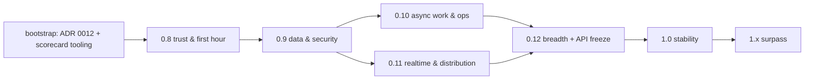

# id_effect Plan of Plans: 0.8 → 1.0 → Surpass

Status: **approved** (2026-10-15) · Baseline: 0.7.0 (2026-10-15) · Scorecard method 2.1 (re-based 2026-10-16, §7.0)
(`../../../docs/scorecard/METHOD.md`) · Data: `../../../docs/scorecard/scorecard.json`

Every release from 0.8.0 onward begins by reading this document (§7), picks its scope from it, and
closes by proving progress with the scorecard (§6). This document changes only through the release
retro step (§7.5) or an ADR.

---

## 1. North star

> **id_effect is the platform where the compiler checks your dependencies, errors and resources,
> the runtime supervises them, and one command gets you a production-shaped service.**

Success is measured with numbers only:

| Horizon | Enterprise index E | Rank (E) | Runtime index RT | Red rows (<40) | Best-in-class rows (≥80) | First hour (K1) |
|---|---|---|---|---|---|---|
| 0.7.0 baseline | 43.2 | #9 | 56.1 (#6) | 39 | 13 | not possible (no generator) |
| 1.0.0 | ≥ 82 | #1 | ≥ 84 (#1) | ≤ 1 | ≥ 59 | ≤ 90 s |
| Surpass (1.x) | ≥ 85, and #1 on the refreshed snapshot | #1 | #1 | 0 | ≥ 70 | ≤ 60 s |

All numbers are scorecard method 2.0 (checklist scores, METHOD §7). Being honest about them:
- The plan as targeted reaches **#1 at 1.0** (E 82.1 against .NET 77.3 and Spring 73.0), but
  against the competitor snapshot frozen on 2026-10-14. Competitors keep shipping, and the snapshot
  is refreshed before 1.0 (METHOD §4), so #1 at 1.0 must be re-proven on that refresh. Under the
  method 1.1 history (judgment scores) the same plan reaches only #3 (80.3, behind .NET 85.4 and
  Spring 81.1).
- The structural gap is *Ecosystem & trust* (group score 17 at 0.7.0: community, backing,
  production track record), which code alone cannot close. That is why the Surpass horizon (§9)
  exists, and why trust work (T0) is a mandatory part of **every** release rather than its own phase.

---

## 2. Why id_effect can win (the thesis)

| Advantage | Who has it today | id_effect position at 0.7 |
|---|---|---|
| Typed errors + typed DI + resource safety checked by the compiler | Effect-TS, ZIO | ✓ core 85 (group score), Send kernel, HList `R` |
| OTP-grade supervision and distribution | OTP, Phoenix | ✓ the only non-BEAM entrant (supervision 88, mesh rows 75) |
| Native performance with memory safety and no GC | (.NET partially) | ✓ concurrency 82, `forbid(unsafe_code)` |
| Batteries (data, auth, jobs, mail, admin, scaffolding) | Rails, Laravel, Spring, .NET, Phoenix | ✗ data 33, web 28, security 21, messaging 28, DX 37 |
| Trust (license, stability, backing, users) | everyone else | ✗ ecosystem 17 |

Group scores are method 2.0 at 0.7.0 (`docs/scorecard/results/v0.7.0.json`).

Nobody else has the first three together. The plan builds the fourth on top of them and works on the
fifth continuously. **Every battery must be effect-native:** a `Layer` to provide it, a typed error
channel, interruption-safe and supervisable, and testable with `TestExecutor`. Wrapping a battery
any other way does not count.

---

## 3. Decisions

### 3.1 Locked (change only by ADR)

| # | Decision | Rationale |
|---|---|---|
| L1 | **Supersede the ADR 0010 vision with ADR 0012 "Platform vision".** id_effect becomes a batteries-included platform. ADR 0010's tiers stay; a **platform** tier is added for battery crates, using the integration-tier gates plus a reference-app consumer. | ADR 0010:39-42 forbids the goal; Rule 5 requires an amendment before any new crate. |
| L2 | **Effect-native batteries, built on proven Rust crates.** Integrate (sqlx, sea-query, lettre, object_store, openidconnect, jsonwebtoken, argon2, fluent, async-graphql); do not rewrite them. | The value is the typed effect surface, not reimplementing protocols. |
| L3 | **One front door:** the facade crate `id_effect_kit` (feature flags per battery, `prelude`) plus the `id-effect` CLI binary (`new`, `generate`, `dev`, `doctor`, `migrate`, `deploy`). | Coherence (45), scaffolding (4) and the first hour are the biggest DX gaps. |
| L4 | **Reference apps are the consumers.** `examples/reference/{ledger,relay,pipeline}` are CI-tested apps. They count as the "real consumer" for labs → platform promotion and for the ≥ 90 cap. | ADR 0010 Rule 2 (promotion needs a real consumer) blocked promotion; ADR 0012 amends Rule 4 (labs) so a reference app satisfies it. |
| L5 | **The scorecard is the release KPI.** Each release ships `docs/scorecard/results/<ver>.json` and `REPORT-<ver>.md`. Missing an index target by more than 1.0 requires a written carry-over. | The user's request: prove progress with numbers. |
| L6 | **Postgres first, then SQLite, then MySQL.** Jobs, sessions, outbox and workflows default to Postgres, with SQLite for dev and tests. | One excellent path beats three mediocre ones. |
| L7 | **UI: integrate, do not build.** Ship HTMX+maud and Leptos recipes and an admin generator. No in-house frontend framework (`web.ui` target 40). | Next.js and Phoenix own this; Rust UI frameworks exist. |
| L8 | **Hot code loading remains a non-goal.** Target `dev` auto-restart and zero-downtime rolling deploys instead (`fault.reload` target 55). | ADR 0009. |
| L10 | **License: MIT** (owner decision 2026-10-15). A single `LICENSE` file, `license = "MIT"` in every manifest, and a DCO line in CONTRIBUTING. | It is the most widely accepted permissive license, and corporate legal reviews clear it routinely. |
| L11 | **Facade crate: `id_effect_kit`** (owner decision 2026-10-15). | Clear and searchable. |
| L12 | **Console built into the app** (owner decision 2026-10-15). `id_effect_console` is mounted by the service at `/_console` behind auth, server-rendered (axum + maud + htmx) with live updates, behind a feature flag. No separate SPA and no JavaScript toolchain in the repo. | Nothing extra to deploy, everything stays in Rust, and it follows the Phoenix LiveDashboard model. |
| L13 | **Scoring method (owner decisions 2026-10-16):** method v2 (table-stakes checklists) becomes primary after one alignment pass on competitor levels. v1 caps are applied strictly (method 1.1). Both happen in one re-base at 0.8 kickoff (§7.0), after which every stored version, the §1 north-star numbers and the §6 targets are re-stated on method 2.0. | v2 is objective and harder to inflate; under v1, 25 scores broke their own caps (`docs/scorecard/REPORT-method-v2.md`). |
| L9 | **Breaking changes are allowed until 1.0**, but each one needs a deprecation shim for one minor version and a migration-guide entry. `cargo-semver-checks` runs in CI from 0.8. | Stability (28) is a trust blocker. |

### 3.2 Open: needs owner decision before 0.8 kickoff

| # | Question | Recommendation |
|---|---|---|
| ~~O1~~ | **Decided 2026-10-15 → L10:** the license is **MIT**. | — |
| ~~O2~~ | **Decided 2026-10-15 → L11:** the facade crate is named **`id_effect_kit`**. | — |
| ~~O3~~ | **Decided 2026-10-15 → L12:** the console is built into the app. | — |

---

## 4. Target architecture at 1.0

```mermaid
flowchart TB
  subgraph Front door
    KIT[id_effect_kit — facade + prelude + features]
    CLI[id-effect CLI — new / generate / dev / doctor / migrate / deploy]
  end
  subgraph Core [core tier]
    CORE[id_effect — Effect, Layer, fibers, Schema, Stream, STM*]
    MAC[id_effect_macro / proc_macro]
    TOK[id_effect_tokio] CFG[id_effect_config] LOG[id_effect_logger] RES[id_effect_resilience]
  end
  subgraph Runtime [runtime tier]
    PROC[id_effect_process] NODE[id_effect_node] FSM[id_effect_fsm]
  end
  subgraph Platform [platform tier — new in ADR 0012]
    WEB[id_effect_axum + openapi + ws/sse]
    SQL[id_effect_sql — pg/sqlite/mysql, FromRow, migrate, sea-query]
    AUTH[id_effect_auth — sessions, argon2, JWT, OIDC] AUTHZ[id_effect_authz — policies]
    JOBS[id_effect_jobs — pg queue, cron, outbox] MAIL[id_effect_mail]
    STORE[id_effect_storage — object_store] REDIS[id_effect_redis — cache, sessions, pubsub]
    CHAN[id_effect_channels — channels + presence over mesh]
    CONSOLE[id_effect_console — fibers, supervisors, metrics, jobs UI]
    OTEL[id_effect_opentelemetry + prometheus] PLAT[id_effect_platform — http client, fs]
    RPC[id_effect_rpc*] WF[id_effect_workflow*] EV[id_effect_events*] AI[id_effect_ai*]
    GQL[id_effect_graphql] I18N[id_effect_i18n] TEST[id_effect_test — containers, http client, arbitrary]
  end
  KIT --> Core & Runtime & Platform
  CLI --> KIT
  Platform --> Core
  Runtime --> Core
```

`*` = promoted from `labs/` once its reference-app consumer exists. STM moves from `id_effect_fp`
into core in 0.11.

---

## 5. Tracks (the work, grouped by outcome)

Each track lists its epics. Release slots are in §6, and row targets are in `scorecard.json`.

### T0 · Trust & governance (in every release)
- **E0.1 Legal:** relicense to MIT (L10): a `LICENSE` file, `license = "MIT"` in the workspace and labs manifests, the README badge and footer, and a `CONTRIBUTING.md` DCO line (0.8).
- **E0.2 Security process:** `SECURITY.md`, `deny.toml` (cargo-deny advisories/licenses/bans/sources), SBOM via `cargo-cyclonedx` in `publish.yml`, signed tags (0.8).
- **E0.3 Stability:** `cargo-semver-checks` in CI, a documented deprecation policy, an MSRV policy (N-2 stable) (0.8). API freeze RFC (0.12). 1.0 LTS policy (1.0).
- **E0.4 Governance & backing:** `GOVERNANCE.md`, a co-maintainer program, GitHub Sponsors/OpenCollective (0.8). Target ≥ 3 maintainers with merge rights by 1.0.
- **E0.5 Adoption evidence:** an `ADOPTERS.md`, migration of the downstream consumers (closes stale W5), and case studies (≥ 5 public adopters by 1.0).
- **E0.6 Scorecard in CI:** `scripts/scorecard.sh` with self-test, and a results file per release (bootstrap mission).

### T1 · First hour (onboarding & DX)
- **E1.1 `id-effect new`:** templates `service` (axum+sql+otel+health), `worker` (jobs+cron), `cli`, `cluster` (mesh). Generated apps compile, pass their tests, and include Dockerfile, devenv/compose and CI config (0.8).
- **E1.2 `id_effect_kit`:** facade, prelude, feature bundles (`web`, `sql-pg`, `otel`, `full`) (0.8).
- **E1.3 Generators:** `generate resource|job|migration|layer|process` (0.9). `generate admin` (0.12).
- **E1.4 `id-effect doctor`:** environment check plus a Layer-graph explanation that replaces the removed `id-effect-diagnose` (0.8).
- **E1.5 `id-effect dev`:** watch, rebuild, restart with port hand-off, and a local services bring-up (0.10).
- **E1.6 Docs:** a "Zero to production in 15 minutes" tutorial tested in CI, a cookbook keyed by scorecard row, every book snippet compiled (`K5`), and a docs site with search (0.8 → 1.0).
- **E1.7 Diagnostics:** an `on_unimplemented` sweep, a trybuild gallery of top-20 mistakes each with a `help:` fix (`K4`) (0.8), and compile-time budget work (0.10 → 1.0).
- **E1.8 Ergonomics:** `Effect` helpers that remove the factory boilerplate for retry/repeat, and `pipe!` revisited (0.8).
- **E1.9 Lint:** port `id_effect_lint` to stable dylint and publish it (0.10).

### T2 · Core runtime completeness
- **E2.1 0.8 quick wins:**
  - `on_interrupt` and `on_exit`, `race_with`
  - cron `Schedule`
  - Stream `zip`, `throttle`, `debounce`, `group_by`
  - a resilience policy pipeline with `fallback`
  - removal of the `streaming/channel.rs:306` `expect`
  - fixes for the queue/schedule perf regressions in REPORT-0.7
- **E2.2 Property testing:** a `HasSchema → Arbitrary` derive plus restored effect-aware proptest helpers, in the `id_effect_test` crate (0.8).
- **E2.3 Schema:** JSON Schema export from `Schema` (0.8), then a full OpenAPI 3.1 path (0.9).
- **E2.4 Determinism:** seeded schedule exploration in `TestExecutor` (0.8).
- **E2.5 STM into core** (0.11).
- **E2.6 Perf:** bench gates in CI on a dedicated runner (0.10), and compile-time benches (`K2`) (0.8).

### T3 · Data platform
- **E3.1 Typed SQL:**
  - `FromRow` derive (bridging Schema), typed params (float, uuid, time, json, decimal)
  - savepoints, isolation levels, streaming rows
  - `sqlite` and `mysql` features (0.9)
- **E3.2 Migrations:** `id_effect_sql::migrate` (sqlx migrator in effect form, with an advisory lock) plus `id-effect migrate new|run|status|check` (0.9).
- **E3.3 Query builder & repositories:** sea-query integration, a `#[derive(Repository)]` for CRUD (0.9), then relations and pagination (0.12).
- **E3.4 Cache:** `id_effect_redis` (cache Layer, session store, rate-limit store, pubsub) and stampede protection in the core `Cache` (0.9).

### T4 · Web & API
- **E4.1 Typed routing:** route definitions carry Schema-typed path/query/body/headers, with uniform `Problem+JSON` errors (0.9).
- **E4.2 OpenAPI:** generated from routes and served with Scalar/Swagger UI behind a feature (0.9).
- **E4.3 HTTP client:** resilience policies, tracing propagation and typed responses as defaults (0.10).
- **E4.4 Storage:** `id_effect_storage` over `object_store` (S3/GCS/Azure/local), plus multipart uploads (0.10).

### T5 · Security
- **E5.1 Web hardening:**
  - per-session double-submit CSRF with a constant-time compare (fixes `security.rs:91`)
  - a CORS layer
  - a complete CSP builder
  - security headers, cookie flags (0.8)
- **E5.2 Authentication:** `id_effect_auth` with argon2 passwords, server-side sessions (pg/redis), JWT, OIDC + PKCE, and TOTP (0.9). Passkeys (1.0).
- **E5.3 Authorization:** `id_effect_authz` with policies as capabilities, RBAC plus attribute checks, and route guards (0.9).
- **E5.4 Secrets:** config providers for Vault, AWS Secrets Manager and GCP Secret Manager, and hot reload (0.9).
- **E5.5 Audit & tenancy:** a tamper-evident audit-log Layer (0.9), then tenant-scoping helpers for sql and authz (0.12).

### T6 · Operations & observability
- **E6.1 0.8 quick wins:** a Prometheus `/metrics` endpoint and readiness aggregation over dependency checks.
- **E6.2 `id_effect_console`:** fiber dump API in core, supervisor tree, metrics, job queues and mesh membership, mounted at `/_console` behind auth (0.10). Remote eval shell (1.0).
- **E6.3 Deploy:** Docker, Kamal and Helm templates driven by `id-effect deploy`, plus rolling-drain docs (0.8 templates, 0.10 command).
- **E6.4 Logging:** a redaction policy, sampling, per-module levels at runtime (0.10).
- **E6.5 Testing:** `id_effect_test` with a testcontainers harness, an in-process HTTP test client and DB fixtures (0.9 → 0.10), and effect-level fault injection (0.10).

### T7 · Async work
- **E7.1 Jobs:** promote `id_effect_jobs` with a Postgres queue (`SKIP LOCKED`), retries via `Schedule`, uniqueness, priorities, cron (cluster singleton) and a dashboard in the console (0.10).
- **E7.2 Brokers:** Kafka, NATS and AMQP as features, plus the transactional outbox (0.10).
- **E7.3 Mail:** `id_effect_mail` over lettre, with templates, a preview server and a test mailbox (0.10).
- **E7.4 Events:** promote `id_effect_events` (pg journal, projections) (0.10).
- **E7.5 Workflows:** promote `id_effect_workflow` on Postgres, multi-writer, with sagas and timers (0.11).

### T8 · Distribution & realtime
- **E8.1 Actors:** selective receive, `send_after`/timers, hibernate (0.11).
- **E8.2 gen_statem parity:** state data, state timeouts, postpone, enter actions (0.11).
- **E8.3 Mesh hardening:** mTLS on QUIC, encrypted TCP, a global registry, at-least-once delivery mode (0.11).
- **E8.4 Realtime:** WebSockets/SSE in `id_effect_axum`, plus `id_effect_channels` (topics, presence, cluster broadcast) (0.11).
- **E8.5 RPC:** promote `id_effect_rpc` with typed clients from the same route/RPC definitions (0.11).

### T9 · Breadth
- **E9.1 AI:** promote `id_effect_ai` (tool calling, streaming, MCP server and client, embeddings) (0.12).
- **E9.2 GraphQL:** an `id_effect_graphql` integration over async-graphql (0.12).
- **E9.3 Admin:** `generate admin` from `Repository` and Schema (htmx) (0.12).
- **E9.4 i18n:** `id_effect_i18n` over fluent with locale negotiation (0.12).
- **E9.5 UI:** recipes for HTMX+maud and Leptos (0.12).

---

## 6. Release train

Index targets come from METHOD §5.2, and row targets from `scorecard.json`. "Rows" counts the rows
whose target moves in that release.

| Release | Theme | Tracks / epics | Rows | Target E (rank) | Target RT | Red rows | Exit KPIs |
|---|---|---|---|---|---|---|---|
| **0.8.0** | Trust & first hour | E0.1–E0.4, E0.6, E1.1, E1.2, E1.4, E1.6 (tutorial), E1.7, E1.8, E2.1–E2.4, E2.6 (compile bench), E5.1, E6.1, E6.3 templates | 28 | 53.0 (#6) | 63.3 (#3) | ≤ 31 | K1 ≤ 180 s, K4 = 100 %, K5 ≥ 80 % |
| **0.9.0** | Data & security | E1.3, E2.3 OpenAPI, E3.1–E3.4, E4.1–E4.2, E5.2–E5.5 (audit), E6.5 part 1 | 18 | 63.1 (#3) | 68.1 (#2) | ≤ 21 | Ledger reference app: CRUD + auth + migrations green |
| **0.10.0** | Async work & operations | E1.5, E1.9, E2.6 bench CI, E4.3–E4.4, E6.2–E6.5, E7.1–E7.4 | 16 | 70.3 (#3) | 74.6 (#1) | ≤ 11 | Ledger with jobs, mail, console; K2 ≤ 8 s |
| **0.11.0** | Realtime & distribution | E2.5, E7.5, E8.1–E8.5 | 11 | 73.3 (#2) | 78.9 (#1) | ≤ 8 | Relay reference app (3-node chat + presence) green |
| **0.12.0** | Breadth & API freeze | E3.3 part 2, E5.5 tenancy, E9.1–E9.5, E0.3 freeze RFC | 7 | 77.4 (#1) | 81.0 (#1) | ≤ 3 | Pipeline reference app; API freeze RFC accepted |
| **1.0.0** | Stability | E0.3 LTS, E0.4, E0.5, E1.6 docs complete, E1.7 compile budget, E5.2 passkeys, E6.2 shell, snapshot refresh | 24 | 82.1 (#1) | 84.5 (#1) | ≤ 1 | K1 ≤ 90 s, ≥ 5 public adopters, ≥ 3 maintainers |



0.10 and 0.11 depend only on 0.9, so with enough capacity their tracks can run in parallel. They
still ship in order.

---

## 7. Per-release operating protocol (how every version uses this document)

### 7.0 One-time step at 0.8 kickoff: method re-base (L13) — done 2026-10-16
Done in leaf `method-rebase-2-0` (METHOD §7.4, `docs/scorecard/alignment-2.0.json`); step 4 (owner
acceptance) is recorded in §11. The first 0.8 leaf runs before scope selection:
1. Align the v2 competitor levels across all rows with one rule: a third-party library counts as `production` only if the framework's own docs recommend it; otherwise it is `labs`.
2. Apply the v1 caps strictly: every score listed under cap violations in `REPORT-method-v2.md` is lowered to its cap. Bump the method to 1.1 and regenerate `results/`.
3. Switch to method 2.0 (v2 primary). Re-base 0.6.0, 0.7.0 and every row target. Re-state §1 and §6 (and METHOD §5.2) with v2 numbers. Keep the v1 numbers in a "history" table.
4. The owner accepts the re-based numbers before step 7.1.3 uses them.

### 7.1 Kickoff (day 0)
1. Run `scripts/scorecard.sh --version <previous>` at the previous tag. Confirm the stored results
   reproduce (self-test).
2. List the release's slot from §6, plus any **carry-over** rows from the previous release that
   missed their target.
3. Score each candidate epic for scope selection:

   ```
   value(epic)    = Σ over rows it moves:  w_ent(group(row)) / |rows in group| × (target − current)
   priority(epic) = value / effort      where effort ∈ {S=1, M=2, L=4, XL=8}
   ```

   T0 epics in the slot are **always in scope**, whatever their priority. Fill the remaining
   capacity in priority order.
4. Write `.maestro/specs/releases/<ver>.md` from `release-spec-template.md`. Run
   `maestro mission from-spec`, then `decompose`, then write the execution overlay.

### 7.2 During the release
- Each leaf that moves a row adds the evidence (a path, a test, an example) to the leaf's Maestro
  evidence. That evidence feeds the exit re-score.
- No PR may reduce a scored capability without an ADR note. The reviewer checks the row ids listed
  in the PR description.

### 7.3 Exit gate (all must pass)

| Gate | Command / artifact | Pass condition |
|---|---|---|
| Quality bar | `moon run :ci`, coverage script, packaging, minimal-versions | as `docs/QUALITY_BAR.md`; coverage ≥ 96 % |
| Semver | `cargo semver-checks` | only the breaks listed in the migration guide |
| Bench gates | `scripts/bench-compare.sh` vs previous `vX.json` | no `budget` gate failed |
| Blind re-score | METHOD §6 | done; adjudications recorded |
| Index target | `scorecard.sh --compare-targets <ver>` | measured E ≥ target E − 1.0, or each missed row carried over in writing |
| No silent regression | `scorecard.sh --diff <prev> <ver>` | no row −5 or worse without an ADR note |
| DX KPIs | `scripts/dx-kpis.sh` (§8) | the release's KPI row in §6 is met |
| Reports | `docs/scorecard/results/<ver>.json`, `REPORT-<ver>.md`, a CHANGELOG "Scorecard" section | committed |

### 7.4 Release report contents
Indices before and after; target versus actual; rank movement; rows changed, with evidence; misses
and carry-over; DX KPIs; bench summary; the next release's slot confirmed or adjusted.

### 7.5 Retro (updates this document)
- Re-target rows that slipped. Move epics between slots. Record the change in §11's log.
- If the rubric must change: bump the method version, re-baseline all stored versions, and report
  both values once.

---

## 8. DX KPIs (measured, not scored)

| ID | KPI | How measured | 0.8 | 1.0 | Surpass |
|---|---|---|---|---|---|
| K1 | Time to first request | Clean container with the Rust toolchain, warm registry: `id-effect new svc && cd svc && cargo run` until `GET /health` is 200 | ≤ 180 s | ≤ 90 s | ≤ 60 s |
| K2 | Incremental rebuild | Edit one handler in the `service` template, then `cargo build` | measured | ≤ 5 s | ≤ 3 s |
| K3 | Feature LOC | Lines to add the "invoice" resource (model, migration, routes, auth, job, test) to Ledger | measured | −40 % vs 0.9 | — |
| K4 | Actionable diagnostics | % of trybuild fail cases in the top-20 gallery whose first error carries a `help:` fix | 100 % | 100 % | 100 % |
| K5 | Tested docs | % of book Rust blocks compiled in CI | ≥ 80 % | 100 % | 100 % |
| K6 | Cold build | `cargo build --release` of the `service` template | measured | budget set at 0.10 | — |

`scripts/dx-kpis.sh` (built in 0.8) records the results in `docs/scorecard/results/<ver>.dx.json`.

---

## 9. Surpass horizon (1.x)

On the frozen snapshot the 1.0 targets already pass .NET (E 77.3). Staying ahead after the pre-1.0
snapshot refresh, and reaching E ≥ 85, needs about +3 E beyond the 1.0 targets. Nearly all of it
comes from groups that need **people**, not code:

| Lever | Rows | Needed |
|---|---|---|
| Community and adoption | eco.community, eco.production, eco.backing | ≥ 20 public adopters, a foundation or company backing, a conference talk circuit |
| Ecosystem | eco.fit, web.graphql, web.ui | community crates, Leptos/Dioxus first-class integrations |
| DX ceiling | dx.compile, dx.repl, fault.reload | compile-time work (codegen-lite mode), REPL via evcxr, live-reload of config and routes |

The competitor snapshot is refreshed at 1.0 (METHOD §4). Surpass targets are re-based on the new
snapshot.

---

## 10. Risks

| Risk | Likelihood | Impact | Mitigation |
|---|---|---|---|
| Scope far exceeds a single maintainer's capacity | high | high | T0 E0.4 co-maintainers. Priority formula §7.1. Reference apps keep scope honest. Agents run waves under Maestro. |
| Batteries dilute the core's quality | medium | high | Platform tier gates. Effect-native rule (§2). The 96 % coverage gate also applies to platform crates. |
| Compile times hurt the first hour | high | medium | K2/K6 measured from 0.8. Facade features keep defaults lean. Budget from 0.10. |
| Score inflation by the people who did the work | medium | high | Blind assessor (METHOD §6), hard caps (§3.2), v2 checklists. |
| Competitors move | certain | medium | Frozen snapshot, refreshed with dual reporting. |
| Relicensing (O1) delayed | low | high | Blocks the 0.8 exit (T0 is mandatory). |

---

## 11. Change log

| Date | Change |
|---|---|
| 2026-10-15 | Initial draft (baseline 0.7.0, method v1.0). |
| 2026-10-15 | Owner decisions L10 (MIT), L11 (`id_effect_kit`), L12 (console built into the app). Plan approved; roadmap-bootstrap mission executed. |
| 2026-10-16 | roadmap-bootstrap complete: ADR 0012, scorecard tooling + reports + HTML, method v2 checklists (61f3b78, 3af5d74, 679a1d4, f9bb09d, 15ea25f). Owner decision L13 (v2 primary after alignment; v1 caps applied strictly); §7.0 added. Under v2, 0.7.0 scores E 43.2, rank #9 of 11. |
| 2026-10-16 | §7.0 re-base done (method 1.1, then 2.0): competitor levels aligned by the third-party rule (60 competitor scores changed), 25 v1 cap violations lowered, targets re-based to checklist scores (METHOD §7.4). §1, §2, §6 and §9 re-stated: 0.7.0 E 43.2 (#9); 1.0 target E 82.1 (#1 on the frozen snapshot; #3 under the 1.1 history). Owner accepted the re-based numbers 2026-10-16 (§7.0 step 4). |
| 2026-10-16 | 0.8 kickoff (§7.1): release spec `.maestro/specs/releases/0.8.0.md` approved with owner decisions D1 (`data.jsonschema` 0.8 target 50; OpenAPI stays in 0.9) and D2 (METHOD 2.1 process-row levels). 0.8 target E 53.0 (#6). |
