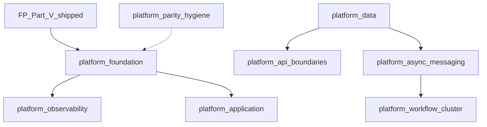

# Unified Application Platform Roadmap

Single index for **FP Kitchen Sink** (Part V) and **Platform Kitchen Sink** (Part VI–VII).

> **Status (0.6): all missions below are completed.** They are kept as a historical index. What
> happens next is set by the 0.6 consolidation plan,
> [`.maestro/missions/id-effect-consolidation-0-6.plan.md`](../../.maestro/missions/id-effect-consolidation-0-6.plan.md),
> and [ADR 0010](../adrs/0010-crate-tiers.md): several crates these missions produced moved to the
> unpublished `labs/` workspace (`id_effect_rpc`, `id_effect_ai`, `id_effect_parse`,
> `id_effect_workflow`, `id_effect_events`, `id_effect_jobs`, `id_effect_graph`), `id_effect_tower`
> merged into `id_effect_axum`, and `id_effect_sql_pg` merged into `id_effect_sql` (feature `pg`).
> New extension work resumes only after the consolidation exit gate. Current per-area status:
> [PARITY_DASHBOARD.md](./PARITY_DASHBOARD.md).
>
> **0.7:** the v1 interpreter (`run_blocking`, `run_async`, the provider registry) was replaced by
> the fiber runtime ([ADR 0011](../adrs/0011-fiber-runtime-send-typed-r.md)). API names in the
> linked execution overlays predate it; see [MIGRATION-0.7.md](../MIGRATION-0.7.md) for the current equivalents.

## Part V — Functional patterns (shipped)

See [fp-patterns/ROADMAP.md](../fp-patterns/ROADMAP.md).

| Execution overlay | Mission ID | Spec | Book |
|------|------------|------|------|
| [fp_algebra_foundation](../../.maestro/missions/fp-algebra.execution.md) | `pln-mqjykorq-bvmr7a` | fp-algebra | Part V ch17 |
| [fp_optics_immutable](../../.maestro/missions/fp-optics.execution.md) | `pln-mqjykos6-ovw199` | fp-optics | Part V ch18 |
| [fp_state_process](../../.maestro/missions/fp-fsm.execution.md) | `pln-mqjykov9-bcblcg` | fp-fsm | Part V ch19 |
| [fp_parse_codec](../../.maestro/missions/fp-parse.execution.md) | `pln-mqjykox8-rmjgqz` | fp-parse | Part V ch20 |
| [fp_runtime_resilience](../../.maestro/missions/fp-runtime.execution.md) | `pln-mqjykp1v-cdoxhr` | fp-runtime | Part V ch21 |
| [fp_streaming_advanced](../../.maestro/missions/fp-streaming.execution.md) | `pln-mqjykp6a-uo9tbq` | fp-streaming | Part V ch22 |
| [fp_events_graph](../../.maestro/missions/fp-events.execution.md) | `pln-mqjykpbf-qbf6qg` | fp-events | Part V ch23 |
| [fp_dx_metaprogramming](../../.maestro/missions/fp-dx.execution.md) | `pln-mqjykpfk-a28tq5` | fp-dx | Part V ch24 |

FP meta: `pln-mqjykoig-a58dfk`

## Part VI–VII — Application platform (completed)

| Execution overlay | Mission ID | Spec | Book | 0.6 status |
|------|------------|------|------|------------|
| [platform_foundation](../../.maestro/missions/platform-foundation.execution.md) | `pln-mqk3uzlz-ffz1p1` | platform-foundation | Part VI ch26 | done — `id_effect_platform` (integration); `auth` now opt-in |
| [platform_observability](../../.maestro/missions/platform-observability.execution.md) | `pln-mqk3v1k9-6c8qcj` | platform-observability | Part VI ch27 | done — `id_effect_opentelemetry` (integration) |
| [platform_data](../../.maestro/missions/platform-data.execution.md) | `pln-mqk3uxtf-055tfk` | platform-data | Part VI ch28 | done — `id_effect_sql` (integration), Postgres as feature `pg` |
| [platform_api_boundaries](../../.maestro/missions/platform-api-boundaries.execution.md) | `pln-mqk3uv7g-4r9v0a` | platform-api-boundaries | Part VI ch29 | done — `id_effect_rpc` moved to labs |
| [platform_application](../../.maestro/missions/platform-application.execution.md) | `pln-mqk3uw14-l2rehg` | platform-application | Part VI ch30 | done — `id_effect_axum` (integration), absorbs tower |
| [platform_async_messaging](../../.maestro/missions/platform-async-messaging.execution.md) | `pln-mqk3ux00-wrxxug` | platform-async-messaging | Part VI ch31 | done — `id_effect_jobs` / `id_effect_events` moved to labs |
| [platform_workflow_cluster](../../.maestro/missions/platform-workflow-cluster.execution.md) | `pln-mqk3v34c-c8b55j` | platform-workflow-cluster | Part VI ch32 | done — `id_effect_workflow` moved to labs; cluster runtime is the Process Mesh |
| [platform_dx_ship](../../.maestro/missions/platform-dx-ship.execution.md) | `pln-mqk3uymr-cb8ftt` | platform-dx-ship | Part VI ch34 | done — scaffolder stub removed; `examples/cli-minimal` template |
| [platform_ai](../../.maestro/missions/platform-ai.execution.md) | `pln-mqk3uu83-9z30eo` | platform-ai | Part VI ch35 | done — `id_effect_ai` moved to labs |
| [platform_parity_hygiene](../../.maestro/missions/platform-parity-hygiene.execution.md) | `pln-mqk3tuel-6cy7au` | platform-parity-hygiene | — | continuous |

Platform meta: `pln-mqk3v0l4-66d3zl`

## Execution order (platform)

1. `platform_parity_hygiene` (continuous) + `platform_foundation`
2. `platform_observability` ∥ `platform_data`
3. `platform_api_boundaries`
4. `platform_application`
5. `platform_async_messaging`
6. `platform_workflow_cluster`
7. `platform_dx_ship`
8. `platform_ai`

## Dependency graph

## Effect.ts parity phases

See [effect-ts-parity/README.md](../effect-ts-parity/README.md).
